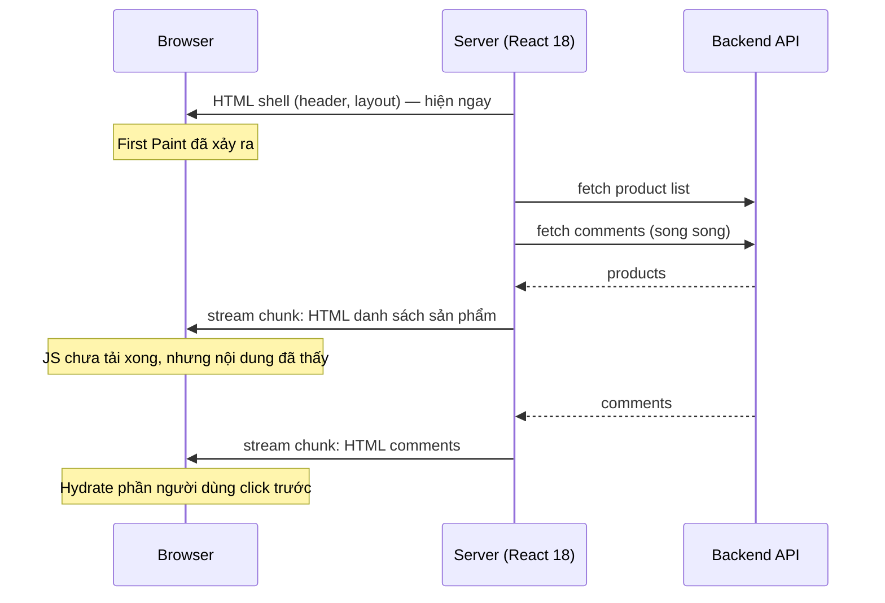

# 01. React 18 & Concurrent Rendering — nền tảng của mọi thứ sau này

> **Mục tiêu:** hiểu React 18 đã thay đổi *cơ chế* gì bên dưới, để các chương sau
> (Suspense, Transition, Server Components, Actions) không còn là "phép thuật".

---

## 1. Overview

### Vấn đề mà React 18 giải quyết

Trước React 18, render là **đồng bộ và không thể ngắt**. Khi React bắt đầu dựng lại cây component,
nó chạy một mạch cho đến hết rồi mới nhả main thread. Điều này tạo ra một class lỗi UX rất khó chữa:

Giả sử bạn có một ô tìm kiếm và một danh sách 5.000 sản phẩm được filter theo từ khoá.
Người dùng gõ chữ "a" → React render lại toàn bộ danh sách → mất 200ms.
Trong 200ms đó, main thread bị chiếm hoàn toàn: người dùng gõ tiếp "o" nhưng ô input không hiện chữ,
con trỏ không nhấp nháy, click không phản hồi. UI bị "đóng băng".

Vấn đề gốc rễ: **React không có khái niệm ưu tiên.** Với nó, việc hiển thị ký tự người dùng vừa gõ
(cực kỳ gấp) và việc filter 5.000 dòng (có thể chờ) là hai việc quan trọng như nhau.

### React 18 giới thiệu điều gì

React 18 viết lại reconciler thành **concurrent renderer**: một bộ render có thể
**tạm dừng giữa chừng, nhả main thread cho browser, rồi quay lại tiếp tục — hoặc bỏ luôn kết quả đang dựng**.

Điều này mở ra khả năng phân loại cập nhật theo độ ưu tiên. Từ đó mới có:

- `startTransition` / `useTransition` — đánh dấu "cập nhật này không gấp"
- `useDeferredValue` — hiển thị giá trị cũ trong khi giá trị mới đang được dựng
- **Streaming SSR + Selective Hydration** — server gửi HTML theo từng phần, client hydrate phần nào cần trước
- **Suspense hoạt động thật sự** trên cả server và client
- Và xa hơn: **React Server Components** và **Server Actions** trong React 19

> **Điểm quan trọng nhất cần nhớ:** Concurrent rendering **không làm code của bạn nhanh hơn**.
> Nó làm cho ứng dụng **phản hồi tốt hơn** bằng cách thay đổi *thứ tự* và *tính ngắt được* của công việc.
> Tổng lượng CPU không giảm — có khi còn tăng nhẹ.

---

## 2. Mental Model

### 🧠 Render như một bản nháp có thể xé bỏ

Hãy tưởng tượng React là một hoạ sĩ vẽ bảng thông báo:

**React 17 (legacy):** Hoạ sĩ vẽ trực tiếp lên bảng đang treo. Khi đã bắt đầu vẽ, không ai được
đi qua, không ai được xem bảng cho đến khi vẽ xong. Nếu có tin tức mới quan trọng hơn đến giữa lúc vẽ,
phải chờ vẽ hết bản cũ.

**React 18 (concurrent):** Hoạ sĩ vẽ trên **giấy nháp ở phòng bên**. Bảng cũ vẫn treo, người xem vẫn
đọc được. Cứ vài nét, hoạ sĩ dừng lại nhìn ra cửa xem có tin gì gấp hơn không:

- Không có gì gấp → vẽ tiếp
- Có tin gấp hơn (người dùng vừa gõ chữ) → **xé bản nháp, vẽ bản mới ngay lập tức**
- Vẽ xong bản nháp → dán lên bảng trong một lần duy nhất (**commit**)

### Hệ quả trực tiếp của mental model này

Từ hình ảnh trên, ba quy tắc sau trở thành **hiển nhiên** thay vì phải học thuộc:

| Quy tắc | Vì sao |
| --- | --- |
| **Render phải là hàm pure** | Bản nháp có thể bị xé và vẽ lại nhiều lần. Nếu mỗi lần vẽ đều gửi một request hoặc tăng một biến đếm bên ngoài, bạn sẽ có N request cho một lần hiển thị. |
| **Không mutate props/state trong render** | Bản nháp bị xé nhưng dữ liệu đã bị sửa → lần vẽ sau bắt đầu từ trạng thái sai. |
| **Side-effect phải nằm trong `useEffect` / event handler** | Đó là những nơi chạy *sau khi commit*, tức là sau khi bản nháp đã thực sự được dán lên bảng. |

### Hai pha của một lần cập nhật

```
┌─────────────────────── RENDER PHASE ──────────────────────┐
│  • Gọi function component của bạn                          │
│  • So sánh cây mới vs cây cũ (reconciliation)               │
│  • CÓ THỂ BỊ NGẮT, TẠM DỪNG, BỎ, HOẶC CHẠY LẠI TỪ ĐẦU      │
│  • KHÔNG được có side-effect                                │
└──────────────────────────┬─────────────────────────────────┘
                           │  (nếu không bị bỏ)
                           ▼
┌─────────────────────── COMMIT PHASE ──────────────────────┐
│  • Áp thay đổi vào DOM thật                                 │
│  • ĐỒNG BỘ, KHÔNG THỂ NGẮT                                  │
│  • Chạy useLayoutEffect (sync) → browser paint → useEffect  │
└────────────────────────────────────────────────────────────┘
```

Ranh giới này giải thích được rất nhiều thứ, ví dụ: vì sao `useLayoutEffect` có thể gây "jank"
(nó chặn paint), còn `useEffect` thì không.

---

## 3. How It Works — bốn thay đổi cụ thể

### 3.1 `createRoot` thay cho `ReactDOM.render`

React 18 đổi entry point. Đây không phải chuyện cú pháp — nó là **công tắc bật/tắt concurrent features**:

```tsx
// React 17 — legacy mode, không có concurrent features
ReactDOM.render(<App />, document.getElementById('root'))

// React 18+ — concurrent mode
import { createRoot } from 'react-dom/client'
createRoot(document.getElementById('root')!).render(<App />)
```

📄 **Trong repo này bạn không thấy dòng nào như trên** — và đó là điều đáng chú ý.

`app/layout.tsx`:

```tsx
export default function RootLayout({ children }: Readonly<{ children: React.ReactNode }>) {
  return (
    <html lang="en" className={`${geistSans.variable} ${geistMono.variable} h-full antialiased`}>
      <body className="min-h-full flex flex-col">
        {children}
        <Toaster richColors position="top-right" />
      </body>
    </html>
  )
}
```

Next.js App Router **tự quản lý root**: nó gọi `hydrateRoot` (phiên bản concurrent) ở phía client và
`renderToReadableStream` ở phía server. Bạn không có `index.tsx`, không có `main.tsx`.

⚖️ **Trade-off của việc framework giữ root:** bạn được concurrent + streaming miễn phí và không thể
cấu hình sai, nhưng bạn cũng **mất quyền truy cập** vào các tuỳ chọn của root như `onUncaughtError`,
`onRecoverableError`, `identifierPrefix`. Muốn xử lý lỗi ở tầng đó, bạn phải dùng cơ chế của Next.js
(`error.tsx`, `global-error.tsx`) chứ không phải API của React.

### 3.2 Automatic Batching

**Batching** = gộp nhiều lần `setState` thành **một** lần render.

React 17 chỉ batch bên trong React event handler. Ngoài phạm vi đó (setTimeout, promise, native event)
mỗi `setState` gây một lần render riêng:

```tsx
// ===== React 17 =====
function handleClick() {
  setCount(c => c + 1)   //
  setFlag(f => !f)       // → 1 lần render (được batch, vì trong React event)
}

setTimeout(() => {
  setCount(c => c + 1)   // → render #1
  setFlag(f => !f)       // → render #2  ❌ 2 lần render
}, 0)

fetch('/api').then(() => {
  setLoading(false)      // → render #1
  setData(d)             // → render #2  ❌ 2 lần render
})
```

React 18 batch **mọi nơi**, kể cả trong promise, timeout, native event handler:

```tsx
// ===== React 18+ =====
setTimeout(() => {
  setCount(c => c + 1)
  setFlag(f => !f)       // → 1 lần render duy nhất ✅
}, 0)
```

📄 **Vì sao điều này quan trọng cho repo này.** Xem `components/store/checkout-wizard.tsx`:

```tsx
const [step, setStep] = useState(0)
const [address, setAddress] = useState({ street: '', city: '', state: '', country: '' })
const [method, setMethod] = useState('COD')
const [state, formAction] = useActionState(placeOrderAction, initialActionState)
```

Component này có 4 nguồn state. Khi Server Action `placeOrderAction` resolve, React 19 cập nhật
`state` (từ `useActionState`) và đồng thời tắt cờ pending nội bộ. Nhờ automatic batching, đây là
**một lần render**. Ở React 17, cùng logic đó sẽ khiến form nhấp nháy giữa các trạng thái trung gian.

Nói cách khác: **toàn bộ mô hình Server Actions của React 19 phụ thuộc vào automatic batching**.
Nếu không có nó, mỗi lần submit form sẽ tạo ra một chuỗi render trung gian nhìn thấy được.

**Khi cần thoát khỏi batching:** dùng `flushSync` — nhưng hãy coi đó là cửa thoát hiểm, không phải công cụ:

```tsx
import { flushSync } from 'react-dom'

// Chỉ dùng khi bạn CẦN đọc DOM ngay sau khi state đổi
flushSync(() => setOpen(true))
// đến đây DOM đã cập nhật, có thể đo kích thước / focus
inputRef.current?.focus()
```

### 3.3 StrictMode double-invoke — công cụ chẩn đoán, không phải bug

Trong **development**, `<StrictMode>` của React 18 làm hai việc:

1. Gọi function component **hai lần** (và cả reducer, `useMemo` callback...)
2. **Mount → unmount → mount lại** mỗi component, tức là effect chạy `setup → cleanup → setup`

Đây không phải lỗi. Đây là React đang **ép bạn đối mặt với sự thật**: trong concurrent rendering,
component của bạn *có thể* bị render nhiều lần và effect *có thể* bị mount lại. Nếu code không chịu
được điều đó, tốt hơn là vỡ ngay ở dev thay vì lỗi ngẫu nhiên ở production.

📄 **Một effect vượt qua bài kiểm tra này** — `components/seller/seller-mobile-nav.tsx`:

```tsx
// Lock body scroll while the drawer is open.
useEffect(() => {
  if (!open) return
  const prev = document.body.style.overflow
  document.body.style.overflow = 'hidden'
  return () => {
    document.body.style.overflow = prev
  }
}, [open])
```

Vì sao nó an toàn khi chạy `setup → cleanup → setup`?

1. `setup` lần 1: lưu `prev = ''`, set `'hidden'`
2. `cleanup`: khôi phục về `''`
3. `setup` lần 2: lưu `prev = ''` (đúng, vì cleanup đã khôi phục), set `'hidden'`

Kết quả cuối giống hệt như chạy một lần. Đây chính là định nghĩa của một effect **idempotent**.

⚠️ **Phản ví dụ — effect KHÔNG chịu được double-invoke:**

```tsx
// ❌ SAI: mất giá trị gốc sau lần mount thứ hai
useEffect(() => {
  document.body.style.overflow = 'hidden'
  return () => { document.body.style.overflow = 'auto' }  // hardcode 'auto'!
}, [open])
```

Nếu trang gốc dùng `overflow: clip`, effect này sẽ đổi nó thành `auto` vĩnh viễn. Bug im lặng,
rất khó tìm. Việc lưu `prev` trong repo là chi tiết của một người đã từng bị bug này.

⚠️ **Phản ví dụ nghiêm trọng hơn — effect gọi API:**

```tsx
// ❌ Ở dev với StrictMode: gửi 2 request. Ở production concurrent: cũng có thể 2 request.
useEffect(() => {
  fetch('/api/track-view', { method: 'POST' })
}, [])
```

Với một endpoint "tăng lượt xem", bạn vừa nhân đôi số liệu. Cách sửa: `AbortController` để cancel,
hoặc — tốt hơn trong App Router — **đưa việc đó ra Server Component hoặc Server Action** ngay từ đầu.

### 3.4 Streaming SSR & Selective Hydration

Đây là thay đổi có ảnh hưởng lớn nhất tới Next.js App Router.

**SSR ở React 17 là một quy trình "tất-cả-hoặc-không-gì" gồm 4 bước tuần tự:**

```
Server: fetch TOÀN BỘ data  ──▶  render TOÀN BỘ HTML  ──▶  gửi 1 lần
Client:                                                    tải TOÀN BỘ JS  ──▶  hydrate TOÀN BỘ
```

Mỗi mũi tên là một **hàng rào chặn**. Một API chậm ở footer làm chậm cả trang. Một bundle JS lớn
làm cả trang không tương tác được.

**React 18 phá cả bốn hàng rào** bằng `renderToPipeableStream` + Suspense:



Hai kỹ thuật đằng sau:

- **Streaming HTML**: server gửi `<Suspense fallback>` trước, rồi khi data về thì gửi thêm một chunk
  HTML kèm một đoạn script nhỏ để "thay thế" fallback bằng nội dung thật.
- **Selective Hydration**: React hydrate từng Suspense boundary độc lập. Nếu người dùng click vào
  một phần chưa hydrate, React **ưu tiên hydrate đúng phần đó trước** và replay event click.

📄 Toàn bộ khả năng này là lý do các trang trong repo có thể viết `async` một cách thoải mái —
`app/(store)/products/[id]/page.tsx`:

```tsx
export default async function ProductDetailPage({ params }: { params: Promise<{ id: string }> }) {
  const { id } = await params
  let product: Product | null = null
  try {
    product = await apiFetch<Product>(`/product/${id}`)
  } catch (e) { /* ... */ }

  // ...

  let comments: Comment[] = []
  try {
    comments = await apiFetch<Comment[]>(`/comment?productId=${id}`)
  } catch {
    comments = []
  }
```

`await` trực tiếp trong component chỉ có nghĩa khi renderer biết cách **tạm dừng và tiếp tục** —
đó chính là concurrent rendering.

⚠️ **Nhưng ở đây có một vấn đề thật sự trong repo.** Hai lệnh `await` trên chạy **tuần tự**:
`comments` chỉ bắt đầu fetch sau khi `product` đã về. Nếu mỗi request mất 150ms, trang mất 300ms
thay vì 150ms. Cách sửa (chi tiết ở file `10-data-fetching-caching.md`):

```tsx
// Cả hai request khởi động cùng lúc
const [productRes, commentsRes] = await Promise.allSettled([
  apiFetch<Product>(`/product/${id}`),
  apiFetch<Comment[]>(`/comment?productId=${id}`),
])
```

---

## 4. Từ React 18 đến React 19 — bản đồ tính năng

Repo dùng React `19.2.4`. Bảng dưới đây cho bạn thấy React 19 **không phải một hướng đi mới**,
mà là việc xây tiếp trên nền móng của 18.

| React 18 đặt nền | React 19 xây lên |
| --- | --- |
| Concurrent renderer ngắt được | **Server Components** stable — render trên server, không gửi JS xuống client |
| `startTransition` | **Actions** — `useActionState`, `useFormStatus`, form action nhận async function |
| Automatic batching | `useOptimistic` — cập nhật lạc quan rồi tự rollback khi action fail |
| Suspense + streaming | `use()` — unwrap Promise/Context ngay trong render |
| — | **`ref` là prop bình thường** — `forwardRef` không còn cần thiết |
| — | `<Context value={...}>` dùng trực tiếp làm Provider |
| — | `<title>`, `<meta>`, `<link>` tự động hoist lên `<head>` |

React 19 cũng **xoá bỏ** một loạt API cũ mà bạn nên biết để không dùng lại:
`propTypes`, string refs, legacy context (`contextTypes`), `ReactDOM.render`,
`unmountComponentAtNode`, `findDOMNode`.

Phiên bản `19.2.x` bổ sung thêm `<Activity>` (giữ state của cây UI đang bị ẩn) và
`useEffectEvent` (tách "giá trị mới nhất" khỏi dependency array của effect).
Chúng được nói đến trong file `03` và `05`.

📄 **Bằng chứng của "ref là prop" ngay trong repo** — `components/ui/input.tsx`:

```tsx
function Input({ className, type, ...props }: React.ComponentProps<"input">) {
  return (
    <InputPrimitive
      type={type}
      data-slot="input"
      className={cn("...", className)}
      {...props}
    />
  )
}
```

Không có `forwardRef`, không có `React.forwardRef<HTMLInputElement, Props>`. `ref` đi qua `...props`
như bất kỳ prop nào khác. Nếu đây là React 18, component này **không thể** nhận `ref` và
`components/store/comment-form.tsx` sẽ không gắn được ref vào form.

---

## 5. When to Use — bạn có cần *chủ động* làm gì với concurrent rendering?

Câu trả lời trung thực: **hầu hết là không.** Concurrent rendering là hạ tầng, không phải công cụ
bạn gọi hàng ngày. Bạn chỉ chủ động can thiệp trong ba tình huống:

| Tình huống | Công cụ | Có trong repo này? |
| --- | --- | --- |
| Một cập nhật state gây render cây lớn/chậm, làm input lag | `useTransition`, `useDeferredValue` | Chưa cần — mọi danh sách đều nhỏ và render trên server |
| Một hành động cần phản hồi tức thì trước khi server trả lời | `useOptimistic` | **Nên có** — nút +/- giỏ hàng (xem file `07`) |
| Một phần trang phụ thuộc data chậm, không nên chặn phần còn lại | `<Suspense>` | Có một chỗ, nhưng vì lý do khác (xem file `06`) |

## 6. When NOT to Use

- **Đừng bọc mọi `setState` vào `startTransition`.** Transition có độ ưu tiên *thấp*. Nếu bạn hạ ưu
  tiên của việc cập nhật ô input, bạn vừa tạo ra chính cái lag mà mình muốn tránh. Input, checkbox,
  toggle — luôn là cập nhật gấp.
- **Đừng dùng transition để che một vấn đề khác.** Nếu render chậm vì bạn tính toán O(n²) trong
  component, transition chỉ làm cho sự chậm đó *bớt lộ*. Hãy sửa thuật toán.
- **Đừng tắt `StrictMode` vì thấy effect chạy hai lần.** Bạn đang tắt cái đèn báo động, không phải
  sửa cái cháy.

## 7. Trade-offs

| Lợi ích | Cái giá |
| --- | --- |
| UI luôn phản hồi, không đóng băng | Render có thể chạy nhiều lần cho *một* lần hiển thị → mọi thứ không-pure trở thành bug |
| Streaming SSR: TTFB và FCP tốt hơn nhiều | Mô hình tinh thần phức tạp hơn; debug khó hơn vì thứ tự thực thi không còn tuyến tính |
| Suspense/Actions/Server Components trở nên khả thi | Tăng nhẹ tổng CPU (do scheduling và các lần render bị bỏ) |
| Bug về side-effect lộ ra sớm (StrictMode) | Dev experience "ồn ào" hơn: log đôi, effect chạy hai lần |
| Framework có thể tối ưu thay bạn | Bạn mất quyền kiểm soát chi tiết ở tầng root |

**Vì sao trade-off này đáng chấp nhận:** phần lớn cái giá là **một lần** (học mô hình mới, sửa các
effect không pure), còn phần lớn lợi ích là **liên tục** (mọi trang, mọi request). Với một ứng dụng
e-commerce như repo này — nơi FCP ảnh hưởng trực tiếp tới tỷ lệ chuyển đổi — đây là một cái giá rẻ.

---

## 8. Best Practices

1. **Coi render là một biểu thức pure `(props, state) => UI`.** Trước khi viết bất cứ gì trong thân
   component, hỏi: "nếu dòng này chạy 3 lần thì có sao không?" Nếu có → nó thuộc về effect hoặc handler.

2. **Luôn viết cleanup cho effect, và luôn khôi phục giá trị *trước đó* chứ không phải giá trị mặc định.**
   `seller-mobile-nav.tsx` là mẫu để copy.

3. **Giữ `<StrictMode>` bật trong dev.** Nó là bộ test miễn phí cho tính idempotent.

4. **Đừng đo hiệu năng ở development.** StrictMode double-invoke, không có minify, có dev warning —
   con số bạn thấy không phản ánh production. Luôn benchmark trên `next build && next start`.

5. **Ưu tiên chuyển việc ra server thay vì tối ưu concurrent trên client.** Repo này là ví dụ tốt:
   không có `useTransition` nào cả, vì phần lớn công việc nặng (fetch, sort, group) đã nằm ở
   Server Component. Đó là cách tối ưu rẻ nhất.

---

## Tự kiểm tra

Trả lời được cả 6 câu này thì bạn đã nắm chương này:

1. Vì sao render phải pure trong concurrent mode? (gợi ý: bản nháp bị xé)
2. Trong React 18, đoạn này gây bao nhiêu lần render? `setTimeout(() => { setA(1); setB(2) })`
3. `useEffect` khác `useLayoutEffect` ở điểm nào trong sơ đồ hai pha?
4. StrictMode làm effect chạy `setup → cleanup → setup`. Điều đó *tiết lộ* loại bug nào?
5. Selective hydration giải quyết vấn đề gì mà streaming HTML một mình không giải quyết được?
6. Vì sao `components/ui/input.tsx` không cần `forwardRef`?

➡️ Tiếp theo: `02-state-va-render-model.md`
