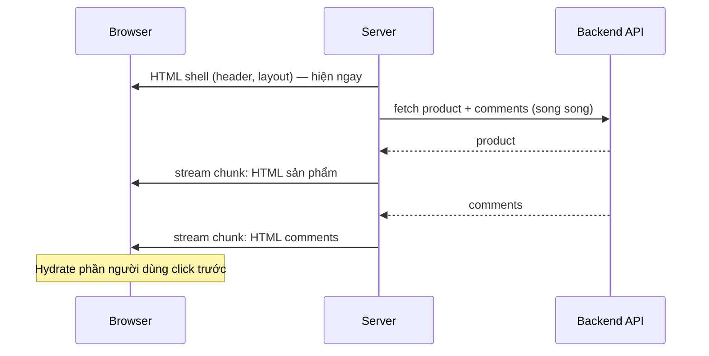

# 01. React 18 & Concurrent Rendering — nền tảng của mọi thứ sau này

> **Mục tiêu:** hiểu React 18 đã thay đổi *cơ chế* gì bên dưới, để các chương sau
> (Suspense, Transition, Server Components, Actions) không còn là "phép thuật".
> Repo chạy React `19.2.4` + Next.js `16.2.10` — mọi thứ ở đây vẫn là nền móng của React 19.

---

## 1. Overview

### Vấn đề mà React 18 giải quyết

Trước React 18, render là **đồng bộ và không thể ngắt**: React dựng lại cây component một mạch rồi
mới nhả main thread.

Ví dụ: ô tìm kiếm filter danh sách 5.000 sản phẩm. Gõ "a" → render lại cả danh sách mất 200ms.
Trong 200ms đó người dùng gõ tiếp "o" nhưng ô input không hiện chữ, click không phản hồi — UI "đóng băng".

Gốc rễ: **React không có khái niệm ưu tiên.** Hiển thị ký tự vừa gõ (rất gấp) và filter 5.000 dòng
(có thể chờ) bị coi là quan trọng như nhau.

### React 18 giới thiệu điều gì

React 18 có **concurrent renderer**: render có thể **tạm dừng, nhả main thread cho browser, rồi tiếp
tục — hoặc bỏ luôn kết quả đang dựng**. Từ đó mới có:

- `startTransition` / `useTransition` — đánh dấu "cập nhật này không gấp"
- `useDeferredValue` — hiển thị giá trị cũ trong khi giá trị mới đang được dựng
- **Streaming SSR + Selective Hydration**
- **Suspense hoạt động thật sự** trên cả server và client
- Và xa hơn: **Server Components**, **Actions** (React 19), `<Activity>` (React 19.2)

> **Điểm quan trọng nhất:** concurrent rendering **không làm code nhanh hơn**. Nó làm ứng dụng
> **phản hồi tốt hơn** bằng cách đổi *thứ tự* và *tính ngắt được* của công việc. Tổng CPU không giảm.

---

## 2. Mental Model

### 🧠 Render như một bản nháp có thể xé bỏ

**React 17 (legacy):** hoạ sĩ vẽ trực tiếp lên bảng đang treo; đã bắt đầu là phải vẽ xong, tin gấp
đến giữa chừng cũng phải chờ.

**React 18 (concurrent):** hoạ sĩ vẽ trên **giấy nháp ở phòng bên**, bảng cũ vẫn treo. Cứ vài nét lại
nhìn ra cửa:

- Không có gì gấp → vẽ tiếp
- Có tin gấp hơn (người dùng vừa gõ) → **xé bản nháp**, xử lý việc gấp trước
- Vẽ xong → dán lên bảng trong một lần duy nhất (**commit**)

Từ hình ảnh này, ba quy tắc trở thành hiển nhiên:

| Quy tắc | Vì sao |
| --- | --- |
| **Render phải pure** | Bản nháp có thể bị xé và vẽ lại nhiều lần → side-effect trong render chạy N lần. |
| **Không mutate props/state trong render** | Nháp bị xé nhưng dữ liệu đã bị sửa → lần vẽ sau bắt đầu từ trạng thái sai. |
| **Side-effect nằm trong effect / event handler** | Đó là nơi chạy *sau commit* (hoặc khi người dùng thật sự tương tác). |

```tsx
// ❌ Side-effect trong render: chạy mỗi lần React "vẽ nháp", kể cả bản nháp bị bỏ
function ProductCard({ product }: { product: Product }) {
  analytics.track('impression', product._id)
  viewedIds.push(product._id)            // mutate biến ngoài
  return <Card>{product.product_name}</Card>
}

// ✅ Render chỉ tính UI; side-effect chạy sau commit
function ProductCard({ product }: { product: Product }) {
  useEffect(() => {
    analytics.track('impression', product._id)
  }, [product._id])
  return <Card>{product.product_name}</Card>
}
```

### Hai pha của một lần cập nhật

```
┌─────────────────────── RENDER PHASE ──────────────────────┐
│  • Gọi function component của bạn                          │
│  • So sánh cây mới vs cây cũ (reconciliation)               │
│  • CÓ THỂ BỊ NGẮT, TẠM DỪNG, BỎ, HOẶC CHẠY LẠI TỪ ĐẦU      │
│  • KHÔNG được có side-effect                                │
└──────────────────────────┬─────────────────────────────────┘
                           │  (nếu không bị bỏ)
                           ▼
┌─────────────────────── COMMIT PHASE ──────────────────────┐
│  • Áp thay đổi vào DOM thật, gắn ref                        │
│  • ĐỒNG BỘ, KHÔNG THỂ NGẮT                                  │
│  • useLayoutEffect (sync, trước paint) → paint → useEffect  │
└────────────────────────────────────────────────────────────┘
```

Ranh giới này giải thích vì sao `useLayoutEffect` có thể gây jank (chặn paint), còn `useEffect` thì không.

---

## 3. How It Works — bốn thay đổi cụ thể

### 3.1 `createRoot` thay cho `ReactDOM.render`

Entry point mới là **công tắc bật concurrent features**:

```tsx
// React 17 — legacy mode (ReactDOM.render đã bị XOÁ trong React 19)
ReactDOM.render(<App />, document.getElementById('root'))

// React 18+ — concurrent
import { createRoot } from 'react-dom/client'
createRoot(document.getElementById('root')!).render(<App />)
```

📄 **Trong repo không có dòng nào như trên.** `app/layout.tsx` chỉ trả về `<html>`/`<body>`:

```tsx
export default function RootLayout({ children }: Readonly<{ children: React.ReactNode }>) {
  return (
    <html lang="en" className={`${geistSans.variable} ${geistMono.variable} h-full antialiased`}>
      <body className="min-h-full flex flex-col">
        {children}
        <Toaster richColors position="top-right" />
      </body>
    </html>
  )
}
```

Next.js App Router **tự quản lý root**: client gọi `hydrateRoot`, server dùng API streaming của
`react-dom/server`. App Router cũng **bật `<StrictMode>` mặc định** (từ Next 13.5.1; tắt bằng
`reactStrictMode: false` trong `next.config.ts` — đừng tắt).

⚖️ **Trade-off:** bạn được concurrent + streaming miễn phí, nhưng **không truy cập** được tuỳ chọn
của root như `onUncaughtError`, `onRecoverableError`. Xử lý lỗi phải qua cơ chế của Next.js
(`error.tsx`, `global-error.tsx`, `instrumentation-client.ts`).

### 3.2 Automatic Batching

**Batching** = gộp nhiều `setState` thành **một** lần render.

React 17 chỉ batch trong React event handler. React 18+ batch **mọi nơi** — promise, timeout,
native event:

```tsx
// React 17: 2 lần render ❌   |   React 18+: 1 lần render ✅
setTimeout(() => {
  setCount(c => c + 1)
  setFlag(f => !f)
}, 0)

fetch('/api/cart').then(async res => {
  setLoading(false)
  setItems(await res.json())   // React 18+: không có frame "loading=false nhưng items rỗng"
})
```

📄 `components/store/checkout-wizard.tsx` có 4 nguồn state:

```tsx
const [step, setStep] = useState(0)
const [address, setAddress] = useState({ street: '', city: '', state: '', country: '' })
const [method, setMethod] = useState('COD')
const [state, formAction] = useActionState(placeOrderAction, initialActionState)
```

Khi `placeOrderAction` resolve, React cập nhật `state` và tắt cờ pending của Action trong **cùng một
lần render** — không có frame trung gian "hết pending nhưng chưa có kết quả".

**Thoát khỏi batching:** `flushSync` — cửa thoát hiểm, không phải công cụ hàng ngày:

```tsx
import { flushSync } from 'react-dom'

flushSync(() => setOpen(true))
// DOM đã cập nhật → có thể đo kích thước / focus ngay
inputRef.current?.focus()
```

### 3.3 StrictMode — công cụ chẩn đoán, không phải bug

Trong **development**, `<StrictMode>` (Next bật sẵn):

1. Gọi function component **hai lần** (cả initializer của `useState`, reducer, callback `useMemo`)
2. Chạy thêm một chu kỳ **effect `setup → cleanup → setup`** khi mount
3. Từ React 19: chạy thêm một chu kỳ **ref callback** `gắn → cleanup → gắn`

Production **không** double-invoke. Nhưng code vẫn phải chịu được việc này vì ở production component
vẫn có thể bị render nhiều lần (bản nháp bị bỏ) và effect vẫn có thể bị cleanup rồi chạy lại
(đổi `key`, `<Activity>` ẩn rồi hiện, điều hướng qua lại). StrictMode chỉ làm lộ bug sớm.

📄 **Một effect vượt qua bài kiểm tra** — `components/seller/seller-mobile-nav.tsx`:

```tsx
// Lock body scroll while the drawer is open.
useEffect(() => {
  if (!open) return
  const prev = document.body.style.overflow
  document.body.style.overflow = 'hidden'
  return () => {
    document.body.style.overflow = prev
  }
}, [open])
```

`setup` (lưu `prev = ''`, set `hidden`) → `cleanup` (khôi phục `''`) → `setup` (lưu lại `''`, set
`hidden`). Kết quả giống chạy một lần — effect **idempotent**.

```tsx
// ❌ Hardcode giá trị khôi phục: trang gốc dùng overflow: clip sẽ bị đổi thành auto vĩnh viễn
useEffect(() => {
  document.body.style.overflow = 'hidden'
  return () => { document.body.style.overflow = 'auto' }
}, [open])
```

⚠️ **Effect gọi API có side-effect trên server:**

```tsx
// ❌ Dev: 2 request. Production: mỗi lần component mount lại cũng 1 request mới
useEffect(() => {
  fetch('/api/track-view', { method: 'POST' })
}, [])
```

Với endpoint "tăng lượt xem", bạn vừa nhân đôi số liệu. `AbortController` **không** cứu được (request
POST đã tới server). Cách đúng trong App Router: ghi lượt xem **ở server** (Server Component /
Server Action / Route Handler), hoặc làm cho endpoint idempotent (dedupe theo session + productId).

### 3.4 Streaming SSR & Selective Hydration

Thay đổi ảnh hưởng lớn nhất tới App Router.

**SSR ở React 17 là "tất-cả-hoặc-không-gì":**

```
Server: fetch TOÀN BỘ data ──▶ render TOÀN BỘ HTML ──▶ gửi 1 lần
Client:                                     tải TOÀN BỘ JS ──▶ hydrate TOÀN BỘ
```

Mỗi mũi tên là một hàng rào: một API chậm ở footer làm chậm cả trang.

**React 18 phá các hàng rào này** bằng streaming + Suspense:



- **Streaming HTML**: server gửi `<Suspense fallback>` trước; khi data về, gửi thêm chunk HTML kèm
  script nhỏ để thay fallback bằng nội dung thật.
- **Selective Hydration**: mỗi Suspense boundary hydrate độc lập. Người dùng click vào phần chưa
  hydrate → React **ưu tiên hydrate phần đó trước** và replay sự kiện.

📄 Nhờ vậy page có thể là `async` — `app/(store)/products/[id]/page.tsx`:

```tsx
export default async function ProductDetailPage({ params }: { params: Promise<{ id: string }> }) {
  const { id } = await params
  let detail: ProductDetail | null = null
  try {
    detail = normalizeProductDetail(await apiFetch<unknown>(`/product/${id}`))
  } catch (e) { /* ... */ }
  // ... return sớm nếu lỗi

  let comments: Comment[] = []
  try {
    comments = await apiFetch<Comment[]>(`/comment?productId=${id}`)
  } catch {
    comments = []
  }
  const currentUserId = await getClientId()
```

⚠️ **Vấn đề thật trong repo:** ba `await` chạy **tuần tự** dù không phụ thuộc nhau (comments chỉ cần
`id`, không cần `detail`). 3 × 150ms = 450ms thay vì ~150ms. Sửa (chi tiết ở `10-data-fetching-caching.md`):

```tsx
const [detailRes, commentsRes, currentUserId] = await Promise.all([
  apiFetch<unknown>(`/product/${id}`).then(normalizeProductDetail).catch(() => null),
  apiFetch<Comment[]>(`/comment?productId=${id}`).catch(() => [] as Comment[]),
  getClientId(),
])
```

Tốt hơn nữa: tách comments thành component `async` riêng bọc trong `<Suspense>` để phần sản phẩm
stream ra trước (file `06`).

---

## 4. Từ React 18 đến React 19.2 — bản đồ tính năng

React 19 không phải hướng đi mới — nó xây tiếp trên nền của 18:

| React 18 đặt nền | React 19 xây lên |
| --- | --- |
| Concurrent renderer | **Server Components** stable — render trên server, không gửi JS xuống client |
| `startTransition` | **Actions**: transition nhận async function; `useActionState`, `useFormStatus`, `<form action={fn}>` |
| Automatic batching | `useOptimistic` — cập nhật lạc quan, tự rollback khi Action kết thúc |
| Suspense + streaming | `use()` — đọc Promise/Context ngay trong render (được gọi trong `if`) |
| — | **`ref` là prop bình thường** — không cần `forwardRef`; ref callback được trả cleanup |
| — | `<Context value={...}>` dùng trực tiếp làm Provider |
| — | `<title>`, `<meta>`, `<link>` tự hoist lên `<head>`; `preload`/`preinit` từ `react-dom` |

**React 19.2** thêm:

- `<Activity mode="visible" | "hidden">` — ẩn cây UI nhưng **giữ state**; khi ẩn, effect bị cleanup
- `useEffectEvent` (stable) — đọc giá trị mới nhất trong effect mà không đưa vào dependency (file `03`)
- `cacheSignal` (chỉ Server Components) — `AbortSignal` báo khi lifetime của `cache()` kết thúc
- **Performance Tracks** trong Chrome DevTools — thấy Scheduler/Components track trong tab Performance

**React Compiler 1.0** (stable): tự memo hoá component/hook lúc build. Trong Next 16 bật bằng
`reactCompiler: true` ở top-level `next.config.ts` (cần `babel-plugin-react-compiler`), **không bật
mặc định** — repo này chưa bật (file `04`).

React 19 **xoá** các API cũ: `ReactDOM.render`, `hydrate`, `unmountComponentAtNode`, `findDOMNode`,
`propTypes`, `defaultProps` cho function component (dùng default parameter), string refs,
legacy context (`contextTypes`).

📄 **"ref là prop" trong repo** — `components/ui/input.tsx`:

```tsx
function Input({ className, type, ...props }: React.ComponentProps<"input">) {
  return (
    <InputPrimitive type={type} data-slot="input" className={cn("...", className)} {...props} />
  )
}
```

Không có `forwardRef`. `React.ComponentProps<"input">` đã bao gồm `ref`, và `ref` đi qua `...props`
như mọi prop khác. Vì vậy có thể viết:

```tsx
const searchRef = useRef<HTMLInputElement>(null)
<Input ref={searchRef} name="q" />   // ✅ React 19: chạy. React 18: ref bị nuốt mất (cần forwardRef)
```

---

## 5. When to Use — bạn có cần *chủ động* làm gì?

Hầu hết là **không** — concurrent rendering là hạ tầng. Bạn chỉ can thiệp khi:

| Tình huống | Công cụ | Trong repo |
| --- | --- | --- |
| Cập nhật gây render cây lớn, làm input lag | `useTransition`, `useDeferredValue` | Chưa cần — danh sách nhỏ, render trên server |
| Gọi async (Server Action) từ event handler, cần cờ pending | `useTransition` với async function | `components/products/image-manager.tsx` (upload ảnh) |
| Phản hồi tức thì trước khi server trả lời | `useOptimistic` | **Nên có** — nút +/- giỏ hàng (file `07`) |
| Phần trang phụ thuộc data chậm | `<Suspense>` | `app/(seller)/seller/page.tsx` (file `06`) |

📄 `image-manager.tsx` — transition async của React 19:

```tsx
const [uploading, startUpload] = useTransition()

startUpload(async () => {
  const result = await prepareImagesAction({ ok: false }, body)
  if (result.ok && result.data) onUploaded(result.data)
  else toast.error(result.message ?? 'Could not upload images')
})
// uploading === true suốt thời gian await → disable nút "Upload"
```

## 6. When NOT to Use

- **Đừng bọc mọi `setState` vào `startTransition`.** Transition có ưu tiên *thấp*. Input, checkbox,
  toggle — luôn là cập nhật gấp.

  ```tsx
  // ❌ ô input sẽ lag vì value bị hạ ưu tiên
  onChange={e => startTransition(() => setQuery(e.target.value))}
  // ✅ input cập nhật gấp, phần nặng hoãn lại
  onChange={e => setQuery(e.target.value)}
  const deferredQuery = useDeferredValue(query)  // list filter theo deferredQuery
  ```

- **Đừng dùng transition để che thuật toán chậm.** Render O(n²) thì sửa thuật toán.
- **Đừng tắt StrictMode vì effect chạy hai lần.** Đó là tắt đèn báo cháy, không phải dập lửa.

## 7. Trade-offs

| Lợi ích | Cái giá |
| --- | --- |
| UI luôn phản hồi | Render có thể chạy nhiều lần cho một lần hiển thị → mọi thứ không pure thành bug |
| Streaming SSR: TTFB/FCP tốt hơn | Debug khó hơn vì thứ tự thực thi không tuyến tính |
| Suspense/Actions/RSC khả thi | Tăng nhẹ tổng CPU (scheduling, render bị bỏ) |
| Bug side-effect lộ sớm (StrictMode) | Dev "ồn ào": log đôi, effect chạy hai lần |
| Framework tối ưu thay bạn | Mất quyền kiểm soát tầng root |

---

## 8. Best Practices

1. **Coi render là biểu thức pure `(props, state) => UI`.** Hỏi: "dòng này chạy 3 lần thì có sao không?"
2. **Cleanup luôn khôi phục giá trị *trước đó*, không phải giá trị mặc định** (mẫu: `seller-mobile-nav.tsx`).
3. **Giữ StrictMode bật** — bộ test idempotent miễn phí.
4. **Không đo hiệu năng ở dev.** Benchmark trên `next build && next start`; dùng Performance Tracks
   của React 19.2 trong DevTools để xem component nào render.
5. **Ưu tiên chuyển việc ra server** thay vì tối ưu concurrent trên client. Repo này fetch, sort,
   group ở Server Component — cách tối ưu rẻ nhất.

---

## Tự kiểm tra

1. Vì sao render phải pure trong concurrent mode? (gợi ý: bản nháp bị xé)
2. React 18+: `setTimeout(() => { setA(1); setB(2) })` gây bao nhiêu lần render?
3. `useEffect` khác `useLayoutEffect` ở điểm nào trong sơ đồ hai pha?
4. Production không double-invoke — vậy vì sao effect vẫn phải idempotent?
5. Selective hydration giải quyết gì mà streaming HTML một mình không giải quyết được?
6. Vì sao `<Input ref={...}>` chạy được dù `components/ui/input.tsx` không có `forwardRef`?

➡️ Tiếp theo: `02-state-va-render-model.md`
