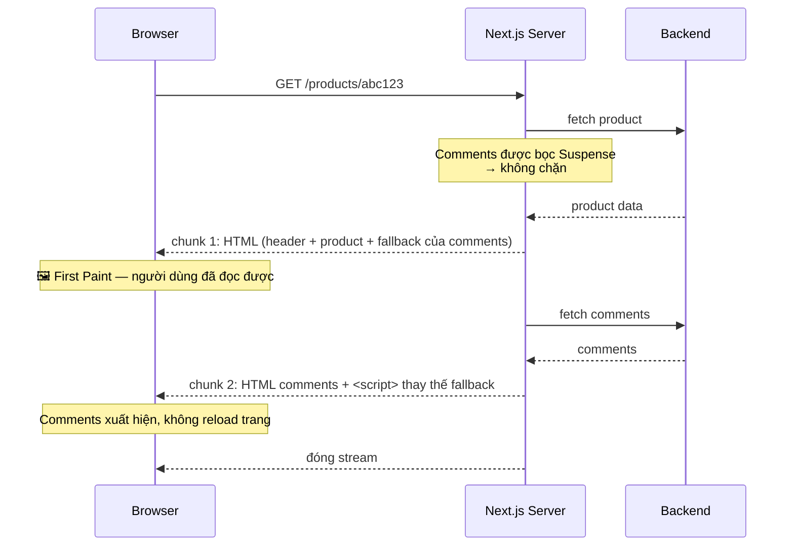

# 06. Suspense & Streaming — trả lời câu hỏi "vì sao có `<Suspense>` ở đây?"

> **Mục tiêu:** hiểu Suspense là gì ở mức cơ chế, giải thích được chính xác vì sao
> `<Suspense>` trong `seller/page.tsx` là **bắt buộc**, và biết đặt boundary ở đâu để cải thiện UX thật.

---

## 1. Overview

### Suspense là gì

`<Suspense>` là một **boundary** (ranh giới) khai báo cho React biết:
*"nếu bất cứ thứ gì bên trong đây chưa sẵn sàng, hãy hiển thị `fallback` thay vì nó."*

```tsx
<Suspense fallback={<Skeleton />}>
  <SomethingThatMightNotBeReady />
</Suspense>
```

"Chưa sẵn sàng" nghĩa là gì? Trong React 18+ có ba nguồn:

1. Một **Server Component** đang `await` một Promise
2. Một Client Component gọi `use(promise)` với Promise chưa resolve
3. `React.lazy()` đang tải một code chunk

### Vấn đề mà Suspense giải quyết

Trước Suspense, mỗi component tự quản lý trạng thái loading của mình:

```tsx
// ❌ Mô hình cũ: loading state rải khắp mọi nơi
function ProductPage({ id }) {
  const [product, setProduct] = useState(null)
  const [loading, setLoading] = useState(true)
  const [error, setError] = useState(null)

  useEffect(() => { /* fetch, setLoading, setError... */ }, [id])

  if (loading) return <Spinner />
  if (error) return <Error error={error} />
  return <div>{product.name}</div>
}
```

Ba vấn đề:
- **Trùng lặp:** mỗi component fetch dữ liệu đều phải viết lại 3 state + 3 nhánh
- **Waterfall:** con chỉ bắt đầu fetch sau khi cha đã render xong → request nối tiếp nhau
- **Không kiểm soát được UX tổng thể:** 5 spinner nhỏ nhấp nháy không đồng bộ, layout nhảy liên tục

Suspense đảo ngược mô hình: **component chỉ khai báo "tôi cần dữ liệu này"**, còn việc hiển thị gì
trong lúc chờ là quyết định của **component cha** (nơi đặt boundary). Đây gọi là *inversion of control*
cho trạng thái loading.

---

## 2. Mental Model

### 🧠 Suspense như một cái khung ảnh có ảnh tạm

Hãy hình dung bạn dựng một trang báo. Ảnh chính chưa in xong.

**Không có Suspense:** bạn chờ ảnh xong rồi mới in cả trang. Người đọc không có gì để đọc.

**Có Suspense:** bạn để một **khung xám cùng kích thước** vào chỗ ảnh, in cả trang ngay, và khi ảnh
xong thì dán vào khung. Người đọc đọc được chữ ngay lập tức.

Điểm quan trọng của hình ảnh này: **cái khung có cùng kích thước với ảnh thật**. Đó là lý do
skeleton tốt hơn spinner — nó giữ layout ổn định. Spinner làm layout nhảy khi nội dung thật xuất hiện
(và đó là một chỉ số Core Web Vitals: CLS).

### 🧠 Boundary như một cầu chì

Suspense boundary hoạt động giống cầu chì trong hệ thống điện: nó **giới hạn phạm vi ảnh hưởng**.

```
Không có boundary:                   Có boundary quanh Comments:
┌──────────────────────┐             ┌──────────────────────┐
│  Header              │             │  Header      ✅ hiện  │
│  Product info        │             │  Product     ✅ hiện  │
│  Comments (chậm 2s)  │             │  ┌─ Suspense ──────┐ │
│                      │             │  │ Comments ⏳     │ │
│  ⏳ CẢ TRANG CHỜ 2s  │             │  └─────────────────┘ │
└──────────────────────┘             └──────────────────────┘
```

Không có boundary → thứ chậm nhất quyết định thời gian của cả trang.
Có boundary → mỗi phần hiện ngay khi nó sẵn sàng.

> **Nguyên tắc đặt boundary:** đặt quanh những phần **chậm** và **không quan trọng nhất**.
> Đừng đặt quanh nội dung chính — người dùng đến để xem nó.

---

## 3. How It Works — cơ chế streaming



**Cơ chế thay thế fallback hoạt động thế nào?** Next.js gửi HTML của comments xuống *cuối* tài liệu
(trong một `<template>` ẩn), kèm một đoạn script nhỏ có nhiệm vụ di chuyển nó vào đúng vị trí và xoá
fallback. Điều quan trọng: **nó hoạt động cả khi JavaScript chính của trang chưa tải xong**, vì script
này là inline và cực nhỏ.

### Lợi ích đo được

| Chỉ số | Không streaming | Có streaming |
| --- | --- | --- |
| TTFB (Time To First Byte) | Sau khi *mọi* fetch xong | Gần như ngay lập tức |
| FCP (First Contentful Paint) | Sau fetch chậm nhất | Sau fetch nhanh nhất |
| Người dùng thấy gì trước? | Trang trắng | Header + nội dung chính |

---

## 4. ⭐ Ca chính: vì sao `seller/page.tsx` cần `<Suspense>`

Đây là câu hỏi đáng giá nhất của chương, vì `<Suspense>` ở đây **không dùng cho loading state**.

📄 `app/(seller)/seller/page.tsx`:

```tsx
import { Suspense } from 'react'
// ...
export default async function SellerHomePage() {
  const payload = await getAccessPayload()
  return (
    <div className="space-y-6">
      <Suspense fallback={null}>
        <WelcomeToast />
      </Suspense>
      <div>
        <h1 className="text-2xl font-semibold">Dashboard</h1>
        ...
```

📄 `components/seller/welcome-toast.tsx`:

```tsx
'use client'
import { useEffect } from 'react'
import { useRouter, useSearchParams } from 'next/navigation'
import { toast } from 'sonner'

export function WelcomeToast() {
  const router = useRouter()
  const params = useSearchParams()          // ← ĐÂY là nguyên nhân
  const welcome = params.get('welcome')

  useEffect(() => {
    if (welcome !== '1') return
    toast.success("You're now a shop — welcome to Seller Centre")
    router.replace('/seller')
  }, [welcome, router])

  return null
}
```

Chú ý: `fallback={null}`. Không có skeleton, không có spinner. Component còn `return null` — nó không
render gì cả. Vậy Suspense để làm gì?

### Câu trả lời: `useSearchParams()` bắt buộc phải có Suspense boundary

Lý do nằm ở cách Next.js prerender trang.

**Bước 1 — Next.js muốn prerender trang này tại build time.** Trang `/seller` không có tham số động
trong URL path, nên về lý thuyết có thể tạo HTML tĩnh một lần và dùng cho mọi request.

**Bước 2 — Nhưng `useSearchParams()` phụ thuộc vào request cụ thể.** Tại build time, không có
`?welcome=1` nào cả. Không tồn tại "query string" khi chưa có request.

**Bước 3 — Mâu thuẫn.** Next.js không thể prerender một component mà giá trị của nó chỉ biết được
lúc runtime.

**Cách Next.js giải quyết:** dùng Suspense boundary như một **đường cắt**.

```
Build time (prerender):
┌────────────────────────────────────────┐
│ Dashboard, QUICK_ACTIONS cards         │  ← prerender được, thành HTML tĩnh
│ ┌── Suspense ──────────────────────┐   │
│ │ (fallback: null)                 │   │  ← đến đây thì DỪNG prerender
│ └──────────────────────────────────┘   │
└────────────────────────────────────────┘

Runtime (trên browser, sau hydration):
│ │ WelcomeToast đọc ?welcome=1 → toast │
```

Suspense boundary cho Next.js biết: *"phần bên trong này có thể được điền sau. Cứ prerender phần
còn lại và để chỗ trống ở đây."*

**Nếu bỏ `<Suspense>` đi thì sao?**

`useSearchParams()` sẽ khiến **toàn bộ trang** bị đánh dấu là dynamic — nghĩa là Next.js phải render
lại nó cho **mỗi request**. Bạn mất khả năng prerender toàn bộ dashboard, chỉ vì một component
`return null`. Trong các cấu hình build nghiêm ngặt hơn, đây là **lỗi build**, không chỉ là mất tối ưu.

> **Quy tắc cần nhớ:** trong App Router, bất kỳ Client Component nào gọi `useSearchParams()` phải
> được bọc trong `<Suspense>`, trừ khi bạn chủ ý muốn cả trang là dynamic.
>
> **Suspense không chỉ dùng cho loading. Nó còn là đường cắt giữa "prerender được" và
> "chỉ biết lúc runtime".**

Điều này cũng giải thích `fallback={null}` — vì component thật cũng `return null`, không cần
"chỗ giữ chỗ" nào. `fallback` khớp chính xác với nội dung thật.

---

## 5. ⚠️ Cơ hội lớn nhất bị bỏ qua trong repo

📄 `app/(store)/products/[id]/page.tsx`:

```tsx
export default async function ProductDetailPage({ params }: { params: Promise<{ id: string }> }) {
  const { id } = await params
  let product: Product | null = null
  let error: string | null = null
  try {
    product = await apiFetch<Product>(`/product/${id}`)          // ← chờ #1
  } catch (e) {
    error = e instanceof Error ? e.message : 'Could not load the product'
  }

  if (error || !product) { /* ... */ }

  const gallery = product.product_images?.length ? product.product_images : [...]
  const attrs = product.product_attributes ?? {}

  let comments: Comment[] = []
  try {
    comments = await apiFetch<Comment[]>(`/comment?productId=${id}`)   // ← chờ #2, TUẦN TỰ
  } catch {
    comments = []
  }
  const currentUserId = await getClientId()

  return (
    <div className="space-y-6">
      {/* ...ảnh, tên, giá, mô tả, AddToCart... */}
      <CommentSection productId={id} comments={comments} currentUserId={currentUserId} />
    </div>
  )
}
```

**Vấn đề:** hai lệnh `await` chạy nối tiếp. Với 150ms mỗi request, người dùng chờ **300ms** trước khi
thấy *bất cứ gì*.

Và tệ hơn: **comments chặn cả sản phẩm.** Người dùng vào trang để xem sản phẩm và bấm "Add to cart" —
họ đang phải chờ phần comment mà có thể họ không bao giờ cuộn xuống đọc.

### Cách sửa cấp 1: `Promise.all` — chạy song song

Nhanh và đơn giản. Hai request khởi động cùng lúc:

```tsx
const { id } = await params

const [productResult, commentsResult] = await Promise.allSettled([
  apiFetch<Product>(`/product/${id}`),
  apiFetch<Comment[]>(`/comment?productId=${id}`),
])

const product = productResult.status === 'fulfilled' ? productResult.value : null
const comments = commentsResult.status === 'fulfilled' ? commentsResult.value : []
```

Dùng `allSettled` chứ không phải `all`, vì logic hiện tại **cho phép comments lỗi** (`catch { comments = [] }`)
mà vẫn hiện trang. `Promise.all` sẽ reject cả cụm nếu một cái lỗi.

**Kết quả: 300ms → 150ms.** Nhưng người dùng vẫn chờ 150ms cho phần comment mà họ chưa cần.

### Cách sửa cấp 2: Suspense — stream phần comment

Đây là cách đúng nhất:

```tsx
// app/(store)/products/[id]/page.tsx
import { Suspense } from 'react'

export default async function ProductDetailPage({ params }: { params: Promise<{ id: string }> }) {
  const { id } = await params
  let product: Product | null = null
  let error: string | null = null
  try {
    product = await apiFetch<Product>(`/product/${id}`)
  } catch (e) {
    error = e instanceof Error ? e.message : 'Could not load the product'
  }

  if (error || !product) {
    return (
      <div className="space-y-4">
        <Link href="/" className="text-sm text-primary hover:underline">← Back to store</Link>
        <p className="text-sm text-destructive">{error ?? 'Product not found'}</p>
      </div>
    )
  }

  const gallery = product.product_images?.length
    ? product.product_images
    : [{ url: product.product_thumb, public_id: 'thumb' }]
  const attrs = product.product_attributes ?? {}

  return (
    <div className="space-y-6">
      <Link href="/" className="text-sm text-primary hover:underline">← Back to store</Link>
      <div className="grid gap-8 md:grid-cols-2">
        {/* ...gallery, tên, giá, attrs, AddToCart — hiện NGAY... */}
      </div>

      {/* Comments stream xuống sau, không chặn phần trên */}
      <Suspense fallback={<CommentsSkeleton />}>
        <ProductComments productId={id} />
      </Suspense>
    </div>
  )
}

function CommentsSkeleton() {
  return (
    <section className="space-y-6 border-t pt-8">
      <h2 className="text-xl font-semibold">Comments</h2>
      <div className="space-y-4" aria-busy="true" aria-label="Loading comments">
        {[0, 1, 2].map((i) => (
          <div key={i} className="space-y-2">
            <div className="h-4 w-32 animate-pulse rounded bg-muted" />
            <div className="h-4 w-full animate-pulse rounded bg-muted" />
          </div>
        ))}
      </div>
    </section>
  )
}
```

```tsx
// components/store/product-comments.tsx — Server Component MỚI
import { apiFetch } from '@/lib/api/server-client'
import { getClientId } from '@/lib/auth/session'
import { CommentSection } from '@/components/store/comment-section'
import type { Comment } from '@/types/comment'

export async function ProductComments({ productId }: { productId: string }) {
  let comments: Comment[] = []
  try {
    comments = await apiFetch<Comment[]>(`/comment?productId=${productId}`)
  } catch {
    comments = []
  }
  const currentUserId = await getClientId()
  return <CommentSection productId={productId} comments={comments} currentUserId={currentUserId} />
}
```

**Kết quả:**

| | Hiện tại (tuần tự) | `Promise.all` | Suspense (đề xuất) |
| --- | --- | --- | --- |
| Thấy tên/giá sản phẩm | 300ms | 150ms | **150ms** |
| Nút Add to cart dùng được | 300ms | 150ms | **150ms** |
| Thấy comments | 300ms | 150ms | 300ms (nhưng không ai chờ) |
| Comments lỗi/chậm bất thường | Cả trang chờ | Cả trang chờ | **Chỉ comments chờ** |

Lợi ích lớn nhất không phải con số, mà là **sự cô lập**: nếu API comment chậm 5 giây hoặc sập, trang
sản phẩm vẫn dùng được bình thường. Đây gọi là *graceful degradation*, và Suspense cho bạn nó miễn phí.

### Khi nào tuần tự là *đúng*

📄 `app/(store)/checkout/page.tsx` — đối chiếu với ví dụ trên:

```tsx
let cart: Cart = { cart_products: [], cart_count_product: 0 }
try {
  cart = await apiFetch<Cart>('/cart', { auth: true })       // #1
} catch (e) {
  return <p className="text-sm text-destructive">{...}</p>
}

const items = cart.cart_products ?? []
if (items.length === 0) { return <p>Your cart is empty...</p> }

const shopOrderIds = buildShopOrders(items)                   // ← CẦN kết quả của #1
let review: CheckoutReview
try {
  review = await apiFetch<CheckoutReview>('/checkout/review', {
    auth: true,
    body: { shop_order_ids: shopOrderIds },                   // #2 phụ thuộc #1
  })
} catch (e) { /* ... */ }
```

Ở đây tuần tự là **bắt buộc**: `/checkout/review` cần `shopOrderIds`, mà `shopOrderIds` được tính từ
`cart`. Không có cách nào song song hoá.

> **Cách phân biệt trong 5 giây:** request #2 có dùng kết quả của #1 không?
> - **Có** → tuần tự là đúng, không sửa được
> - **Không** → đang có waterfall không cần thiết → `Promise.all` hoặc Suspense

---

## 6. `loading.tsx` — Suspense tự động cho cả route

Next.js cung cấp một cách khai báo boundary ở cấp route. File `loading.tsx` trong một thư mục route
sẽ **tự động** bọc `page.tsx` của nó bằng `<Suspense>`:

```tsx
// app/(store)/orders/loading.tsx  →  áp dụng cho app/(store)/orders/page.tsx
export default function Loading() {
  return (
    <div className="space-y-6">
      <div className="h-8 w-40 animate-pulse rounded bg-muted" />
      <div className="space-y-4">
        {[0, 1, 2].map((i) => (
          <div key={i} className="space-y-3 rounded-xl p-4 ring-1 ring-foreground/10">
            <div className="flex items-center gap-3">
              <div className="h-5 w-16 animate-pulse rounded-full bg-muted" />
              <div className="h-4 w-20 animate-pulse rounded bg-muted" />
            </div>
            <div className="h-10 w-full animate-pulse rounded bg-muted" />
          </div>
        ))}
      </div>
    </div>
  )
}
```

Tương đương với việc Next.js làm:

```tsx
<Suspense fallback={<Loading />}>
  <OrdersPage />
</Suspense>
```

⚠️ **Repo này hiện KHÔNG có `loading.tsx` nào.** Hệ quả cụ thể khi người dùng bấm vào một order:

1. Bấm "View details" → điều hướng tới `/orders/abc123`
2. Server `await apiFetch('/order/abc123')` — mất 200ms
3. Trong 200ms đó: **màn hình không đổi gì cả.** Người dùng không biết click có được nhận hay không
4. Rồi trang mới xuất hiện đột ngột

Với một `loading.tsx`, bước 3 trở thành skeleton hiện ngay lập tức → người dùng có phản hồi tức thì.

**Các route nên thêm `loading.tsx`** (theo mức độ ưu tiên):

| Route | Vì sao |
| --- | --- |
| `app/(store)/orders/` | Danh sách + nhiều order → fetch chậm nhất |
| `app/(store)/orders/[id]/` | Điều hướng từ danh sách, cần phản hồi ngay |
| `app/(store)/products/[id]/` | 2 request tuần tự → chậm nhất trong repo |
| `app/(seller)/seller/products/` | Có phân trang, fetch mỗi lần đổi trang |
| `app/(store)/checkout/` | 2 request phụ thuộc nhau, không tránh được |

---

## 7. `error.tsx` — Error Boundary, người bạn song sinh của Suspense

Suspense xử lý "chưa có dữ liệu". Error Boundary xử lý "có lỗi". Chúng là hai mặt của cùng một bài toán
và nên được thiết kế cùng nhau.

⚠️ **Repo này cũng không có `error.tsx` nào.** Thay vào đó, mỗi trang tự bắt lỗi:

📄 `app/(store)/orders/page.tsx`:

```tsx
let orders: Order[] = []
let error: string | null = null
try {
  const result = await apiFetch<OrdersResult>('/order', { auth: true })
  orders = result.data ?? []
} catch (e) {
  error = e instanceof Error ? e.message : 'Could not load your orders'
}
```

Pattern `let x; let error; try/catch` này lặp lại ở **9 trang**. Nó có ưu điểm thật:

✅ Lỗi được xử lý **cục bộ** — phần còn lại của trang vẫn hiện
✅ Thông báo lỗi cụ thể theo ngữ cảnh ("Could not load your orders")
✅ Không cần Client Component (error boundary bắt buộc là `'use client'`)

Nhưng cũng có nhược điểm:

❌ **Lặp lại 9 lần** — cùng một cấu trúc 6 dòng
❌ **Không bắt được lỗi ngoài `try`** — ví dụ nếu `order.order_products.flatMap(...)` throw vì dữ liệu
   backend có hình dạng lạ, người dùng thấy màn hình lỗi trắng của Next.js
❌ **Không có nút "Thử lại"**

`error.tsx` bổ sung một lớp lưới an toàn:

```tsx
// app/(store)/error.tsx
'use client'   // BẮT BUỘC — error boundary cần state ở client

import { useEffect } from 'react'
import { Button } from '@/components/ui/button'

export default function StoreError({
  error,
  reset,
}: {
  error: Error & { digest?: string }
  reset: () => void
}) {
  useEffect(() => {
    // Log lên hệ thống monitoring. `digest` là hash để đối chiếu với log server.
    console.error('Store route error:', error.digest, error.message)
  }, [error])

  return (
    <div className="space-y-4 py-12 text-center">
      <h2 className="text-xl font-semibold">Đã có lỗi xảy ra</h2>
      <p className="text-sm text-muted-foreground">
        Chúng tôi không tải được nội dung này. Vui lòng thử lại.
      </p>
      <Button onClick={reset}>Thử lại</Button>
    </div>
  )
}
```

**Chi tiết cần biết về `error.tsx`:**

- **Phải có `'use client'`.** Error boundary cần bắt lỗi ở runtime và giữ state → không thể là
  Server Component.
- **`reset()`** yêu cầu React render lại cây con. Nếu lỗi là tạm thời (API timeout), lần thử lại có
  thể thành công.
- **`error.digest`** là hash mà Next.js sinh ra. Ở production, message lỗi thật **bị ẩn** khỏi client
  (để không lộ thông tin server); `digest` cho phép bạn đối chiếu với log phía server.
- **`error.tsx` không bắt được lỗi trong `layout.tsx` cùng cấp** — vì nó nằm *bên trong* layout đó.
  Muốn bắt lỗi của layout root, cần `app/global-error.tsx`.

**Cấu trúc lỗi nên có cho repo này:**

```
app/
├── global-error.tsx        ← lỗi ở root layout (rất ít gặp, nhưng cần)
├── (store)/
│   ├── error.tsx           ← lưới an toàn cho toàn bộ storefront
│   ├── loading.tsx
│   └── ...
└── (seller)/
    └── seller/
        ├── error.tsx       ← lưới an toàn cho seller dashboard
        └── loading.tsx
```

> **Chiến lược hai tầng:** giữ `try/catch` trong page cho các lỗi **dự đoán được** (API trả 404,
> không có quyền) — vì bạn muốn thông báo cụ thể và giữ phần còn lại của trang.
> Thêm `error.tsx` cho các lỗi **không dự đoán được** (bug, dữ liệu sai hình dạng) — để người dùng
> không bao giờ thấy màn hình trắng.

---

## 8. `use()` — Suspense cho Client Component (React 19)

`use()` cho phép một Client Component "unwrap" một Promise và suspend trong lúc chờ:

```tsx
// Server Component: KHÔNG await — truyền cả Promise xuống
export default async function ProductDetailPage({ params }: { params: Promise<{ id: string }> }) {
  const { id } = await params
  const commentsPromise = apiFetch<Comment[]>(`/comment?productId=${id}`)   // không await!

  return (
    <>
      <ProductInfo id={id} />
      <Suspense fallback={<CommentsSkeleton />}>
        <CommentsClient promise={commentsPromise} />
      </Suspense>
    </>
  )
}
```

```tsx
'use client'
import { use } from 'react'

function CommentsClient({ promise }: { promise: Promise<Comment[]> }) {
  const comments = use(promise)     // suspend ở đây tới khi resolve
  return <CommentSection comments={comments} ... />
}
```

**Vì sao pattern này hữu ích:** fetch bắt đầu ngay trên server (không có waterfall client), nhưng
component tiêu thụ dữ liệu là Client Component (có tương tác). Bạn được cả hai.

**Khi nào KHÔNG cần `use()`:** nếu component đã là Server Component, chỉ cần `await`. `use()` là công
cụ dành cho ranh giới server→client. Repo này chưa cần nó, nhưng nó là lựa chọn thay thế cho cách
sửa cấp 2 ở mục 5.

---

## 9. Thiết kế `fallback` — chi tiết quyết định chất lượng

Đây là nơi phân biệt một app cảm giác "nhanh" với một app cảm giác "vá tạm".

| Loại fallback | Khi nào dùng | Vì sao |
| --- | --- | --- |
| **Skeleton khớp layout** | Mặc định cho mọi nội dung | Layout không nhảy (CLS = 0); người dùng thấy được cấu trúc trước |
| `null` | Component không render gì (như `WelcomeToast`) | Không có gì để giữ chỗ |
| Spinner | Chỉ cho vùng nhỏ, kích thước không đoán được | Đơn giản, nhưng gây layout shift |
| Dữ liệu cũ (stale) | Khi có sẵn từ lần trước | Tốt nhất về UX, nhưng cần `useDeferredValue` (file `07`) |

**Ba quy tắc cho skeleton:**

1. **Khớp kích thước với nội dung thật.** Nếu order card cao 120px, skeleton cũng phải 120px.
2. **Đừng vẽ quá chi tiết.** Skeleton nhìn giống nội dung thật 95% gây cảm giác "app bị lỗi hiển thị".
   Mấy khối xám đơn giản là đủ.
3. **Thêm `aria-busy="true"`** và một `aria-label` để screen reader biết đang tải:
   ```tsx
   <div aria-busy="true" aria-label="Loading orders">...</div>
   ```

---

## 10. When NOT to Use Suspense

- **Không bọc nội dung chính của trang.** Nếu bạn bọc chính sản phẩm trên trang sản phẩm, người dùng
  chỉ thấy skeleton — không tốt hơn trang trắng, và tệ hơn cho SEO của nội dung quan trọng.
- **Không đặt boundary quá mịn.** 10 boundary nhỏ trên một trang = 10 phần lần lượt nhấp nháy xuất
  hiện. Cảm giác hỗn loạn hơn là một boundary bọc cả nhóm.
- **Không dùng cho việc chỉ mất < 100ms.** Skeleton nhấp nháy 50ms rồi biến mất trông tệ hơn không có gì.
- **Không dùng Suspense thay cho việc sửa waterfall.** Nếu bạn có 5 request tuần tự không cần thiết,
  Suspense làm nó *trông* ổn hơn nhưng tổng thời gian vẫn thế. Sửa waterfall trước.

---

## 11. Trade-offs

| Lợi ích | Cái giá |
| --- | --- |
| TTFB/FCP tốt hơn nhiều — nội dung hiện ngay | Nội dung xuất hiện theo từng đợt → cảm giác "nhảy" nếu skeleton không khớp |
| Cô lập lỗi/độ chậm: một phần chậm không kéo cả trang | Phải thiết kế và bảo trì skeleton cho từng boundary |
| Loading state khai báo, không rải trong component | Bug về cấp độ boundary khó debug (vì sao *cái này* suspend?) |
| Cho phép prerender phần tĩnh của trang dynamic (ca `useSearchParams`) | Streaming khó dùng chung với một số CDN/proxy cũ |
| Sinh HTML thật (khác client-side loading) → tốt cho SEO | Không đặt được HTTP status code sau khi stream đã bắt đầu — ảnh hưởng cách trả 404/500 |

Điểm cuối đáng lưu ý: một khi byte đầu tiên đã gửi (status 200), bạn **không thể** đổi sang 404 nữa.
Đó là lý do Next.js khuyến khích kiểm tra điều kiện "not found" **trước** khi stream — như
`app/(store)/checkout/page.tsx` đang làm với `if (items.length === 0)`.

---

## 12. Best Practices

1. **Bọc Suspense quanh phần chậm + không quan trọng nhất**, không quanh nội dung chính.
2. **Mỗi Client Component gọi `useSearchParams()` phải ở trong `<Suspense>`.** Nhớ ca `WelcomeToast`.
3. **Thêm `loading.tsx` cho mọi route có fetch.** Đây là cải thiện UX có tỉ lệ lợi ích/công sức cao nhất
   mà repo này chưa làm.
4. **Thêm `error.tsx` làm lưới an toàn**, giữ `try/catch` cho các lỗi dự đoán được. Hai tầng, không loại trừ nhau.
5. **Sửa waterfall trước khi thêm Suspense.** Câu hỏi: "request #2 có dùng kết quả #1 không?"
6. **Skeleton khớp kích thước nội dung thật.** Đây là cách giữ CLS = 0.
7. **`Promise.allSettled` khi các fetch độc lập và được phép lỗi riêng lẻ**, `Promise.all` khi lỗi một
   cái nghĩa là cả trang vô nghĩa.

---

## Tự kiểm tra

1. Giải thích chính xác vì sao `<Suspense fallback={null}>` quanh `WelcomeToast` là bắt buộc.
2. Chuyện gì xảy ra nếu xoá Suspense đó đi?
3. Vì sao `checkout/page.tsx` phải fetch tuần tự, còn `products/[id]/page.tsx` thì không?
4. `loading.tsx` tương đương với đoạn code nào viết tay?
5. Vì sao `error.tsx` bắt buộc phải là `'use client'`? `error.digest` dùng để làm gì?
6. Kể ba quy tắc thiết kế skeleton và lý do của từng cái.

➡️ Tiếp theo: `07-transitions-va-useoptimistic.md`
