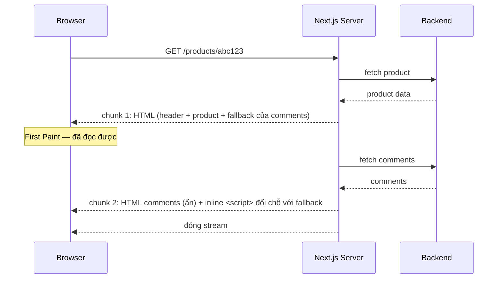

# 06. Suspense & Streaming — trả lời câu hỏi "vì sao có `<Suspense>` ở đây?"

> **Mục tiêu:** hiểu Suspense ở mức cơ chế, giải thích chính xác vai trò của `<Suspense>` trong
> `seller/page.tsx`, và biết đặt boundary ở đâu để cải thiện UX thật.

---

## 1. Overview

### Suspense là gì

`<Suspense>` là một **boundary** nói với React: *"nếu thứ gì bên trong chưa sẵn sàng, hiện `fallback`."*

```tsx
<Suspense fallback={<Skeleton />}>
  <SomethingThatMightNotBeReady />
</Suspense>
```

"Chưa sẵn sàng" chỉ có ba nguồn (React 19):

1. Một **async Server Component** đang `await`
2. Một component gọi `use(promise)` với Promise chưa resolve
3. `React.lazy()` đang tải chunk

```tsx
// ❌ Suspense KHÔNG thấy fetch trong useEffect — fallback không bao giờ hiện
function Comments({ id }: { id: string }) {
  const [data, setData] = useState<Comment[] | null>(null)
  useEffect(() => { fetch(`/api/comments?productId=${id}`).then(r => r.json()).then(setData) }, [id])
  return data ? <List items={data} /> : null
}

// ✅ Server Component await → Suspense bắt được
async function Comments({ id }: { id: string }) {
  const data = await apiFetch<Comment[]>(`/comment?productId=${id}`)
  return <List items={data} />
}
```

### Vấn đề Suspense giải quyết

Trước Suspense, mỗi component tự giữ `loading/error/data` → trùng lặp, waterfall (con chỉ fetch sau khi
cha render), và 5 spinner nhấp nháy lệch nhau. Suspense đảo ngược: **component chỉ khai báo "tôi cần dữ
liệu"**, còn hiện gì trong lúc chờ là quyết định của **cha** (nơi đặt boundary).

---

## 2. Mental Model

### 🧠 Boundary như cầu chì

```
Không có boundary:                   Có boundary quanh Comments:
┌──────────────────────┐             ┌──────────────────────┐
│  Header              │             │  Header      ✅ hiện  │
│  Product info        │             │  Product     ✅ hiện  │
│  Comments (chậm 2s)  │             │  ┌─ Suspense ──────┐ │
│                      │             │  │ Comments ⏳     │ │
│  ⏳ CẢ TRANG CHỜ 2s  │             │  └─────────────────┘ │
└──────────────────────┘             └──────────────────────┘
```

Không có boundary → thứ chậm nhất quyết định thời gian cả trang. Có boundary → mỗi phần hiện khi sẵn sàng.

> **Nguyên tắc:** đặt boundary quanh phần **chậm** và **ít quan trọng nhất**. Đừng bọc nội dung chính —
> người dùng đến để xem nó.

### 🧠 Fallback như khung ảnh cùng kích thước

Skeleton tốt hơn spinner vì nó **giữ chỗ đúng kích thước** → layout không nhảy khi nội dung thật vào (CLS).

---

## 3. How It Works — cơ chế streaming



HTML của phần đến sau được gửi ở cuối tài liệu trong một node ẩn, kèm một script inline rất nhỏ chuyển
nó vào đúng vị trí và gỡ fallback — chạy được **trước** khi bundle JS chính tải xong.

**React 19.2 — batch reveal khi SSR:** thay vì lộ từng boundary ngay khi xong, React gom các boundary
xong gần nhau và lộ chúng **cùng lúc** (giống hành vi phía client) — ít "nhảy" từng mảnh hơn. Hệ quả
thực tế: đừng đo thời điểm hiện của từng boundary đến từng mili-giây; thiết kế boundary theo **nhóm nội
dung có nghĩa**.

| Chỉ số | Không streaming | Có streaming |
| --- | --- | --- |
| TTFB | Sau khi *mọi* fetch xong | Gần như ngay |
| FCP | Sau fetch chậm nhất | Sau phần nhanh nhất |

---

## 4. ⭐ Ca chính: `<Suspense>` trong `seller/page.tsx`

📄 `app/(seller)/seller/page.tsx`:

```tsx
export default async function SellerHomePage() {
  const payload = await getAccessPayload()     // ← cookies()
  return (
    <div className="space-y-6">
      <Suspense fallback={null}>
        <WelcomeToast />
      </Suspense>
      {/* Dashboard, QUICK_ACTIONS cards... */}
```

📄 `components/seller/welcome-toast.tsx`:

```tsx
'use client'
export function WelcomeToast() {
  const router = useRouter()
  const params = useSearchParams()          // ← lý do có Suspense
  const welcome = params.get('welcome')

  useEffect(() => {
    if (welcome !== '1') return
    toast.success("You're now a shop — welcome to Seller Centre")
    router.replace('/seller')
  }, [welcome, router])

  return null
}
```

`fallback={null}`, component `return null` — Suspense ở đây **không phải loading state**.

### `useSearchParams()` và prerender

Khi một route được **prerender** (build time), chưa có request nên chưa có query string. Docs Next 16:
gọi `useSearchParams()` trong route prerender khiến cây Client Component **tới Suspense boundary gần nhất**
bị đẩy sang render ở client. Không có boundary nào → bail-out lan tới root và build báo lỗi
*Missing Suspense boundary with useSearchParams* (`missing-suspense-with-csr-bailout`).

```
Prerender:
┌────────────────────────────────────────┐
│ Dashboard, QUICK_ACTIONS cards         │  ← HTML tĩnh
│ ┌── Suspense (fallback: null) ─────┐   │  ← đường cắt: phần này để client lo
│ └──────────────────────────────────┘   │
└────────────────────────────────────────┘
Browser (hydration): WelcomeToast đọc ?welcome=1 → toast
```

### Thực tế trong repo: chưa *bắt buộc* — nhưng nên giữ

`/seller` gọi `getAccessPayload()` → `cookies()` → route đã **dynamic**, không được prerender. Với route
dynamic, `useSearchParams()` có giá trị ngay khi render server, nên bỏ `<Suspense>` hôm nay **không vỡ gì**.

Giữ nó vì: (1) nếu sau này dashboard bỏ đọc cookie và trở thành static, build sẽ lỗi; (2) dưới
**Cache Components** (file `10` §9), Suspense chính là ranh giới giữa static shell và phần request-time.
Chi phí: một dòng.

> **Quy tắc:** Client Component gọi `useSearchParams()` → bọc `<Suspense>`.
> **Suspense không chỉ cho loading — nó là đường cắt giữa "prerender được" và "chỉ biết lúc request".**

`fallback={null}` hợp lý vì nội dung thật cũng là `null`.

---

## 5. ⚠️ Waterfall bị bỏ qua: trang sản phẩm

📄 `app/(store)/products/[id]/page.tsx` (rút gọn):

```tsx
const { id } = await params
detail = normalizeProductDetail(await apiFetch<unknown>(`/product/${id}`))   // ← chờ #1
if (error || !detail) { /* return trang lỗi */ }

comments = await apiFetch<Comment[]>(`/comment?productId=${id}`)             // ← chờ #2, TUẦN TỰ
const currentUserId = await getClientId()
return (/* ... */ <CommentSection productId={id} comments={comments} currentUserId={currentUserId} />)
```

Hai `await` nối tiếp: 150ms + 150ms = **300ms** trước khi thấy *bất cứ gì*. Tệ hơn: **comments chặn cả
sản phẩm** — người dùng đến để bấm "Add to cart", không phải để đọc review.

### Cấp 1: `Promise.allSettled` — song song

```tsx
const [productRes, commentsRes] = await Promise.allSettled([
  apiFetch<unknown>(`/product/${id}`),
  apiFetch<Comment[]>(`/comment?productId=${id}`),
])
const detail = productRes.status === 'fulfilled' ? normalizeProductDetail(productRes.value) : null
const comments = commentsRes.status === 'fulfilled' ? commentsRes.value : []
```

`allSettled` chứ không phải `all`, vì comments **được phép lỗi** mà trang vẫn hiện. 300ms → 150ms, nhưng
vẫn chờ comments.

### Cấp 2: Suspense — stream phần comment

```tsx
// app/(store)/products/[id]/page.tsx
export default async function ProductDetailPage({ params }: { params: Promise<{ id: string }> }) {
  const { id } = await params
  // ... fetch + normalize detail, early return nếu lỗi (giữ nguyên)
  return (
    <div className="space-y-4">
      {/* breadcrumb, ProductPurchase, highlights, specs — hiện NGAY */}
      <Suspense fallback={<CommentsSkeleton />}>
        <ProductComments productId={id} />
      </Suspense>
    </div>
  )
}

function CommentsSkeleton() {
  return (
    <div className="space-y-4 rounded-2xl bg-card p-4 sm:p-6" aria-busy="true" aria-label="Loading comments">
      {[0, 1, 2].map((i) => (
        <div key={i} className="space-y-2">
          <div className="h-4 w-32 animate-pulse rounded bg-muted" />
          <div className="h-4 w-full animate-pulse rounded bg-muted" />
        </div>
      ))}
    </div>
  )
}
```

```tsx
// components/store/product-comments.tsx — Server Component MỚI
export async function ProductComments({ productId }: { productId: string }) {
  let comments: Comment[] = []
  try {
    comments = await apiFetch<Comment[]>(`/comment?productId=${productId}`)
  } catch {
    comments = []
  }
  const currentUserId = await getClientId()
  return <CommentSection productId={productId} comments={comments} currentUserId={currentUserId} />
}
```

| | Tuần tự (hiện tại) | `allSettled` | Suspense |
| --- | --- | --- | --- |
| Thấy tên/giá, bấm Add to cart | 300ms | 150ms | **150ms** |
| Thấy comments | 300ms | 150ms | 300ms (không ai chờ) |
| API comment chậm 5s / sập | Cả trang chờ | Cả trang chờ | **Chỉ comments chờ** |

Lợi ích lớn nhất là **cô lập**: comment sập, trang sản phẩm vẫn dùng được.

### Khi nào tuần tự là *đúng*

📄 `app/(store)/checkout/page.tsx`:

```tsx
cart = await apiFetch<Cart>('/cart', { auth: true })                        // #1
const shopOrderIds = buildShopOrders(cart.cart_products ?? [])               // ← cần kết quả #1
review = await apiFetch<CheckoutReview>('/checkout/review', {
  auth: true,
  body: { shop_order_ids: shopOrderIds },                                     // #2 phụ thuộc #1
})
```

> **Phân biệt trong 5 giây:** request #2 có dùng kết quả #1 không?
> **Có** → tuần tự là đúng. **Không** → waterfall thừa → song song hoặc Suspense.

---

## 6. `loading.tsx` — Suspense tự động cho cả route

`loading.tsx` trong một segment tự bọc `page.tsx` (và các segment con) của nó bằng `<Suspense>`:

```tsx
// app/(store)/orders/loading.tsx
export default function Loading() {
  return (
    <div className="space-y-4" aria-busy="true" aria-label="Loading orders">
      {[0, 1, 2].map((i) => (
        <div key={i} className="h-28 animate-pulse rounded-xl bg-muted" />
      ))}
    </div>
  )
}

// Tương đương Next tự làm:
// <Layout><Suspense fallback={<Loading />}><OrdersPage /></Suspense></Layout>
```

Ngoài streaming, `loading.tsx` còn được **prefetch** cùng layout → bấm `<Link>` là skeleton hiện **ngay**
(nếu prefetch đã xong), không cần chờ server.

⚠️ **Repo chưa có `loading.tsx` nào.** Bấm "View details" ở `/orders` → server `await` 200ms → trong lúc
đó **màn hình đứng yên**, người dùng không biết click đã được nhận chưa.

| Route nên thêm | Vì sao |
| --- | --- |
| `app/(store)/orders/`, `orders/[id]/` | Điều hướng từ danh sách, cần phản hồi ngay |
| `app/(store)/products/[id]/` | 2 request tuần tự — chậm nhất repo |
| `app/(seller)/seller/products/` | Phân trang, fetch mỗi lần đổi trang |
| `app/(store)/checkout/` | 2 request phụ thuộc, không tránh được |

---

## 7. `error.tsx` — cặp song sinh của Suspense

Suspense lo "chưa có dữ liệu", error boundary lo "có lỗi". Repo hiện tự bắt lỗi trong từng page
(`let error; try/catch` — 8 file trong `app/`): thông báo cụ thể, phần còn lại vẫn hiện, nhưng không bắt
được lỗi ngoài `try` (ví dụ dữ liệu backend sai hình dạng) và không có nút thử lại.

`error.tsx` là lưới an toàn cho phần còn lại. Nó **bắt buộc `'use client'`** và không bắt được lỗi của
`layout.tsx` cùng cấp (nó nằm *bên trong* layout đó). Next 16.2 thêm prop **`unstable_retry`** — fetch lại *và*
render lại; `reset()` cũ chỉ render lại **không** fetch lại, nên với lỗi server thường vô dụng:

```tsx
// app/(store)/error.tsx
'use client'
export default function StoreError({
  error,
  unstable_retry,
}: {
  error: Error & { digest?: string }
  unstable_retry: () => void
}) {
  return (
    <div className="space-y-4 py-12 text-center">
      <h2 className="text-xl font-semibold">Đã có lỗi xảy ra</h2>
      <Button onClick={() => unstable_retry()}>Thử lại</Button>
    </div>
  )
}
```

> **Hai tầng:** `try/catch` trong page cho lỗi **dự đoán được** (404, không có quyền); `error.tsx` cho lỗi
> **không dự đoán được**. Chi tiết (`digest`, `global-error.tsx`, lỗi ở layout) → file `16`.

---

## 8. `use()` — truyền Promise từ server sang Client Component

```tsx
// Server Component: KHÔNG await — truyền Promise xuống
export default async function ProductDetailPage({ params }: { params: Promise<{ id: string }> }) {
  const { id } = await params
  const commentsPromise = apiFetch<Comment[]>(`/comment?productId=${id}`)   // fetch bắt đầu ngay
  return (
    <>
      <ProductInfo id={id} />
      <Suspense fallback={<CommentsSkeleton />}>
        <CommentsClient promise={commentsPromise} productId={id} />
      </Suspense>
    </>
  )
}
```

```tsx
'use client'
import { use } from 'react'

export function CommentsClient({ promise, productId }: { promise: Promise<Comment[]>; productId: string }) {
  const comments = use(promise)     // suspend tới khi resolve; reject → error boundary gần nhất
  return <CommentSection productId={productId} comments={comments} />
}
```

Fetch bắt đầu trên server (không waterfall client), component tiêu thụ là Client Component (có tương tác).
Nếu component đã là Server Component thì chỉ cần `await` — `use()` dành cho ranh giới server→client.

⚠️ Đừng tạo Promise **trong** Client Component rồi `use()` nó (`use(fetch(...))` trong render) — mỗi lần
render tạo Promise mới → suspend vô hạn. Promise phải đến từ server hoặc được cache.

---

## 9. Thiết kế `fallback`

| Loại | Khi nào | Vì sao |
| --- | --- | --- |
| **Skeleton khớp layout** | Mặc định | CLS = 0, thấy cấu trúc trước |
| `null` | Component không render gì (`WelcomeToast`) | Không có gì để giữ chỗ |
| Spinner | Vùng nhỏ, không đoán được kích thước | Đơn giản nhưng gây layout shift |
| Dữ liệu cũ | Khi đã có từ lần trước | UX tốt nhất — `useDeferredValue`/transition (file `07`) |

Skeleton: khớp kích thước thật; vài khối xám là đủ (đừng vẽ giống 95%); có `aria-busy="true"` + `aria-label`.

---

## 10. When NOT to Use Suspense

- **Bọc nội dung chính** — người dùng chỉ thấy skeleton, tệ cho SEO nội dung quan trọng.
- **Boundary quá mịn** — 10 boundary = 10 mảnh nhấp nháy. Gom theo nhóm có nghĩa.
- **Việc < 100ms** — skeleton nháy 50ms trông tệ hơn không có gì.
- **Thay cho sửa waterfall** — Suspense làm nó *trông* ổn, tổng thời gian vẫn thế.

---

## 11. Trade-offs

| Lợi ích | Cái giá |
| --- | --- |
| TTFB/FCP tốt hơn | Nội dung hiện theo đợt → "nhảy" nếu skeleton không khớp |
| Cô lập lỗi/độ chậm | Phải thiết kế, bảo trì skeleton |
| Loading state khai báo | Khó debug "vì sao *cái này* suspend?" |
| Tách static shell / phần request-time | Một số CDN/proxy cũ buffer stream |
| HTML thật → tốt cho SEO | **Không đổi được HTTP status sau khi stream bắt đầu** |

Stream bắt đầu ngay khi một fallback render (kể cả `loading.tsx`) → header `200` đã gửi, không đổi được
nữa. `notFound()` gọi giữa stream chỉ chèn `<meta name="robots" content="noindex">`; `redirect()` giữa
stream thành redirect phía client.

```tsx
// ❌ notFound() nằm trong phần đã stream → HTTP 200 + noindex, không phải 404 thật
<Suspense fallback={<ProductSkeleton />}>
  <ProductInfo id={id} />   {/* bên trong: if (!product) notFound() */}
</Suspense>

// ✅ kiểm tra tồn tại TRƯỚC mọi boundary → 404 thật
const { id } = await params
const detail = await getProduct(id)
if (!detail) notFound()
return <Suspense fallback={<CommentsSkeleton />}><ProductComments productId={id} /></Suspense>
```

⚠️ Thêm `loading.tsx` cho một segment nghĩa là fallback render **trước** page → mọi `notFound()` trong page
đó không còn trả 404 thật. Route nào cần status chuẩn (SEO, analytics) thì cân nhắc kỹ.

---

## 12. Best Practices

1. **Suspense quanh phần chậm + ít quan trọng**, không quanh nội dung chính.
2. **Client Component gọi `useSearchParams()` → bọc `<Suspense>`**, kể cả khi route hiện đang dynamic.
3. **Thêm `loading.tsx` cho route có fetch** — lợi ích/công sức cao nhất repo chưa làm.
4. **`error.tsx` làm lưới an toàn**, giữ `try/catch` cho lỗi dự đoán được; dùng `unstable_retry` (16.2).
5. **Sửa waterfall trước khi thêm Suspense.**
6. **`allSettled`** khi các fetch độc lập và được phép lỗi riêng; **`all`** khi lỗi một cái là cả trang vô nghĩa.

---

## Tự kiểm tra

1. Ba nguồn khiến một boundary suspend? Vì sao fetch trong `useEffect` không tính?
2. Vì sao `<Suspense>` quanh `WelcomeToast` *chưa* bắt buộc trong repo hôm nay, và khi nào nó thành bắt buộc?
3. Vì sao `checkout/page.tsx` phải tuần tự, còn `products/[id]/page.tsx` thì không?
4. `loading.tsx` tương đương đoạn code nào viết tay? Ngoài streaming nó còn giúp gì khi điều hướng?
5. `unstable_retry` khác `reset` thế nào?
6. Vì sao không được tạo Promise trong render của Client Component rồi `use()` nó?

➡️ Tiếp theo: `07-transitions-va-useoptimistic.md`
