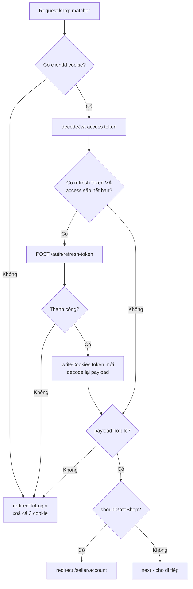

# 12. `proxy.ts`, Edge Runtime & Session/Auth

> **Mục tiêu:** hiểu tầng chạy-trước-mọi-request, vì sao nó có ràng buộc runtime riêng,
> và đọc được toàn bộ luồng session của repo — kèm những rủi ro thật của nó.

---

## 1. Overview

### `middleware.ts` → `proxy.ts`

Next.js 16 đổi tên convention từ `middleware.ts` sang **`proxy.ts`**. Đây không chỉ là đổi tên — nó
làm rõ **ý định** của tầng này.

"Middleware" là một từ quá rộng (có middleware của Express, của Redux, của webpack...). "Proxy" nói
đúng vai trò: **một lớp đứng trước ứng dụng, xem xét request đi vào, và quyết định cho đi tiếp hay
chuyển hướng.**

Nếu bạn đọc tài liệu hoặc bài viết cũ, `middleware.ts` và `proxy.ts` là cùng một khái niệm.

### Nó chạy ở đâu trong luồng request

```
Request từ browser
      │
      ▼
┌──────────────────────────────────┐
│  proxy.ts  ← BẠN Ở ĐÂY           │  Edge runtime, chạy trước MỌI thứ
│  • Đọc cookie                     │
│  • Refresh token nếu sắp hết hạn  │
│  • Gate theo role                 │
│  • Redirect / rewrite / next()    │
└────────────┬─────────────────────┘
             │ NextResponse.next()
             ▼
┌──────────────────────────────────┐
│  Route matching                   │
│  layout.tsx → page.tsx            │  Node.js runtime
│  Server Components, apiFetch      │
└──────────────────────────────────┘
```

Điểm mấu chốt: proxy chạy **trước khi** Next.js quyết định route nào, **trước khi** bất kỳ layout hay
page nào render. Nó là điểm sớm nhất bạn can thiệp được.

### Vấn đề nó giải quyết

Ba việc mà nếu làm ở tầng page sẽ vừa trùng lặp vừa muộn:

1. **Xác thực / phân quyền route** — chặn trước khi render, thay vì render rồi redirect
2. **Refresh token** — làm một lần cho mọi route, thay vì mỗi page tự lo
3. **Rewrite / A-B test / i18n routing** — đổi đích đến mà không đổi URL người dùng thấy

---

## 2. Mental Model

### 🧠 Proxy như nhân viên bảo vệ ở cửa toà nhà

Bảo vệ kiểm tra thẻ **trước khi** bạn vào toà nhà:

- **Không có thẻ** → mời ra ngoài (redirect `/login`)
- **Thẻ sắp hết hạn** → gia hạn ngay tại cửa (refresh token)
- **Thẻ hợp lệ nhưng không có quyền vào tầng 5** → chuyển bạn xuống tầng cho phép
  (redirect `/seller/account`)
- **Mọi thứ ổn** → mời vào (`NextResponse.next()`)

Và bảo vệ có hai đặc điểm quan trọng:

- **Rất nhanh.** Anh ta không mở database tra cứu 10 giây. Proxy chạy trên **mọi** request khớp
  matcher, nên chậm 100ms nghĩa là *mọi* request chậm 100ms.
- **Chỉ mang theo bộ đàm, không mang cả phòng máy.** Đây là Edge runtime — môi trường hạn chế.

### 🧠 Edge runtime: một JavaScript engine "gầy"

Edge runtime **không phải Node.js**. Nó là môi trường dựa trên Web API, thiết kế để khởi động trong
vài millisecond và chạy ở hàng trăm điểm gần người dùng.

| Có | Không có |
| --- | --- |
| `fetch`, `Request`, `Response`, `Headers` | `fs`, `path`, `child_process` |
| `URL`, `URLSearchParams` | `Buffer` (dùng `Uint8Array`) |
| `atob`, `btoa`, `TextEncoder`, `TextDecoder` | `net`, `http` module của Node |
| `crypto.subtle` (Web Crypto) | Phần lớn native module (`bcrypt`, `sharp`) |
| `Uint8Array`, `TypedArray` | `next/headers` (`cookies()`, `headers()`) |

---

## 3. ⭐ Vì sao `lib/auth/gate.ts` được viết như vậy

Đây là ví dụ dạy học tốt nhất về ràng buộc runtime trong repo.

📄 `lib/auth/gate.ts`:

```tsx
// Pure, edge-safe: decide whether a /seller request should be gated for
// lacking the `shop` role. Kept free of server-only / next/headers so proxy.ts
// (Edge runtime) can import it.
export function shouldGateShop(
  pathname: string,
  roles: string[] | undefined,
): boolean {
  if (!pathname.startsWith('/seller')) return false
  if (pathname === '/seller/account' || pathname.startsWith('/seller/account/')) {
    return false
  }
  return !(roles ?? []).includes('shop')
}
```

Chú ý: hàm này **nhận `pathname` và `roles` làm tham số**. Nó không tự đi lấy chúng.

Nếu viết theo cách "tiện" hơn:

```tsx
// ❌ Không dùng được ở proxy.ts
import { cookies } from 'next/headers'
import { getAccessPayload } from '@/lib/auth/session'

export async function shouldGateShop(pathname: string): Promise<boolean> {
  const payload = await getAccessPayload()      // next/headers → KHÔNG có ở Edge
  // ...
}
```

Ba thứ bị mất:

1. **Không dùng được ở Edge** — `next/headers` không tồn tại
2. **Không test được mà không mock** — phải mock `cookies()`
3. **Không pure** — kết quả phụ thuộc trạng thái ngầm

Cách repo viết cho phép đúng ba điều đó. 📄 `lib/auth/__tests__/gate.test.ts` — 21 dòng, **không một
dòng mock nào**:

```tsx
import { describe, it, expect } from 'vitest'
import { shouldGateShop } from '@/lib/auth/gate'

describe('shouldGateShop', () => {
  it('does not gate paths outside /seller', () => {
    expect(shouldGateShop('/login', [])).toBe(false)
    expect(shouldGateShop('/', undefined)).toBe(false)
  })
  it('never gates /seller/account (upgrade must stay reachable)', () => {
    expect(shouldGateShop('/seller/account', [])).toBe(false)
    expect(shouldGateShop('/seller/account/anything', [])).toBe(false)
  })
  it('gates /seller for a logged-in non-shop', () => {
    expect(shouldGateShop('/seller', ['user'])).toBe(true)
    expect(shouldGateShop('/seller/products', undefined)).toBe(true)
  })
  it('allows /seller for a shop', () => {
    expect(shouldGateShop('/seller', ['user', 'shop'])).toBe(false)
    expect(shouldGateShop('/seller/products', ['shop'])).toBe(false)
  })
})
```

**Chú ý test case thứ hai — nó ghi lại một luật nghiệp vụ quan trọng:**

```tsx
it('never gates /seller/account (upgrade must stay reachable)', () => {
```

Nếu `/seller/account` bị gate, người dùng chưa phải shop sẽ **không bao giờ** vào được trang để nâng
cấp thành shop → redirect vòng vô hạn: `/seller` → `/seller/account` → `/seller` → ...

Test này là **tài liệu sống** cho luật đó. Ai đó "đơn giản hoá" `shouldGateShop` thành
`return !roles.includes('shop')` sẽ thấy test đỏ ngay, kèm tên test giải thích tại sao.

> **Nguyên tắc:** hàm pure nhận input rõ ràng thì (a) dùng được ở mọi runtime, (b) test được không cần
> mock, (c) đọc là hiểu. Ba lợi ích từ một quyết định thiết kế.

📄 `lib/auth/tokens.ts` cũng theo cùng nguyên tắc — và đây là chỗ ràng buộc Edge lộ rõ nhất:

```tsx
export function decodeJwt(token: string): JwtPayload | null {
  const parts = token.split('.')
  if (parts.length !== 3) return null
  try {
    const b64 = parts[1].replace(/-/g, '+').replace(/_/g, '/')
    const pad = b64.length % 4 === 0 ? '' : '='.repeat(4 - (b64.length % 4))
    const bytes = Uint8Array.from(atob(b64 + pad), (c) => c.charCodeAt(0))
    return JSON.parse(new TextDecoder().decode(bytes)) as JwtPayload
  } catch {
    return null
  }
}
```

Cách viết "tự nhiên" trong Node.js sẽ là:

```tsx
// ❌ Buffer KHÔNG có ở Edge runtime
return JSON.parse(Buffer.from(parts[1], 'base64url').toString('utf8'))
```

Repo dùng `atob` + `Uint8Array` + `TextDecoder` — **Web API**, có ở Edge, Node, và browser.

Lưu ý cả phần xử lý padding:

```tsx
const b64 = parts[1].replace(/-/g, '+').replace(/_/g, '/')
const pad = b64.length % 4 === 0 ? '' : '='.repeat(4 - (b64.length % 4))
```

JWT dùng **base64url** (`-` và `_` thay cho `+` và `/`, và bỏ padding `=`), còn `atob` cần
**base64 chuẩn**. Hai dòng này chuyển đổi giữa hai định dạng. Đây là loại chi tiết dễ bỏ sót và gây
lỗi chỉ với một số token nhất định (những token có độ dài payload không chia hết cho 4) — bug cực khó
tái hiện.

---

## 4. Mổ xẻ `proxy.ts`

### 4.1 Toàn cảnh

📄 `proxy.ts`:

```tsx
export default async function proxy(req: NextRequest): Promise<NextResponse> {
  const access = req.cookies.get(COOKIE.ACCESS)?.value
  const refresh = req.cookies.get(COOKIE.REFRESH)?.value
  const clientId = req.cookies.get(COOKIE.CLIENT)?.value

  if (!clientId) return redirectToLogin(req)

  let payload = access ? decodeJwt(access) : null
  const res = NextResponse.next()

  // Refresh proactively when the access token is expiring/expired and a refresh token is present.
  if (refresh && isExpiringSoon(payload, Date.now())) {
    const tokens = await refreshTokens(clientId, refresh)
    if (!tokens) return redirectToLogin(req)
    writeCookies(res, tokens, clientId)
    payload = decodeJwt(tokens.accessToken)
  }

  if (!payload) return redirectToLogin(req)

  // Role-gate: non-shops may only reach /seller/account (to upgrade).
  // Runs AFTER refresh so a just-upgraded user is judged by fresh roles.
  if (shouldGateShop(req.nextUrl.pathname, payload.roles)) {
    return NextResponse.redirect(new URL('/seller/account', req.url))
  }

  return res
}

export const config = {
  matcher: ['/seller/:path*', '/cart/:path*', '/checkout/:path*', '/orders/:path*'],
}
```



### 4.2 Thứ tự các bước là cố ý — và comment nói rõ

```tsx
// Role-gate: non-shops may only reach /seller/account (to upgrade).
// Runs AFTER refresh so a just-upgraded user is judged by fresh roles.
```

**Vì sao thứ tự quan trọng?** Hãy theo dõi luồng nâng cấp thành shop:

```
1. Người dùng (chưa là shop) ở /seller/account, bấm "Create shop"
2. upgradeToShopAction chạy → backend trả tokens MỚI với roles: ['user', 'shop']
3. Action gọi setSession(data.tokens, clientId) → ghi cookie mới
4. Action gọi redirect('/seller?welcome=1')
5. Request tới /seller đi qua proxy
6. proxy đọc access token → roles: ['user', 'shop']  ✅ vào được
```

📄 Bước 3 là chi tiết then chốt — `actions/user.actions.ts`:

```tsx
const data = await apiFetch<UpgradeData>('/user/me/upgrade-to-shop', { auth: true, body: parsed.data })
// Critical: overwrite cookies with the new shop-role tokens, or the proxy
// keeps seeing the old (non-shop) role and gates the user out of /seller.
await setSession(data.tokens, clientId)
```

Comment nói chính xác điều gì sẽ vỡ nếu quên: proxy vẫn đọc token **cũ** (roles không có `shop`) →
gate người dùng ra khỏi `/seller` → họ vừa tạo shop xong mà không vào được dashboard.

**Và nếu gate chạy TRƯỚC refresh?** Kịch bản gãy: người dùng nâng cấp shop, nhưng access token cũ đã
hết hạn. Proxy đọc token cũ (đã hết hạn, roles cũ) → gate → redirect về `/seller/account` → vòng lặp.
Refresh trước mới lấy được roles mới.

### 4.3 `isExpiringSoon` — refresh trước khi hết hạn

📄 `lib/auth/tokens.ts`:

```tsx
export function isExpiringSoon(
  payload: JwtPayload | null,
  nowMs: number,
  skewSeconds = 60,
): boolean {
  if (!payload?.exp) return true
  return payload.exp * 1000 - nowMs <= skewSeconds * 1000
}
```

**Ba quyết định thiết kế:**

**(a) `nowMs` là tham số, không phải `Date.now()` bên trong.** Đây là lý do hàm test được mà không cần
mock time. 📄 `lib/auth/__tests__/tokens.test.ts`:

```tsx
describe('isExpiringSoon', () => {
  const p: JwtPayload = { userId: 'u1', email: 'a@b.com', roles: [], type: 'access', exp: 1000, iat: 0 }
  it('true when under the skew window (60s)', () => {
    // exp=1000s => 1_000_000ms; now=970_000ms => 30s left < 60s
    expect(isExpiringSoon(p, 970_000)).toBe(true)
  })
  it('false when there is plenty of time left', () => {
    expect(isExpiringSoon(p, 900_000)).toBe(false) // 100s left > 60s
  })
  it('true when payload is null or missing exp', () => {
    expect(isExpiringSoon(null, 0)).toBe(true)
  })
})
```

Chú ý comment trong test giải thích phép tính. Đây là chất lượng test cao: người đọc không phải tự
nhân 1000 trong đầu.

> **Nguyên tắc chung:** truyền thời gian vào như một tham số, đừng gọi `Date.now()` bên trong hàm
> logic. Cùng nguyên tắc áp dụng cho `Math.random()`, `crypto.randomUUID()`, và mọi nguồn
> không xác định. Hàm trở nên pure và test được ngay.

**(b) `skewSeconds = 60` — biên an toàn.** Refresh khi còn 60 giây, không phải khi đã hết hạn. Lý do:

- Đồng hồ server và client có thể lệch vài giây
- Request đang bay có thể mất vài trăm ms tới backend
- Không có biên này, sẽ có những request "may rủi" bị 401 vì token hết hạn giữa lúc proxy kiểm tra và
  lúc backend nhận request

**(c) `if (!payload?.exp) return true`** — không có payload hoặc không có `exp` thì coi như hết hạn.
Đây là **fail-safe** hướng bảo mật: khi không rõ, giả định điều tệ hơn.

### 4.4 `refreshTokens` — và một chi tiết dễ sai

```tsx
async function refreshTokens(clientId: string, refresh: string): Promise<Tokens | null> {
  try {
    const res = await fetch(`${process.env.BACKEND_URL}/api/v1/auth/refresh-token`, {
      method: 'POST',
      headers: {
        'x-api-key': process.env.API_KEY!,
        'x-client-id': clientId,
        'x-refresh-token': refresh,
      },
    })
    if (!res.ok) return null
    const json = await res.json()
    return (json?.data?.tokens ?? null) as Tokens | null
  } catch {
    return null
  }
}
```

**Vì sao không dùng `apiFetch`?** Hai lý do:

1. `apiFetch` có `import 'server-only'` → **không import được ở Edge runtime**
2. `apiFetch` dùng `cookies()` từ `next/headers` → cũng không có ở Edge

Nên proxy phải gọi `fetch` trực tiếp. Đây là ví dụ cụ thể của việc **ràng buộc runtime buộc bạn phải
có hai đường code cho cùng một việc** — cái giá thật của Edge runtime.

**`catch { return null }`** — mọi lỗi (mạng, JSON sai, backend sập) đều dẫn tới `null` → `redirectToLogin`.
Fail-safe: khi không refresh được, buộc đăng nhập lại thay vì để người dùng vào với token không rõ trạng thái.

### 4.5 Cookie: từng tuỳ chọn có lý do

📄 `lib/auth/session.ts`:

```tsx
const TWO_DAYS = 60 * 60 * 24 * 2
const SEVEN_DAYS = 60 * 60 * 24 * 7

export async function setSession(tokens: Tokens, clientId: string): Promise<void> {
  const store = await cookies()
  const secure = process.env.NODE_ENV === 'production'
  const common = { httpOnly: true, secure, sameSite: 'lax' as const, path: '/' }
  store.set(COOKIE.ACCESS, tokens.accessToken, { ...common, maxAge: TWO_DAYS })
  store.set(COOKIE.REFRESH, tokens.refreshToken, { ...common, maxAge: SEVEN_DAYS })
  store.set(COOKIE.CLIENT, clientId, { ...common, maxAge: SEVEN_DAYS })
}
```

| Tuỳ chọn | Chống lại điều gì |
| --- | --- |
| `httpOnly: true` | **XSS đánh cắp token.** JavaScript (kể cả script độc hại được inject) không đọc được cookie này qua `document.cookie` |
| `secure` (chỉ production) | **Đánh cắp qua mạng.** Cookie chỉ gửi qua HTTPS. Tắt ở dev vì `localhost` dùng HTTP |
| `sameSite: 'lax'` | **CSRF.** Cookie không gửi kèm request cross-site dạng POST. `'lax'` (không `'strict'`) để link từ email/Google vẫn giữ đăng nhập |
| `path: '/'` | Cookie có mặt ở mọi route |
| `maxAge` khác nhau | Access 2 ngày, refresh 7 ngày — refresh sống lâu hơn để còn dùng để gia hạn |

**Vì sao `'lax'` mà không `'strict'`?** Với `'strict'`, người dùng bấm link `/orders/abc` trong email
xác nhận đơn hàng sẽ **không** được gửi cookie → thấy trang login. Trải nghiệm tệ. `'lax'` gửi cookie
cho navigation GET từ site khác, nhưng vẫn chặn POST cross-site (phần bảo vệ CSRF quan trọng).

### 4.6 `redirectToLogin` — xoá cookie khi từ chối

```tsx
function redirectToLogin(req: NextRequest): NextResponse {
  const url = new URL('/login', req.url)
  url.searchParams.set('redirect', req.nextUrl.pathname)
  const res = NextResponse.redirect(url)
  res.cookies.delete(COOKIE.ACCESS)
  res.cookies.delete(COOKIE.REFRESH)
  res.cookies.delete(COOKIE.CLIENT)
  return res
}
```

**Xoá cả ba cookie là điều đúng đắn.** Nếu không, mỗi request tiếp theo lại thử refresh với cùng cái
refresh token đã chết → tốn một request tới backend cho mỗi lần tải trang, mãi mãi.

**`?redirect=<pathname>` giữ ý định của người dùng.** Người dùng vào `/orders/abc` khi token hết hạn →
sau khi đăng nhập, được đưa lại đúng `/orders/abc`.

⚠️ Nhưng đây cũng chính là đường vào của **lỗ open redirect** đã phân tích ở file `09`. Ở đây
`pathname` là **an toàn** (nó do Next.js cung cấp, luôn bắt đầu bằng `/`), nhưng
`loginAction` đọc nó từ `FormData` — và **FormData thì client kiểm soát được**. Đó là chỗ cần `safeRedirect`.

---

## 5. ⚠️ Ba rủi ro thật trong luồng auth

### Rủi ro 1: Race condition khi refresh

**Kịch bản:** người dùng mở `/seller/products` và trang đó có 3 `<Link>` được prefetch. Access token
vừa hết hạn. Bốn request đến gần như đồng thời:

```
t=0ms   Request A (/seller/products)     → proxy: token hết hạn → gọi refresh
t=2ms   Request B (prefetch /seller)     → proxy: token hết hạn → gọi refresh
t=3ms   Request C (prefetch /seller/discounts) → proxy: token hết hạn → gọi refresh
t=4ms   Request D (prefetch /seller/account)   → proxy: token hết hạn → gọi refresh
```

**Bốn lời gọi refresh song song với CÙNG một refresh token.**

Hậu quả phụ thuộc cách backend triển khai:

| Backend triển khai | Kết quả |
| --- | --- |
| Refresh token dùng nhiều lần được | ✅ Cả 4 thành công. Chỉ tốn 3 request thừa. |
| **Refresh token dùng một lần (rotation)** | ❌ A thành công, B/C/D nhận 401 → cả ba `redirectToLogin` → **người dùng bị đăng xuất** |
| Có phát hiện "token reuse" | ❌ Backend coi đây là dấu hiệu token bị đánh cắp → **thu hồi cả session** |

**Repo này chưa xử lý.** Và đây là loại bug xuất hiện ngẫu nhiên, chỉ khi token vừa đúng lúc hết hạn —
gần như không thể tái hiện trong lúc dev.

**Hướng giảm thiểu:**

**(a) Nếu backend cho phép dùng lại refresh token trong một cửa sổ ngắn** → vấn đề chỉ là request thừa,
có thể chấp nhận. **Hãy xác nhận điều này với backend, đừng giả định.**

**(b) Nếu backend rotate refresh token** → cần một cơ chế single-flight. Ở Edge runtime, bạn không có
shared memory giữa các instance, nên cách khả thi nhất là làm ở backend: chấp nhận refresh token cũ
trong một cửa sổ grace (ví dụ 10 giây) và trả cùng cặp token mới.

**(c) Giảm xác suất:** tăng `skewSeconds` lên (ví dụ 300 = 5 phút). Refresh xảy ra sớm hơn, ít trùng
với thời điểm nhiều request đồng thời. Đây là biện pháp giảm nhẹ, không phải chữa gốc.

**(d) Giảm prefetch** cho các link ít dùng: `<Link prefetch={false}>`.

### Rủi ro 2: Matcher không phủ hết các route cần token

```tsx
export const config = {
  matcher: ['/seller/:path*', '/cart/:path*', '/checkout/:path*', '/orders/:path*'],
}
```

**Không có `/products/:path*`.** Nhưng trang chi tiết sản phẩm có hai hành động **cần** token:

📄 `app/(store)/products/[id]/page.tsx` render:

```tsx
<AddToCart productId={product._id} max={product.product_quantity} />
<CommentSection productId={id} comments={comments} currentUserId={currentUserId} />
```

**Kịch bản gãy:**

```
1. Người dùng ở /products/abc123 (proxy KHÔNG chạy — không khớp matcher)
2. Access token đã hết hạn 5 phút trước, KHÔNG được refresh
3. Người dùng bấm "Add to cart"
4. addToCartAction đọc cookie → access token đã hết hạn
5. apiFetch gửi token hết hạn → backend trả 401
6. Người dùng thấy toast lỗi: "Could not add to cart"
```

Hành động thất bại **dù người dùng vẫn còn refresh token hợp lệ**. Họ chỉ cần refresh trang là xong,
nhưng không ai nói cho họ biết điều đó.

Đối chiếu: `addToCartAction` **có** xử lý trường hợp không đăng nhập:

```tsx
const clientId = await getClientId()
if (!clientId) redirect(`/login?redirect=/products/${productId}`)
```

Nhưng nó chỉ kiểm tra `clientId` (cookie 7 ngày, vẫn còn), **không** kiểm tra access token còn hạn.

**Ba cách sửa:**

```tsx
// (a) Mở rộng matcher — đơn giản nhất
export const config = {
  matcher: [
    '/seller/:path*',
    '/cart/:path*',
    '/checkout/:path*',
    '/orders/:path*',
    '/products/:path*',      // ← MỚI: refresh token trước khi người dùng bấm Add to cart
  ],
}
```

⚖️ Trade-off: proxy chạy trên nhiều request hơn (một chút latency cho mọi lần xem sản phẩm), nhưng
đổi lại mọi hành động cần token đều có token tươi.

```tsx
// (b) Xử lý 401 trong action — chữa triệu chứng nhưng đúng chỗ
import { ApiError } from '@/lib/api/http'

export async function addToCartAction(_prev: ActionState, formData: FormData): Promise<ActionState> {
  // ...
  try {
    await apiFetch('/cart', { auth: true, body: { productId, quantity } })
  } catch (e) {
    if (e instanceof ApiError && e.status === 401)
      redirect(`/login?redirect=/products/${productId}`)   // gửi họ đi refresh session
    return { ok: false, message: errorMessage(e, 'Could not add to cart') }
  }
  revalidatePath('/cart')
  return { ok: true, message: 'Added to cart' }
}
```

```tsx
// (c) Tốt nhất: xử lý ở tầng apiFetch — một chỗ cho mọi action
// (cần cẩn thận: redirect() throw, nên phải để caller quyết định)
```

**Cách (a) + (b) kết hợp là phương án vững nhất:** (a) làm giảm xác suất xảy ra, (b) xử lý tử tế khi
vẫn xảy ra.

### Rủi ro 3: `decodeJwt` không verify signature

Đã nói ở file `11`, nhắc lại vì nó thuộc chương này:

```tsx
export function decodeJwt(token: string): JwtPayload | null {
  const parts = token.split('.')
  if (parts.length !== 3) return null
  // base64 decode payload, JSON.parse
  // ← KHÔNG kiểm tra parts[2] (signature)
}
```

**Về lý thuyết:** ai đó tạo được cookie `access_token` với payload `roles: ['shop', 'admin']` và
signature bừa, thì proxy sẽ **cho họ qua**.

**Trong thực tế, việc này khó vì:**

- Cookie là `httpOnly` → JavaScript của trang không ghi được
- `sameSite: 'lax'` → không set được từ site khác
- Backend **verify signature thật** → mọi `apiFetch` với token giả đều 401

Nên kết quả cuối là: kẻ tấn công có thể **nhìn thấy** giao diện `/seller` (proxy cho qua), nhưng
**không lấy được dữ liệu nào** (backend từ chối mọi request).

**Đánh giá:** đây là rủi ro **thấp** và kiến trúc vẫn đúng, **nhưng phải hiểu rõ**:

> `shouldGateShop` là một quyết định về **UX** (đưa người dùng đến trang phù hợp), **không phải** một
> quyết định về **bảo mật**. Bảo mật nằm ở backend, nơi signature được verify.

Nếu muốn verify ở Edge, `crypto.subtle` có sẵn:

```tsx
async function verifyJwtHS256(token: string, secret: string): Promise<boolean> {
  const [headerB64, payloadB64, sigB64] = token.split('.')
  if (!headerB64 || !payloadB64 || !sigB64) return false

  const key = await crypto.subtle.importKey(
    'raw',
    new TextEncoder().encode(secret),
    { name: 'HMAC', hash: 'SHA-256' },
    false,
    ['verify'],
  )

  const b64urlToBytes = (s: string) => {
    const b64 = s.replace(/-/g, '+').replace(/_/g, '/')
    const pad = b64.length % 4 === 0 ? '' : '='.repeat(4 - (b64.length % 4))
    return Uint8Array.from(atob(b64 + pad), (c) => c.charCodeAt(0))
  }

  return crypto.subtle.verify(
    'HMAC',
    key,
    b64urlToBytes(sigB64),
    new TextEncoder().encode(`${headerB64}.${payloadB64}`),
  )
}
```

⚖️ Trade-off: cần đưa JWT secret vào môi trường Edge (một secret nữa phải quản lý), và thêm ~1ms cho
mỗi request. Với repo này, nơi backend đã verify, việc đó **không đáng** — nhưng nếu proxy phải tự
quyết định điều gì quan trọng (ví dụ rewrite tới một backend khác theo role), thì nó trở nên cần thiết.

---

## 6. When to Use proxy — và khi nào không

### Nên làm ở proxy

| Việc | Vì sao ở proxy |
| --- | --- |
| Redirect theo auth | Chặn trước khi render, không tốn công render rồi bỏ |
| Refresh token | Một chỗ cho mọi route, thay vì lặp ở từng page |
| Gate theo role | Cùng lý do |
| i18n routing (rewrite theo `Accept-Language`) | Cần biết header trước khi chọn route |
| A/B test bucketing (set cookie rồi rewrite) | Cần quyết định trước khi render |
| Chặn theo IP / geo | Rẻ và sớm |

### KHÔNG nên làm ở proxy

| Việc | Vì sao không | Làm ở đâu |
| --- | --- | --- |
| Fetch data để render | Proxy không render; và làm chậm **mọi** request | Server Component |
| Query database | Driver DB thường không chạy ở Edge; latency ×N request | Server Component / Action |
| Kiểm tra quyền sở hữu resource | Proxy chỉ thấy pathname, không biết ai sở hữu gì | Backend |
| Xử lý nặng (hash, resize, parse lớn) | Edge có giới hạn CPU/thời gian; làm chậm mọi request | Route handler / Server Action |
| Logic nghiệp vụ | Khó test, khó đọc, chạy trên mọi request | `lib/` + Server Action |

> **Quy tắc vàng cho proxy:** nếu nó không thể trả lời trong **vài millisecond** chỉ bằng thông tin có
> trong request (URL, cookie, header), nó không thuộc về proxy.

---

## 7. Trade-offs

| Lợi ích của proxy | Cái giá |
| --- | --- |
| Chặn/redirect trước khi render → không tốn công vô ích | Chạy trên **mọi** request khớp matcher → mọi chậm trễ đều nhân lên |
| Một chỗ duy nhất cho auth/refresh | Ràng buộc Edge runtime → phải viết code riêng (`fetch` thay `apiFetch`) |
| Chạy gần người dùng (thấp latency) | Không có Node API; nhiều thư viện không dùng được |
| Set cookie trước khi app chạy | Không có shared state giữa các invocation → khó làm single-flight (rủi ro 1) |
| Matcher rõ ràng, khai báo | Dễ **thiếu** một route (rủi ro 2) và không có gì cảnh báo bạn |

| Lợi ích của `httpOnly` cookie session | Cái giá |
| --- | --- |
| JS không đọc được → an toàn trước XSS đánh cắp token | Client không tự biết trạng thái đăng nhập → phải hỏi server |
| Tự động gửi kèm mọi request | Cần `sameSite` để chống CSRF |
| Không cần logic lưu trữ ở client | Kích thước giới hạn (~4KB/cookie); token dài có thể chạm ngưỡng |

---

## 8. Best Practices

1. **Giữ mọi thứ proxy import ở dạng pure và edge-safe.** `lib/auth/gate.ts` và `lib/auth/tokens.ts`
   là mẫu chuẩn. Comment giải thích ràng buộc để người sau không phá vỡ nó.

2. **Truyền thời gian vào như tham số** (`isExpiringSoon(payload, nowMs)`), đừng gọi `Date.now()`
   bên trong. Hàm trở nên pure và test được không cần mock.

3. **Refresh trước khi hết hạn với biên an toàn.** 60 giây là hợp lý; tăng lên nếu gặp rủi ro race.

4. **Fail-safe hướng bảo mật.** `!payload?.exp → true`, `catch → null → redirectToLogin`. Khi không
   rõ, chọn hướng an toàn hơn.

5. **Xoá cookie khi từ chối.** Ngăn vòng lặp refresh vô ích với token đã chết.

6. **Audit matcher mỗi khi thêm route có hành động cần token.** Câu hỏi: "trang này có Server Action
   nào dùng `auth: true` không?" Nếu có → nên nằm trong matcher.

7. **Ghi rõ tầng nào chịu trách nhiệm gì.** Proxy = UX/route gating. Backend = bảo mật thật.
   Hiểu sai điều này dẫn tới việc bỏ kiểm tra ở backend.

8. **Xác nhận hành vi refresh token với backend.** Có rotation không? Có grace window không?
   Câu trả lời quyết định rủi ro 1 nghiêm trọng đến đâu.

9. **Giữ proxy mỏng.** Mọi logic phức tạp nên nằm trong hàm pure ở `lib/` để test được, còn `proxy.ts`
   chỉ điều phối. Repo này làm đúng: proxy 78 dòng, phần lớn là điều phối.

---

## Tự kiểm tra

1. Vì sao `shouldGateShop` nhận `pathname` và `roles` làm tham số thay vì tự đọc cookie? Ba lợi ích?
2. Vì sao `decodeJwt` dùng `atob` + `Uint8Array` thay vì `Buffer.from`?
3. Vì sao gate role phải chạy **sau** refresh? Kịch bản nào gãy nếu đảo thứ tự?
4. `skewSeconds = 60` chống lại điều gì cụ thể?
5. Mô tả race condition khi refresh. Nó có nghiêm trọng hay không phụ thuộc vào điều gì?
6. Vì sao "Add to cart" từ trang sản phẩm có thể thất bại dù người dùng vẫn còn refresh token?
7. `shouldGateShop` là quyết định về bảo mật hay UX? Vì sao phân biệt này quan trọng?
8. Vì sao `sameSite: 'lax'` mà không phải `'strict'`?

➡️ Tiếp theo: `13-render-pipeline-va-hydration.md`
