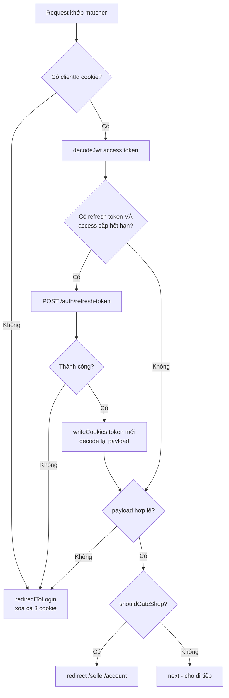

# 12. `proxy.ts` & Session/Auth

> **Mục tiêu:** hiểu tầng chạy-trước-route trong Next 16 (`proxy.ts`, trước đây là `middleware.ts`),
> nó chạy trên runtime nào, nó phủ tới đâu, và đọc được toàn bộ luồng session của repo — kèm những
> rủi ro thật của nó.

---

## 1. Overview

### `middleware.ts` → `proxy.ts` (Next 16)

| | Next ≤ 15 | Next 16 |
| --- | --- | --- |
| File | `middleware.ts` | **`proxy.ts`** (`middleware.ts` vẫn chạy nhưng **deprecated**) |
| Tên function | `export function middleware` | `export function proxy` (hoặc `export default`) |
| Runtime | Edge mặc định; Node từ 15.5 | **Chỉ Node.js** — không cấu hình được, đặt `runtime` sẽ **lỗi** |
| Flag config | `skipMiddlewareUrlNormalize` | `skipProxyUrlNormalize` |

```bash
npx @next/codemod@canary middleware-to-proxy .   # đổi tên file + tên function
```

Cần Edge runtime? Docs Next 16: tiếp tục dùng `middleware.ts` (deprecated). Lý do đổi tên: "middleware"
dễ bị hiểu như middleware của Express; "proxy" nói đúng vai trò — **một lớp mạng đứng trước app**, nên
dùng như phương án cuối, không phải chỗ đặt logic.

### Nó chạy ở đâu trong luồng request

```
Request
  │  1. headers / redirects trong next.config
  ▼
┌──────────────────────────────────┐
│  proxy.ts   (Node.js runtime)     │  • Đọc req.cookies
│                                   │  • Refresh token nếu sắp hết hạn
│                                   │  • Gate theo role
│                                   │  • redirect / rewrite / next()
└────────────┬─────────────────────┘
             ▼  rewrites → filesystem routes → dynamic routes
┌──────────────────────────────────┐
│  layout.tsx → page.tsx            │  Server Components, apiFetch, Server Actions
└──────────────────────────────────┘
```

Proxy chạy **trước** route matching và render — điểm sớm nhất để can thiệp. Nó giải quyết ba việc mà
làm ở page sẽ vừa trùng lặp vừa muộn: **gate route theo auth/role**, **refresh token một chỗ cho mọi
route**, **rewrite** (i18n, A/B test) mà không đổi URL.

⚠️ **Server Actions không phải route riêng.** Action là POST tới route đang hiển thị, nên proxy chỉ
chạy cho action nếu **trang gọi action** khớp `matcher`. Đổi matcher hoặc dùng action ở trang khác là
lặng lẽ mất lớp bảo vệ → luôn kiểm tra auth **trong** action (chương 11).

---

## 2. Mental Model

### 🧠 Proxy như nhân viên bảo vệ ở cửa toà nhà

- **Không có thẻ** → mời ra (redirect `/login`)
- **Thẻ sắp hết hạn** → gia hạn tại cửa (refresh token)
- **Thẻ hợp lệ nhưng không được lên tầng 5** → chuyển xuống tầng cho phép (redirect `/seller/account`)
- **Mọi thứ ổn** → mời vào (`NextResponse.next()`)

Bảo vệ phải **rất nhanh**: proxy chạy trên **mọi** request khớp matcher (kể cả prefetch của `<Link>`),
chậm 100ms là *mọi* request chậm 100ms. Và bảo vệ chỉ nhìn **thẻ** (URL, cookie, header) — không biết
căn hộ nào thuộc về ai (quyền sở hữu resource).

### 🧠 Proxy làm việc với `Request`/`Response`, không phải với "trang"

Proxy nhận `NextRequest` và trả `NextResponse`. Nó đọc cookie bằng **`req.cookies`**, ghi bằng
**`res.cookies`**. Các helper dành cho render/action như `cookies()` từ `next/headers` hay `apiFetch`
(📄 `lib/api/server-client.ts`, có `import 'server-only'` + `cookies()` + `headers()`) thuộc về phạm vi
Server Component / Server Action — đừng kéo chúng vào proxy.

---

## 3. ⭐ Vì sao `lib/auth/gate.ts` được viết như vậy

📄 `lib/auth/gate.ts`:

```tsx
// Pure, edge-safe: decide whether a /seller request should be gated for
// lacking the `shop` role. Kept free of server-only / next/headers so proxy.ts
// (Edge runtime) can import it.
export function shouldGateShop(pathname: string, roles: string[] | undefined): boolean {
  if (!pathname.startsWith('/seller')) return false
  if (pathname === '/seller/account' || pathname.startsWith('/seller/account/')) return false
  return !(roles ?? []).includes('shop')
}
```

⚠️ Comment "(Edge runtime)" đã **lỗi thời** — ở Next 16 `proxy.ts` chạy Node.js. Nhưng thiết kế vẫn
đúng, vì lý do quan trọng hơn runtime: hàm **nhận `pathname` và `roles` làm tham số**, không tự đi lấy.

```tsx
// ❌ Cách "tiện": tự đọc cookie
import { getAccessPayload } from '@/lib/auth/session'   // server-only + next/headers
export async function shouldGateShop(pathname: string) {
  const payload = await getAccessPayload()
  // ...
}
```

Cách này: (1) kéo `next/headers` vào proxy, (2) phải mock `cookies()` mới test được, (3) kết quả phụ
thuộc trạng thái ngầm. Cách của repo → 📄 `lib/auth/__tests__/gate.test.ts` **không một dòng mock**:

```tsx
it('never gates /seller/account (upgrade must stay reachable)', () => {
  expect(shouldGateShop('/seller/account', [])).toBe(false)
  expect(shouldGateShop('/seller/account/anything', [])).toBe(false)
})
it('gates /seller for a logged-in non-shop', () => {
  expect(shouldGateShop('/seller', ['user'])).toBe(true)
})
```

Test thứ nhất ghi lại một luật nghiệp vụ: nếu gate cả `/seller/account`, người chưa là shop không bao
giờ tới được trang nâng cấp → redirect vòng `/seller` → `/seller/account` → `/seller`… Ai "đơn giản
hoá" thành `return !roles.includes('shop')` sẽ thấy test đỏ kèm tên giải thích lý do.

> **Nguyên tắc:** hàm pure nhận input rõ ràng thì dùng được ở mọi runtime, test không cần mock, đọc là hiểu.

📄 `lib/auth/tokens.ts` cùng nguyên tắc, và chỉ dùng **Web API** (`atob`, `Uint8Array`, `TextDecoder`)
nên chạy được ở Node, Edge lẫn browser:

```tsx
export function decodeJwt(token: string): JwtPayload | null {
  const parts = token.split('.')
  if (parts.length !== 3) return null
  try {
    const b64 = parts[1].replace(/-/g, '+').replace(/_/g, '/')
    const pad = b64.length % 4 === 0 ? '' : '='.repeat(4 - (b64.length % 4))
    const bytes = Uint8Array.from(atob(b64 + pad), (c) => c.charCodeAt(0))
    return JSON.parse(new TextDecoder().decode(bytes)) as JwtPayload
  } catch {
    return null
  }
}
```

JWT dùng **base64url** (`-`/`_`, bỏ padding `=`), còn `atob` cần **base64 chuẩn** — hai dòng đầu
chuyển đổi. Thiếu padding là bug chỉ xảy ra với token có độ dài payload không chia hết cho 4 — rất khó
tái hiện. (`TextDecoder` thay vì `atob` thuần để giải mã đúng UTF-8, vd. tên tiếng Việt trong payload.)

---

## 4. Mổ xẻ `proxy.ts`

### 4.1 Toàn cảnh

📄 `proxy.ts` (76 dòng):

```tsx
export default async function proxy(req: NextRequest): Promise<NextResponse> {
  const access = req.cookies.get(COOKIE.ACCESS)?.value
  const refresh = req.cookies.get(COOKIE.REFRESH)?.value
  const clientId = req.cookies.get(COOKIE.CLIENT)?.value

  if (!clientId) return redirectToLogin(req)

  let payload = access ? decodeJwt(access) : null
  const res = NextResponse.next()

  // Refresh proactively when the access token is expiring/expired and a refresh token is present.
  if (refresh && isExpiringSoon(payload, Date.now())) {
    const tokens = await refreshTokens(clientId, refresh)
    if (!tokens) return redirectToLogin(req)
    writeCookies(res, tokens, clientId)
    payload = decodeJwt(tokens.accessToken)
  }

  if (!payload) return redirectToLogin(req)

  // Role-gate: non-shops may only reach /seller/account (to upgrade).
  // Runs AFTER refresh so a just-upgraded user is judged by fresh roles.
  if (shouldGateShop(req.nextUrl.pathname, payload.roles)) {
    return NextResponse.redirect(new URL('/seller/account', req.url))
  }

  return res
}

export const config = {
  matcher: ['/seller/:path*', '/cart/:path*', '/checkout/:path*', '/orders/:path*'],
}
```



`matcher` phải là **hằng số** (Next phân tích tĩnh lúc build; biến bị bỏ qua); thiếu `matcher` thì proxy
chạy cho **mọi** request, kể cả `_next/static`, `_next/image` và file trong `public/`.

```tsx
// ❌ Không matcher + logic redirect login → CSS/JS/ảnh của trang /login cũng bị redirect → trang vỡ
// ✅ Allowlist như repo, hoặc negative match khi cần phủ gần hết app:
export const config = {
  matcher: ['/((?!api|_next/static|_next/image|favicon.ico|.*\\.png$).*)'],
}
```

Matcher còn nhận object `{ source, has, missing }` để lọc theo header/cookie/query — vd. bỏ qua prefetch
của `<Link>`: `{ source: '/seller/:path*', missing: [{ type: 'header', key: 'next-router-prefetch' }] }`.

### 4.2 Cookie ghi ở proxy có tới được page cùng request không?

Có. Khi proxy gọi `res.cookies.set(...)` trên `NextResponse.next()`, Next chuyển các cookie đó vào
request (header nội bộ `x-middleware-set-cookie`), nên `cookies()` trong Server Component/`apiFetch`
**ngay trong request đó** đọc được access token mới. Đây là lý do `writeCookies(res, ...)` đủ — page
không render với token cũ đã hết hạn.

Với dữ liệu không phải cookie, chuyển xuống app bằng request header:

```tsx
const headers = new Headers(req.headers)
headers.set('x-user-id', payload.userId)
return NextResponse.next({ request: { headers } })   // page đọc qua headers() — đừng tin nó cho authz
```

### 4.3 Thứ tự các bước là cố ý

"Runs AFTER refresh so a just-upgraded user is judged by fresh roles." Luồng nâng cấp shop:

```
1. Người dùng (chưa là shop) ở /seller/account, bấm "Create shop"
2. upgradeToShopAction → backend trả tokens MỚI với roles ['user', 'shop']
3. Action gọi setSession(data.tokens, clientId) → ghi cookie mới
4. Action redirect('/seller?welcome=1') → request đi qua proxy → roles mới → vào được ✅
```

📄 `actions/user.actions.ts`:

```tsx
// Critical: overwrite cookies with the new shop-role tokens, or the proxy
// keeps seeing the old (non-shop) role and gates the user out of /seller.
await setSession(data.tokens, clientId)
```

Nếu gate chạy **trước** refresh: access token cũ vừa hết hạn mang roles cũ → bị gate về
`/seller/account` dù refresh token sẽ cho roles mới.

### 4.4 `isExpiringSoon` — refresh trước khi hết hạn

```tsx
export function isExpiringSoon(payload: JwtPayload | null, nowMs: number, skewSeconds = 60): boolean {
  if (!payload?.exp) return true
  return payload.exp * 1000 - nowMs <= skewSeconds * 1000
}
```

- **`nowMs` là tham số** → test không cần mock time (📄 `lib/auth/__tests__/tokens.test.ts`:
  `isExpiringSoon(p, 970_000)` với `exp: 1000` → còn 30s → `true`). Cùng nguyên tắc cho
  `Math.random()`, `crypto.randomUUID()`.
- **`skewSeconds = 60`** — biên an toàn cho lệch đồng hồ và thời gian request bay tới backend; không
  có nó, token có thể hết hạn giữa lúc proxy kiểm tra và lúc backend nhận.
- **`!payload?.exp → true`** — không rõ thì giả định điều tệ hơn (fail-safe).

### 4.5 `refreshTokens` gọi `fetch` trực tiếp

```tsx
async function refreshTokens(clientId: string, refresh: string): Promise<Tokens | null> {
  try {
    const res = await fetch(`${process.env.BACKEND_URL}/api/v1/auth/refresh-token`, {
      method: 'POST',
      headers: { 'x-api-key': process.env.API_KEY!, 'x-client-id': clientId, 'x-refresh-token': refresh },
    })
    if (!res.ok) return null
    const json = await res.json()
    return (json?.data?.tokens ?? null) as Tokens | null
  } catch {
    return null
  }
}
```

Không dùng `apiFetch` vì nó gắn với `cookies()`/`headers()` của phạm vi render, và endpoint refresh
xác thực bằng `x-refresh-token` chứ không phải `authorization`. Mọi lỗi → `null` → `redirectToLogin`:
không refresh được thì buộc đăng nhập lại.

### 4.6 Cookie: từng tuỳ chọn có lý do

📄 `lib/auth/session.ts` (và `writeCookies` trong proxy dùng cùng cấu hình):

```tsx
const common = { httpOnly: true, secure, sameSite: 'lax' as const, path: '/' }
store.set(COOKIE.ACCESS, tokens.accessToken, { ...common, maxAge: TWO_DAYS })
store.set(COOKIE.REFRESH, tokens.refreshToken, { ...common, maxAge: SEVEN_DAYS })
store.set(COOKIE.CLIENT, clientId, { ...common, maxAge: SEVEN_DAYS })
```

| Tuỳ chọn | Chống lại |
| --- | --- |
| `httpOnly` | XSS đọc token qua `document.cookie` |
| `secure` (production) | Lộ qua HTTP; tắt ở dev vì `localhost` không HTTPS |
| `sameSite: 'lax'` | CSRF: không gửi cookie với POST cross-site, nhưng vẫn gửi với link GET từ email/Google |
| `maxAge` khác nhau | Refresh (7 ngày) sống lâu hơn access (2 ngày) để còn gia hạn |

`'strict'` sẽ làm người dùng bấm link `/orders/abc` trong email xác nhận thấy trang login — trải nghiệm tệ.

### 4.7 `redirectToLogin` xoá cả ba cookie

```tsx
function redirectToLogin(req: NextRequest): NextResponse {
  const url = new URL('/login', req.url)
  url.searchParams.set('redirect', req.nextUrl.pathname)
  const res = NextResponse.redirect(url)
  res.cookies.delete(COOKIE.ACCESS)
  res.cookies.delete(COOKIE.REFRESH)
  res.cookies.delete(COOKIE.CLIENT)
  return res
}
```

Không xoá thì mỗi lần tải trang lại thử refresh với cùng refresh token đã chết. `?redirect=` giữ ý định
người dùng. Ở đây `pathname` an toàn (luôn bắt đầu bằng `/`), nhưng `loginAction` đọc lại nó từ
`FormData` rồi `redirect(redirectTo)` — client kiểm soát được → open redirect nếu không lọc:

```tsx
// ✅ chỉ chấp nhận đường dẫn nội bộ
function safeRedirect(to: FormDataEntryValue | null, fallback = '/') {
  const s = typeof to === 'string' ? to : ''
  return s.startsWith('/') && !s.startsWith('//') ? s : fallback
}
```

---

## 5. ⚠️ Ba rủi ro thật trong luồng auth

### Rủi ro 1: Race condition khi refresh

Access token vừa hết hạn, người dùng mở `/seller/products` và `<Link>` prefetch 3 trang khác → 4 request
gần như đồng thời, **mỗi request tự refresh với cùng một refresh token**:

| Backend | Kết quả |
| --- | --- |
| Refresh token dùng lại được | ✅ Chỉ tốn 3 request thừa |
| **Rotation (dùng một lần)** | ❌ 1 thành công, 3 nhận 401 → `redirectToLogin` → **bị đăng xuất** |
| Phát hiện token reuse | ❌ Coi là token bị đánh cắp → **thu hồi cả session** |

Repo chưa xử lý; bug chỉ xuất hiện đúng lúc token hết hạn — gần như không tái hiện được khi dev.

Giảm thiểu: **(a)** xác nhận với backend có cho dùng lại trong một cửa sổ grace (vd. 10 giây, trả cùng
cặp token) — cách chữa gốc vì proxy có thể chạy trên nhiều instance, không có bộ nhớ chung;
**(b)** tăng `skewSeconds` (vd. 300) để refresh sớm, ít trùng thời điểm; **(c)** `<Link prefetch={false}>`
cho link ít dùng, hoặc matcher `missing: next-router-prefetch` (§4.1) để prefetch không kích hoạt refresh.

### Rủi ro 2: Matcher không phủ hết trang có hành động cần token

Matcher **không có** `/products/:path*`, nhưng trang sản phẩm có `AddToCart` (qua `product-purchase.tsx`)
và `CommentSection` — đều gọi Server Action `auth: true`.

```
1. Người dùng ở /products/abc (proxy KHÔNG chạy)
2. Access token hết hạn 5 phút trước, không ai refresh
3. Bấm "Add to cart" → POST /products/abc → vẫn không qua proxy
4. apiFetch gửi token hết hạn → 401 → toast "Could not add to cart"
```

Thất bại dù refresh token còn hạn. `addToCartAction` chỉ kiểm tra `clientId` (cookie 7 ngày):

```tsx
const clientId = await getClientId()
if (!clientId) redirect(`/login?redirect=/products/${productId}`)
```

Cách sửa — kết hợp cả hai:

```tsx
// (a) Mở rộng matcher — proxy refresh token trước khi người dùng bấm
matcher: ['/seller/:path*', '/cart/:path*', '/checkout/:path*', '/orders/:path*', '/products/:path*']
```

⚠️ Nhưng proxy hiện **redirect về login khi không có `clientId`** — thêm `/products` sẽ chặn khách vãng
lai xem sản phẩm. Phải tách nhánh: route công khai chỉ refresh nếu có cookie, không redirect.

```tsx
const PUBLIC_PREFIXES = ['/products']

export default async function proxy(req: NextRequest) {
  const isPublic = PUBLIC_PREFIXES.some((p) => req.nextUrl.pathname.startsWith(p))
  const clientId = req.cookies.get(COOKIE.CLIENT)?.value
  if (!clientId) return isPublic ? NextResponse.next() : redirectToLogin(req)   // khách: cho xem
  // ... refresh như cũ; refresh thất bại ở route công khai → next() thay vì redirect
}
```

```tsx
// (b) Xử lý 401 trong action
} catch (e) {
  if (e instanceof ApiError && e.status === 401) redirect(`/login?redirect=/products/${productId}`)
  return { ok: false, message: errorMessage(e, 'Could not add to cart') }
}
```

`redirect()` throw, nên gọi trong `catch` vẫn đúng — miễn là nó không nằm trong một `try` khác bắt mất
`NEXT_REDIRECT`.

### Rủi ro 3: `decodeJwt` không verify chữ ký

Về lý thuyết, cookie `access_token` giả với `roles: ['shop']` và chữ ký bừa sẽ qua được proxy. Thực tế:
cookie `httpOnly` (JS trang không ghi được) và **backend verify chữ ký** → kẻ tấn công thấy được khung
giao diện `/seller` nhưng **không lấy được dữ liệu**.

> `shouldGateShop` là quyết định **UX** (đưa người dùng tới đúng trang), không phải **bảo mật**.
> Bảo mật nằm ở backend.

Nếu proxy phải tự quyết định điều quan trọng (vd. rewrite sang backend khác theo role), hãy verify. Vì
proxy chạy Node.js, dùng thư viện như `jose` là gọn nhất:

```tsx
import { jwtVerify } from 'jose'
const secret = new TextEncoder().encode(process.env.JWT_SECRET)

async function verifiedPayload(token: string) {
  try {
    const { payload } = await jwtVerify(token, secret, { algorithms: ['HS256'] })
    return payload as JwtPayload
  } catch {
    return null   // chữ ký sai hoặc hết hạn
  }
}
```

⚖️ Cái giá: thêm một secret phải quản lý ở frontend. Với repo này, backend đã verify → **không đáng**.

---

## 6. Nên và không nên làm ở proxy

| ✅ Nên | ❌ Không nên | Làm ở đâu thay |
| --- | --- | --- |
| Redirect theo auth / role | Fetch data để render | Server Component |
| Refresh token | Query DB, gọi API chậm | Server Component / Action |
| Rewrite i18n, A/B bucketing | Kiểm tra quyền sở hữu resource | Backend / Data Access Layer |
| Chặn theo IP/geo, header bảo mật | Logic nghiệp vụ, xử lý nặng | `lib/` + Server Action |

> **Quy tắc vàng:** nếu không trả lời được trong **vài millisecond** chỉ bằng thông tin có trong request
> (URL, cookie, header), nó không thuộc về proxy. Node runtime cho phép làm nhiều hơn — không có nghĩa
> là nên.

⚖️ **Trade-offs:**

| Lợi ích | Cái giá |
| --- | --- |
| Chặn trước khi render, một chỗ cho auth/refresh | Chạy trên mọi request khớp → mọi chậm trễ nhân lên |
| Ghi cookie trước khi app chạy (page cùng request đọc được) | Không có state chung giữa các lần chạy → khó single-flight (rủi ro 1) |
| Matcher khai báo rõ | Dễ **thiếu** route — và Server Action theo matcher của trang gọi nó (rủi ro 2) |
| Cookie `httpOnly`: an toàn trước XSS | Client không tự biết trạng thái đăng nhập; giới hạn ~4KB/cookie |

---

## 7. Best Practices

1. **Dùng `proxy.ts`, `export function proxy`**; đừng đặt `runtime` (lỗi ở Next 16).
2. **Giữ thứ proxy import ở dạng hàm pure** (`gate.ts`, `tokens.ts`), không phụ thuộc `next/headers`.
3. **Truyền thời gian vào như tham số** (`isExpiringSoon(payload, nowMs)`).
4. **Refresh trước khi hết hạn có biên an toàn**; fail-safe về phía đăng nhập lại; xoá cookie khi từ chối.
5. **Audit matcher khi thêm trang có Server Action cần token** — và vẫn kiểm tra auth trong action.
6. **Phân vai rõ:** proxy = UX/route gating; backend = bảo mật thật.
7. **Xác nhận hành vi refresh token với backend** (rotation? grace window?).
8. **Giữ proxy mỏng:** repo làm đúng — 76 dòng, gần như chỉ điều phối.

---

## Tự kiểm tra

1. Next 16 đổi gì ở `middleware.ts`? Proxy chạy runtime nào, muốn Edge thì sao?
2. Proxy có chạy cho Server Action không? Phụ thuộc vào điều gì?
3. Vì sao `shouldGateShop` nhận `pathname` và `roles` làm tham số?
4. Cookie proxy ghi bằng `res.cookies.set` có được `cookies()` trong page cùng request đọc không?
5. Vì sao gate role phải chạy **sau** refresh?
6. Race condition khi refresh nghiêm trọng hay không phụ thuộc vào điều gì?
7. Vì sao "Add to cart" ở trang sản phẩm có thể thất bại dù refresh token còn hạn? Sửa matcher cần lưu ý gì?
8. `shouldGateShop` là quyết định bảo mật hay UX?

➡️ Tiếp theo: `13-render-pipeline-va-hydration.md`
