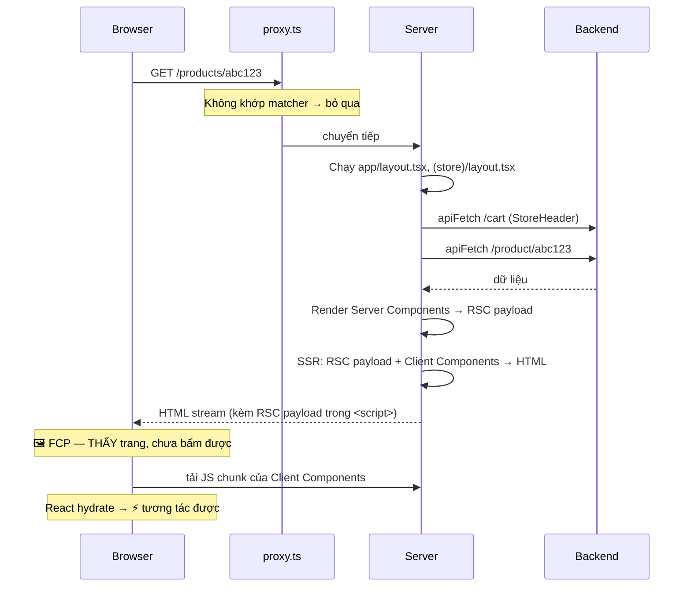

# 13. Render Pipeline & Hydration — một request đi qua những gì

> **Mục tiêu:** vẽ được toàn bộ đường đi từ khi người dùng gõ URL đến khi trang tương tác được,
> hiểu hydration mismatch từ đâu ra, và giải thích được vì sao cách format ngày trong repo này an toàn.

---

## 1. Overview

"Trang này render" trong App Router có thể là **năm** việc khác nhau:

1. **Server render RSC** — chạy Server Component, tạo ra RSC payload (không phải HTML)
2. **Server render HTML (SSR)** — biến RSC payload + Client Component thành HTML
3. **Client hydrate** — gắn event listener và state vào HTML đã có
4. **Client re-render** — sau khi state đổi (React thuần)
5. **Soft navigation** — điều hướng bằng `<Link>`, chỉ lấy RSC payload mới

Không phân biệt được năm bước này thì các câu hỏi như "vì sao `window is not defined`?", "vì sao
hydration mismatch?", "vì sao UI hiện mà bấm chưa được?" trở nên khó trả lời.

---

## 2. Mental Model

### 🧠 "Ảnh chụp" rồi "cắm điện"

**SSR = bức ảnh** chiếc đèn đang bật: thấy ngay, đọc được nhãn, nhưng không bấm được công tắc.
**Hydration = cắm điện:** đèn thật được lắp đúng vị trí bức ảnh, giờ công tắc hoạt động.

Điều kiện then chốt: đèn thật phải **giống hệt** bức ảnh.

> **HTML từ server và lần render đầu tiên ở client phải cho ra kết quả GIỐNG NHAU.**
> Mọi thứ khiến hai bên khác nhau là một hydration mismatch.

### 🧠 RSC payload không phải HTML

Server Component render ra một **định dạng mô tả cây UI** (Flight), đại khái (đã giản lược):

```
0:["$","div",null,{"className":"space-y-6","children":[
    ["$","h1",null,{"children":"All products"}],
    ["$","$L1",null,{"items":[{"_id":"abc","product_name":"Áo thun"}]}]
  ]}]
1:I["./components/store/product-grid.tsx",["chunk-a1b2"],"ProductGrid"]
```

- **Element đã render xong** (`"div"`, `"h1"`) — chỉ là dữ liệu, không cần JS
- **Tham chiếu tới Client Component** (`$L1` → `I[...]`) — "tải chunk `chunk-a1b2`, render
  `ProductGrid` với props này". Props phải serialize được — đó là lý do không truyền function thường
  từ Server xuống Client Component.

Đây là thứ được gửi khi **soft navigate**: chỉ cây UI, React merge vào cây hiện tại mà **không mất
state của Client Component**.

---

## 3. How It Works — luồng đầy đủ

### 3.1 Lần tải đầu tiên (hard navigation)



View Source sẽ thấy `<script>self.__next_f.push(...)</script>` ở cuối trang — đó là RSC payload.
Cần cả hai vì: **HTML** để browser vẽ ngay; **RSC payload** để React dựng lại cây component thật khi
hydrate và cho các lần navigate sau.

### 3.2 Điều hướng bằng `<Link>` (soft navigation)

Next 16 prefetch khi `<Link>` vào viewport (production), nhưng **mức prefetch phụ thuộc route**:

| Route | Prefetch | Khi bấm |
| --- | --- | --- |
| Static | Toàn bộ payload | Gần như tức thì |
| Dynamic **có** `loading.tsx` | Layout dùng chung + skeleton | Hiện skeleton ngay, stream nội dung sau |
| Dynamic **không có** `loading.tsx` | **Bỏ qua** | Chờ server trả lời rồi mới đổi trang |

📄 Mọi trang store/seller của repo đều dynamic (layout đọc cookie để vẽ header/giỏ hàng) và repo
**chưa có `loading.tsx` nào** → rơi vào dòng cuối: bấm link, trang cũ đứng yên tới khi server trả lời.
Thêm một file là đổi trải nghiệm:

```tsx
// app/(store)/products/[id]/loading.tsx
export default function Loading() {
  return <div className="grid gap-6 md:grid-cols-2"><div className="aspect-square animate-pulse rounded-xl bg-muted" /><div className="h-40 animate-pulse rounded-xl bg-muted" /></div>
}
```

So với hard navigation:

| | Hard (gõ URL / F5) | Soft (`<Link>`) |
| --- | --- | --- |
| Server gửi | HTML + RSC payload | **Chỉ RSC payload** |
| Layout dùng chung | Render lại | **Không** render lại (partial rendering) |
| State Client Component trong layout | Mất | **Giữ nguyên** |
| Hydration | Có | Không (React đã chạy) |

📄 Vì vậy `SellerMobileNav` (nằm trong `app/(seller)/seller/layout.tsx`) giữ state `open` khi chuyển
giữa các trang seller.

### 3.3 Cái gì được hydrate

```
app/(store)/products/[id]/page.tsx       ← Server Component: KHÔNG hydrate, 0 byte JS
 ├── <h1>, <p>, <dl>                      ← HTML thuần (breadcrumb, Specifications)
 ├── <ProductPurchase>      'use client'  ← ✅ hydrate (gallery + chọn biến thể + AddToCart)
 └── <CommentSection>       'use client'  ← ✅ hydrate toàn bộ (167 dòng)
      ├── <form> viết comment
      └── <CommentItem>                   ← hydrate dù chủ yếu hiển thị text
           ├── <ReplyControl> / <DeleteButton>   ← phần thật sự cần tương tác
```

Vì `CommentSection` là `'use client'`, **mọi** comment đều hydrate — 50 comment là 50 × (tên, ngày,
nội dung, nút) node — chỉ vì một state reply ở cấp section. Đó là cái giá của `'use client'` đặt quá
cao (chương 08). Cách tách:

```tsx
// ✅ CommentItem là Server Component; chỉ nút Reply là client
<ul>
  {comments.map((c) => (
    <li key={c._id}>
      <p>{c.content}</p>                   {/* HTML tĩnh */}
      <ReplyButton commentId={c._id} />    {/* 'use client' — đảo nhỏ */}
    </li>
  ))}
</ul>
```

---

## 4. ⭐ Hydration Mismatch — nguyên nhân và cách phòng

Hydration mismatch: **HTML server gửi** khác **kết quả render đầu tiên ở client**. Ở React 19, React
báo **một** lỗi kèm diff chỉ rõ node lệch (dev), rồi **bỏ HTML server của đoạn đó và render lại từ
client** tới Suspense boundary gần nhất — mất lợi ích SSR ở đoạn đó, có thể nháy UI.

React 18 in nhiều cảnh báo rời rạc ("Text content did not match…"); React 19 gộp thành một lỗi có diff
kiểu này (dev):

```
Uncaught Error: Hydration failed because the server rendered text didn't match the client.
  <OrderCard>
    <span>
+     Đặt lúc 10:00:01
-     Đặt lúc 10:00:00
```

Đọc diff: `+` là client, `-` là server — tìm component ở đầu diff là biết chỗ sửa.

| Nguyên nhân | Ví dụ | Vì sao lệch |
| --- | --- | --- |
| **Thời gian hiện tại** | `new Date().toLocaleTimeString()` | Server 10:00:00, client hydrate 10:00:01 |
| **Ngẫu nhiên** | `Math.random()`, `crypto.randomUUID()` trong render | Hai giá trị khác nhau (dùng `useId` cho id) |
| **Locale / timezone** | `date.toLocaleDateString()` | Server UTC, browser `Asia/Ho_Chi_Minh` |
| **Browser API trong render** | `window.innerWidth`, `localStorage.getItem()` | Server không có `window` |
| **`typeof window` trong render** | `typeof window !== 'undefined' ? A : B` | Server → B, client → A |
| **HTML không hợp lệ** | `<div>` trong `<p>` | Browser **tự sửa** DOM → khác cây React |
| **Extension browser** | Grammarly, Google Translate | Sửa DOM trước khi React hydrate |

### 📄 Vì sao cách format ngày của repo AN TOÀN

`lib/orders/display.ts` (`formatOrderDate`), `components/store/comment-section.tsx` và
`components/discounts/discount-list.tsx` đều dùng cùng một cách:

```tsx
export function formatOrderDate(s?: string): string {
  if (!s) return ''
  const d = new Date(s)
  return Number.isNaN(d.getTime()) ? '' : d.toISOString().slice(0, 10)
}
```

1. **Input là chuỗi ISO từ server**, không phải `new Date()` (thời gian hiện tại).
2. **`toISOString()` LUÔN là UTC** — không phụ thuộc timezone môi trường:
   ```js
   const d = new Date('2026-07-16T23:30:00Z')
   d.toISOString()          // '2026-07-16T23:30:00.000Z' — giống nhau ở mọi máy ✅
   d.toLocaleDateString()   // '7/16/2026' (US) vs '17/7/2026' (VN, UTC+7) ❌
   d.getDate()              // 16 trên server UTC, 17 trên browser VN ❌
   ```
3. **Input xấu xử lý xác định** — cả hai bên đều ra `''`.

```tsx
// ❌ HYDRATION MISMATCH: server (UTC) ra '16/7/2026', browser VN ra '17/7/2026' cho đơn lúc 23:30 UTC
const formatDate = (s: string) => new Date(s).toLocaleDateString('vi-VN')
```

⚠️ Đánh đổi: hiển thị ngày theo UTC — đơn đặt 01:00 sáng giờ VN sẽ hiện ngày hôm trước.

### Hiển thị ngày theo locale mà KHÔNG mismatch

**(a) Chốt cả `locale` và `timeZone`** — kết quả xác định ở mọi môi trường. Tốt nhất khi người dùng ở
một múi giờ:

```tsx
const vnDate = new Intl.DateTimeFormat('vi-VN', {
  timeZone: 'Asia/Ho_Chi_Minh',      // ← CỐ ĐỊNH, không dùng timezone của môi trường
  day: '2-digit', month: '2-digit', year: 'numeric',
})
export const formatOrderDateVN = (s: string) => vnDate.format(new Date(s))   // '17/07/2026'
```

**(b) Render giá trị xác định trước, đổi sang local sau khi hydrate** — khi cần múi giờ của *chính*
người dùng:

```tsx
'use client'
export function LocalDate({ iso }: { iso: string }) {
  const [text, setText] = useState(() => iso.slice(0, 10))   // server & client lần đầu: giống nhau
  useEffect(() => {
    setText(new Date(iso).toLocaleDateString(undefined, { dateStyle: 'medium' }))
  }, [iso])
  return <time dateTime={iso}>{text}</time>
}
```

**(c) `suppressHydrationWarning`** — chỉ im lặng cảnh báo, **không sửa** gì, và chỉ có tác dụng **một
cấp** (text/attribute của chính element đó). Ca hợp lệ điển hình: `<html suppressHydrationWarning>`
khi script theme (`next-themes`) đổi class trước hydrate.

```tsx
// ✅ Text con trực tiếp của <time> — được bỏ qua (client giữ text của server, không vá lại)
<time dateTime={iso} suppressHydrationWarning>{new Date(iso).toLocaleDateString()}</time>

// ❌ Không lan xuống con cháu — <span> bên trong vẫn báo mismatch
<div suppressHydrationWarning>
  <span>{new Date(iso).toLocaleDateString()}</span>
</div>
```

### `typeof window` trong render

```tsx
// ❌ server → 'server', client → 'client'
const label = typeof window !== 'undefined' ? 'client' : 'server'

// ✅ render đầu giống nhau, đổi sau khi mount
const [mounted, setMounted] = useState(false)
useEffect(() => setMounted(true), [])
return <div>{mounted ? 'client' : 'server'}</div>
```

Với giá trị từ external store (online status, media query), `useSyncExternalStore(subscribe,
getSnapshot, getServerSnapshot)` là cách chuẩn — `getServerSnapshot` quyết định giá trị dùng lúc
SSR **và** lúc hydrate.

### HTML không hợp lệ — nguyên nhân âm thầm nhất

```tsx
// ❌ <p> không được chứa <div>. Browser đóng <p> sớm và đẩy <div> ra ngoài.
<p>Giá: <div className="price">100.000đ</div></p>
// DOM thật: <p>Giá: </p><div class="price">100.000đ</div><p></p>  → MISMATCH
```

Các cặp hay sai: `<div>` trong `<p>`, `<p>` trong `<p>`, `<a>` trong `<a>`, `<tr>` thiếu `<tbody>`.

📄 `products/[id]/page.tsx` (bảng Specifications) dùng `<dl>` đúng cách:

```tsx
<dl className="overflow-hidden rounded-xl border text-sm">
  {Object.entries(attrs).map(([k, v]) => (
    <div key={k} className="grid grid-cols-2 gap-2 px-3 py-2 odd:bg-muted/60">
      <dt className="text-muted-foreground capitalize">{k}</dt>
      <dd>{String(v)}</dd>
    </div>
  ))}
</dl>
```

HTML cho phép `<dl>` chứa các nhóm `<div>` bọc `<dt>/<dd>` — hợp lệ, có chỗ gắn `key`, và mỗi `<div>`
thành một hàng grid. Thay `<div>` bằng `<li>` hay `<p>` là HTML sai.

### Extension của browser

React 19 bỏ qua các thẻ lạ do script/extension chèn vào `<head>`/`<body>`, nên ít lỗi hơn trước. Mismatch
chỉ xảy ra trên máy một người dùng → nhờ họ thử cửa sổ ẩn danh/tắt extension trước khi tìm bug.

---

## 5. ⚠️ Vấn đề hiệu năng lớn nhất của repo: `` thay vì `<Image>`

Repo dùng `` thô ở **10 file**, mỗi lần kèm `{/* eslint-disable-next-line @next/next/no-img-element */}`.
Mười lần tắt cùng một rule là dấu hiệu nên xem lại quyết định.

| Vấn đề của `` thô | Hệ quả |
| --- | --- |
| Không `width`/`height` | Layout nhảy khi ảnh tải xong → CLS xấu |
| Không đổi định dạng | Gửi JPEG/PNG gốc thay vì WebP/AVIF |
| Không responsive | Mobile 375px tải ảnh 1200px |
| Không lazy loading mặc định | 12 ảnh danh mục tải cùng lúc, tranh băng thông với JS/CSS |
| Ảnh LCP không được ưu tiên | Ảnh sản phẩm chính tải muộn → LCP chậm |

Với e-commerce, ảnh sản phẩm **là** LCP element.

### Cách sửa

**Bước 1 — khai báo host ảnh** (bắt buộc; Next từ chối tối ưu ảnh từ host lạ để API tối ưu ảnh của bạn
không thành proxy miễn phí cho người khác):

```ts
// next.config.ts
images: {
  remotePatterns: [{ protocol: 'https', hostname: 'res.cloudinary.com', pathname: '/**' }],
},
```

**Bước 2 — ảnh trong grid** (`product-card.tsx`):

```tsx
<div className="relative aspect-square w-full">
  <Image
    src={product.product_thumb}
    alt={product.product_name}
    fill
    sizes="(max-width: 640px) 50vw, (max-width: 1024px) 33vw, 25vw"
    className="object-cover"
  />
</div>
```

**`sizes` là prop quan trọng nhất** — nói với browser ảnh rộng bao nhiêu ở mỗi màn hình để chọn đúng
biến thể trong `srcset`. Đối chiếu với `product-grid.tsx` (`grid-cols-2 sm:grid-cols-3 lg:grid-cols-4`):
< 640px 2 cột → `50vw`; 640–1024px 3 cột → `33vw`; > 1024px 4 cột → `25vw`. Bỏ `sizes` với `fill` thì
mặc định `100vw` → tải ảnh to gấp ~4 lần.

**Ảnh LCP của trang chi tiết** — Next 16 **deprecate `priority`**, thay bằng `preload`; docs khuyên
phần lớn trường hợp dùng `loading="eager"` hoặc `fetchPriority="high"`:

```tsx
// ❌ Next ≤ 15
<Image src={img.url} alt={name} fill priority />

// ✅ Next 16
<Image src={img.url} alt={name} fill sizes="(max-width: 768px) 100vw, 50vw" fetchPriority="high" loading="eager" />
```

Chỉ dành cho 1 ảnh above-the-fold — đánh dấu mọi ảnh là ưu tiên thì không ảnh nào được ưu tiên.

**Ảnh nhỏ kích thước cố định** (thumbnail `order-card.tsx`, `cart-line.tsx`):

```tsx
<Image src={p.thumb} alt="" width={40} height={40} className="rounded border object-cover" />
```

### `alt=""` — chi tiết accessibility

📄 `product-list.tsx` dùng `alt=""` đúng: tên sản phẩm đã ở ngay cạnh, `alt` thật sẽ khiến screen reader
đọc tên **hai lần**. `alt=""` (rỗng, không phải thiếu) = "ảnh trang trí, bỏ qua". Ngược lại, ảnh trong
`product-card.tsx` là nội dung chính → cần `alt` thật. Gallery trong `edit-product-form.tsx` dùng
`alt=""` mà không có text nào bên cạnh → nên là ``alt={`Ảnh sản phẩm ${i + 1}`}``.

---

## 6. Streaming và HTTP status

Với `<Suspense>`, HTML **không** đến theo thứ tự JSX:

```
1. Shell + fallback (đúng vị trí)
2. Nội dung thật ở CUỐI tài liệu, trong phần tử ẩn
3. <script> inline nhỏ để chuyển nó vào chỗ và xoá fallback
```

**(a)** Không cần bundle React đã tải — script chuyển chỗ là inline, chạy ngay khi parse tới.

**(b)** Byte đầu đã gửi với `200` thì **không đổi status được nữa**. Nếu `notFound()` chạy giữa stream,
Next chèn `<meta name="robots" content="noindex">` (status vẫn 200); `redirect()` giữa stream thành
redirect phía client. Muốn có 404/307 thật, gọi chúng **trước** khi có gì suspend:

```tsx
export default async function ProductPage({ params }: PageProps<'/products/[id]'>) {
  const { id } = await params
  const product = await getProduct(id)       // await ở đầu page, ngoài mọi Suspense
  if (!product) notFound()                   // ✅ 404 thật
  return (
    <>
      <ProductInfo product={product} />
      <Suspense fallback={<CommentsSkeleton />}>
        <Comments productId={id} />          {/* phần chậm stream sau */}
      </Suspense>
    </>
  )
}
```

📄 Repo hiện ở `products/[id]/page.tsx` bắt lỗi rồi `return` một khối "Could not load the product" →
sản phẩm không tồn tại vẫn trả **200** và có thể bị index. Phân biệt 404 của backend để gọi `notFound()`.

⚠️ Có `loading.tsx` ở segment thì page đã nằm trong Suspense — `notFound()` trong page khi đó là
"giữa stream".

---

## 7. Đo lường

| Chỉ số | Nghĩa | Ảnh hưởng bởi |
| --- | --- | --- |
| **TTFB** | Byte đầu tiên | Backend, cache, proxy |
| **FCP** | Nội dung đầu tiên | TTFB + HTML + CSS chặn render |
| **LCP** ⭐ | Nội dung *lớn nhất* (thường là ảnh) | Tối ưu ảnh, ưu tiên ảnh LCP |
| **CLS** ⭐ | Layout nhảy | `width`/`height` ảnh, skeleton khớp kích thước |
| **INP** ⭐ | Độ phản hồi khi tương tác | Kích thước JS, hydration, việc nặng trong handler |

⭐ = Core Web Vitals. (TTI đã bị Lighthouse bỏ từ v10; INP thay FID từ 2024.)

Ưu tiên cho repo: (1) `next/image` → LCP + CLS; (2) `loading.tsx` → phản hồi khi navigate;
(3) cache có tag cho danh mục công khai → TTFB (chương 10).

```bash
pnpm build && pnpm start      # rồi Chrome DevTools → Lighthouse
```

⚠️ **Không đo ở `pnpm dev`** — không minify, có StrictMode double-invoke, dev overlay. Con số không liên
quan tới production.

---

## 8. Trade-offs

| Lợi ích của SSR + Hydration | Cái giá |
| --- | --- |
| FCP nhanh, SEO đọc được HTML thật | Khoảng "thấy nhưng chưa bấm được" |
| Chạy được khi JS chậm/lỗi (nếu có progressive enhancement) | Server/client phải render giống nhau |
| Streaming theo từng phần | Không đổi HTTP status sau khi stream bắt đầu |
| RSC payload nhỏ cho soft navigation | Thêm một định dạng phải hiểu khi debug |

---

## 9. Best Practices

1. **Không dùng giá trị không xác định trong render:** `new Date()` hiện tại, `Math.random()`,
   `window.*`, `localStorage.*`, `toLocale*()` không chốt timezone.
2. **Cần locale → chốt cả `locale` và `timeZone`** trong `Intl.DateTimeFormat`.
3. **Giá trị chỉ có ở client → render sau khi mount** hoặc `useSyncExternalStore` với `getServerSnapshot`.
4. **`suppressHydrationWarning` chỉ cho khác biệt cố ý**, không để "làm im" bug.
5. **HTML hợp lệ** — `<div>` trong `<p>` gây mismatch âm thầm.
6. **`next/image`** với `sizes` khớp grid; ảnh LCP dùng `fetchPriority="high"`/`preload`, không dùng `priority`.
7. **Thêm `loading.tsx`** cho route dynamic để có prefetch một phần và phản hồi tức thì.
8. **Gọi `notFound()`/`redirect()` trước khi stream** nếu cần status thật.
9. **Giữ client tree nhỏ** — tách `CommentSection` để chỉ phần tương tác hydrate.

---

## Tự kiểm tra

1. Kể năm loại "render" trong App Router.
2. RSC payload khác HTML ở điểm nào? Vì sao lần tải đầu cần cả hai?
3. Vì sao bấm `<Link>` sang trang sản phẩm của repo không tức thì? Thêm gì để cải thiện?
4. Vì sao `toISOString().slice(0, 10)` an toàn còn `toLocaleDateString()` thì không?
5. Ba cách hiển thị ngày theo locale mà không mismatch?
6. Vì sao `<div>` trong `<p>` gây mismatch dù trang trông vẫn ổn?
7. `sizes` làm gì? Next 16 thay `priority` bằng gì?
8. `notFound()` gọi giữa stream thì chuyện gì xảy ra?

➡️ Tiếp theo: `14-kien-truc-testing-checklist.md`
