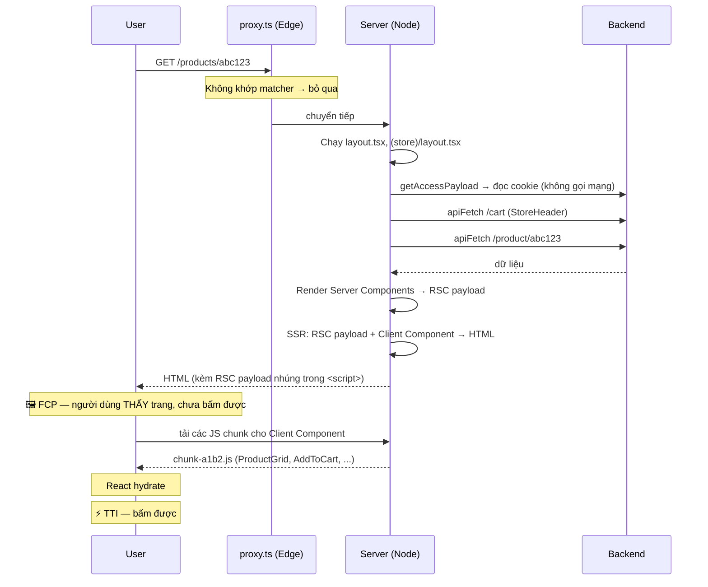
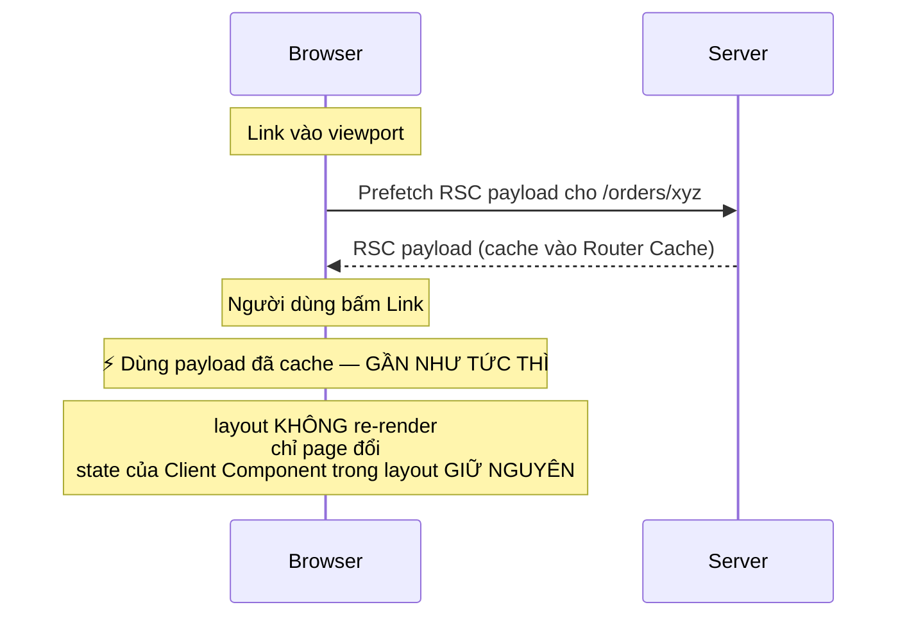

# 13. Render Pipeline & Hydration — một request đi qua những gì

> **Mục tiêu:** vẽ được toàn bộ đường đi từ khi người dùng gõ URL đến khi trang tương tác được,
> hiểu hydration mismatch từ đâu ra, và giải thích được vì sao cách format ngày trong repo này an toàn.

---

## 1. Overview

### Vấn đề: "render" trong App Router không phải một bước

Khi bạn nói "trang này render", điều đó có thể là **năm** việc khác nhau:

1. **Server render RSC** — chạy Server Component, tạo ra RSC payload (không phải HTML)
2. **Server render HTML** — biến RSC payload + Client Component thành HTML để gửi xuống
3. **Client hydrate** — gắn event listener và state vào HTML đã có
4. **Client render** — re-render sau khi state đổi (React thuần)
5. **Soft navigation** — điều hướng bằng `<Link>`, chỉ lấy RSC payload mới

Không phân biệt được năm bước này là lý do các câu hỏi kiểu "vì sao `window is not defined`?",
"vì sao hydration mismatch?", "vì sao `useEffect` chưa chạy mà UI đã hiện?" trở nên khó trả lời.

---

## 2. Mental Model

### 🧠 Hai giai đoạn: "ảnh chụp" rồi "cắm điện"

Hình dung bạn nhận một chiếc đèn bàn qua đường bưu điện:

**Giai đoạn 1 — Ảnh chụp (SSR):** Bạn nhận được một **bức ảnh** của chiếc đèn đang bật. Bạn thấy nó
ngay lập tức, biết nó trông thế nào, đọc được nhãn trên nó. Nhưng **không bấm được công tắc** —
đó chỉ là ảnh.

**Giai đoạn 2 — Cắm điện (Hydration):** Chiếc đèn thật được lắp vào đúng vị trí bức ảnh, và dây điện
được cắm. Giờ công tắc hoạt động.

**Điều kiện then chốt của giai đoạn 2:** chiếc đèn thật phải **giống hệt** bức ảnh. Nếu ảnh chụp đèn
màu đỏ mà đèn thật màu xanh, React không biết phải làm gì — và đó chính là **hydration mismatch**.

Từ hình ảnh này suy ra một quy tắc quan trọng:

> **HTML từ server và lần render đầu tiên ở client phải cho ra kết quả GIỐNG NHAU.**
> Mọi thứ khiến hai bên khác nhau là một hydration mismatch.

### 🧠 RSC payload không phải HTML

Đây là điểm mọi người bỏ qua. Server Component không render ra HTML — nó render ra một
**định dạng mô tả cây UI** (RSC payload), trông đại khái như:

```
0:["$","div",null,{"className":"space-y-6","children":[
    ["$","h1",null,{"className":"text-2xl font-semibold","children":"All products"}],
    ["$","$L1",null,{"items":[{"_id":"abc","product_name":"Áo thun"}]}]
  ]}]
1:I["./components/store/product-grid.tsx",["chunk-a1b2"],"ProductGrid"]
```

Hai loại entry:

- **Element đã render xong** (`"div"`, `"h1"`) — chỉ là dữ liệu, không cần JS
- **Con trỏ tới Client Component** (`$L1` → `I[...]`) — nói cho client biết: "chỗ này cần tải chunk
  `chunk-a1b2` và render component `ProductGrid` với props này"

**Vì sao định dạng này quan trọng?** Vì nó là thứ được gửi khi bạn **soft navigate**. Không phải HTML
cả trang — chỉ là cây UI đã thay đổi. Nhỏ hơn nhiều, và React biết cách merge nó vào cây hiện tại mà
**không mất state của Client Component**.

---

## 3. How It Works — luồng đầy đủ

### 3.1 Lần tải đầu tiên (hard navigation)



**Chi tiết quan trọng: HTML được gửi kèm RSC payload.** Bạn có thể thấy nó nếu View Source: những
`<script>self.__next_f.push(...)</script>` ở cuối trang. Vì sao cần cả hai?

- **HTML** để browser vẽ ngay (FCP nhanh)
- **RSC payload** để React biết cây component *thật* trông thế nào, phục vụ hydration và các lần
  navigate sau

### 3.2 Điều hướng bằng `<Link>` (soft navigation)



**Sự khác biệt cốt lõi so với hard navigation:**

| | Hard navigation (gõ URL / F5) | Soft navigation (`<Link>`) |
| --- | --- | --- |
| Server gửi gì | HTML đầy đủ + RSC payload | **Chỉ RSC payload** của phần đổi |
| Layout | Render lại từ đầu | **Không** render lại |
| State Client Component ở layout | Mất | **Giữ nguyên** |
| Hydration | Có | Không (React đã sống) |
| Kích thước | ~50–200KB | ~2–20KB |

📄 Đây là lý do `SellerMobileNav` giữ được state `open` khi bạn navigate giữa các trang seller — nó
nằm trong `app/(seller)/seller/layout.tsx`, và layout không bị thay thế.

### 3.3 Cái gì được hydrate và cái gì không

```
app/(store)/products/[id]/page.tsx        ← Server Component: KHÔNG hydrate, chỉ là HTML
 ├── , <h1>, <p>, <dl>                ← HTML thuần, 0 byte JS
 ├── <AddToCart>            'use client'    ← ✅ HYDRATE
 │    ├── <form action={formAction}>
 │    ├── <Input>                           ← hydrate (là con của client tree)
 │    └── <SubmitButton>                    ← hydrate
 └── <CommentSection>       'use client'    ← ✅ HYDRATE (toàn bộ 164 dòng)
      ├── <CommentForm>
      ├── <CommentItem>                     ← hydrate dù chỉ hiển thị text
      └── <ReplyControl>
```

**Quan sát đáng chú ý:** vì `CommentSection` là `'use client'`, **toàn bộ** cây comment được hydrate —
kể cả `CommentItem` chỉ render text tĩnh. Đó chính là cái giá của việc đặt `'use client'` ở cấp cao
đã phân tích ở file `08`.

Cụ thể hơn: với một sản phẩm có 50 comment, React phải hydrate 50 × (tên, ngày, nội dung, nút) node —
tất cả chỉ vì `replyOpen` cần state ở cấp section.

---

## 4. ⭐ Hydration Mismatch — nguyên nhân và cách phòng

### Định nghĩa chính xác

Hydration mismatch xảy ra khi **HTML server gửi xuống** khác với **kết quả render đầu tiên ở client**.

React sẽ:
- In cảnh báo trong console (dev)
- Có thể **bỏ HTML từ server và render lại toàn bộ từ client** — mất hết lợi ích SSR

### Bảng nguyên nhân

| Nguyên nhân | Ví dụ | Vì sao mismatch |
| --- | --- | --- |
| **Thời gian hiện tại** | `new Date().toLocaleTimeString()` | Server render lúc 10:00:00, client hydrate lúc 10:00:01 |
| **Ngẫu nhiên** | `Math.random()`, `crypto.randomUUID()` | Hai giá trị khác nhau |
| **Locale / timezone** | `date.toLocaleDateString()` | Server ở UTC, browser ở `Asia/Ho_Chi_Minh` |
| **Browser API trong render** | `window.innerWidth`, `localStorage.getItem()` | Server không có `window` |
| **`typeof window` check trong render** | `typeof window !== 'undefined' ? A : B` | Server → B, client → A |
| **HTML không hợp lệ** | `<div>` trong `<p>`, `<p>` trong `<p>` | Browser **tự sửa** cấu trúc DOM → khác cây của React |
| **Extension của browser** | Grammarly, dịch tự động | Chúng sửa DOM trước khi React hydrate |
| **Nội dung phụ thuộc user-agent** | `isMobile ? <A/> : <B/>` từ UA | UA parsing có thể khác |

### 📄 Vì sao cách format ngày của repo này AN TOÀN

Repo format ngày ở ba chỗ, tất cả dùng cùng một cách:

📄 `lib/orders/display.ts`:

```tsx
// Formats an ISO date string as YYYY-MM-DD (the app's existing convention).
export function formatOrderDate(s?: string): string {
  if (!s) return ''
  const d = new Date(s)
  return Number.isNaN(d.getTime()) ? '' : d.toISOString().slice(0, 10)
}
```

📄 `components/store/comment-section.tsx` (một Client Component):

```tsx
function formatDate(s?: string): string {
  if (!s) return ''
  const d = new Date(s)
  return Number.isNaN(d.getTime()) ? '' : d.toISOString().slice(0, 10)
}
```

📄 `components/discounts/discount-list.tsx`:

```tsx
function formatDate(s: string): string {
  const d = new Date(s)
  return Number.isNaN(d.getTime()) ? s : d.toISOString().slice(0, 10)
}
```

**Ba lý do khiến cách này hydration-safe:**

1. **Input là một chuỗi ISO cố định từ server**, không phải `new Date()` (thời gian hiện tại).
   `new Date('2026-07-16T10:30:00Z')` cho cùng một timestamp ở mọi nơi.

2. **`toISOString()` LUÔN trả về UTC.** Đây là điểm quan trọng nhất. Nó **không** phụ thuộc timezone
   của môi trường:

   ```js
   const d = new Date('2026-07-16T10:30:00Z')
   d.toISOString()             // '2026-07-16T10:30:00.000Z' — GIỐNG NHAU ở mọi máy
   d.toLocaleDateString()      // '7/16/2026' ở US, '16/07/2026' ở VN — KHÁC NHAU ❌
   d.getDate()                 // 16 ở UTC/VN, có thể là 15 ở Hawaii ❌
   ```

3. **`Number.isNaN(d.getTime())` xử lý input xấu một cách xác định.** Nếu backend trả chuỗi ngày lạ,
   cả server và client đều cho ra `''` (hoặc `s` ở `discount-list`) — vẫn khớp nhau.

**Nếu tác giả dùng cách "đẹp hơn cho người Việt":**

```tsx
// ❌ HYDRATION MISMATCH
function formatDate(s: string): string {
  return new Date(s).toLocaleDateString('vi-VN')
}
```

Server (thường chạy UTC) → `'16/7/2026'`. Browser ở `Asia/Ho_Chi_Minh` (UTC+7) → có thể là
`'16/7/2026'` hoặc `'17/7/2026'` tuỳ giờ. Với một order tạo lúc 23:30 UTC, hai bên **chắc chắn** khác nhau.

### Cách hiển thị ngày theo locale mà KHÔNG mismatch

Nếu bạn muốn `'16/07/2026'` thay vì `'2026-07-16'`, có ba cách đúng:

**(a) Format trên server, gửi string đã format xuống** — đơn giản nhất:

```tsx
// lib/orders/display.ts — chạy trên server, timezone do server quyết định
export function formatOrderDateVN(s?: string): string {
  if (!s) return ''
  const d = new Date(s)
  if (Number.isNaN(d.getTime())) return ''
  return new Intl.DateTimeFormat('vi-VN', {
    timeZone: 'Asia/Ho_Chi_Minh',      // ← CỐ ĐỊNH timezone, không dùng của môi trường
    day: '2-digit',
    month: '2-digit',
    year: 'numeric',
  }).format(d)
}
```

Chốt cả `locale` **và** `timeZone` → kết quả xác định ở mọi môi trường. Đây là cách tốt nhất khi
người dùng của bạn ở một timezone.

**(b) `<time>` + format ở client sau khi mount** — khi cần timezone của *chính người dùng*:

```tsx
'use client'
import { useState, useEffect } from 'react'

export function LocalDate({ iso }: { iso: string }) {
  // Render đầu tiên (server VÀ client) đều dùng ISO → KHỚP
  const [text, setText] = useState(() => iso.slice(0, 10))

  useEffect(() => {
    // Sau khi hydrate xong mới đổi sang định dạng local
    setText(new Date(iso).toLocaleDateString(undefined, { dateStyle: 'medium' }))
  }, [iso])

  return <time dateTime={iso}>{text}</time>
}
```

Mấu chốt: render đầu **phải** dùng giá trị xác định. Việc đổi sang locale xảy ra trong `useEffect` —
sau hydration, nên không có mismatch. `<time dateTime>` giúp screen reader và crawler đọc được giá trị
máy đọc được.

**(c) `suppressHydrationWarning`** — chỉ dùng khi bạn *biết chắc* sự khác biệt là cố ý:

```tsx
<time dateTime={iso} suppressHydrationWarning>
  {new Date(iso).toLocaleDateString()}
</time>
```

⚠️ Đây là **cây búa**, không phải giải pháp. Nó chỉ **im lặng cảnh báo**, không sửa mismatch. Chỉ có
hai trường hợp dùng chính đáng:

1. **Theme (như `next-themes`)** — script chạy trước hydration cố tình đổi class trên `<html>`:
   ```tsx
   <html lang="en" suppressHydrationWarning>
   ```
2. **Nội dung mà bạn chấp nhận khác nhau** và không ảnh hưởng cấu trúc DOM.

Và nó **chỉ áp dụng cho một cấp** — không lan xuống con.

---

## 5. Các nguồn mismatch khác — và cách phòng

### `typeof window` trong render

```tsx
// ❌ SAI: server → 'server', client → 'client'
function Widget() {
  const label = typeof window !== 'undefined' ? 'client' : 'server'
  return <div>{label}</div>
}

// ✅ ĐÚNG: render đầu giống nhau, đổi sau khi mount
function Widget() {
  const [mounted, setMounted] = useState(false)
  useEffect(() => setMounted(true), [])
  return <div>{mounted ? 'client' : 'server'}</div>
}
```

### HTML không hợp lệ — nguyên nhân âm thầm nhất

Browser **tự sửa** HTML sai. React thì không biết điều đó xảy ra:

```tsx
// ❌ <p> không được chứa <div>. Browser sẽ ĐÓNG <p> lại và đẩy <div> ra ngoài.
<p>
  Giá: <div className="price">100.000đ</div>
</p>
// HTML thật trong DOM: <p>Giá: </p><div class="price">100.000đ</div><p></p>
// React mong đợi: <p>Giá: <div>...</div></p>
// → MISMATCH
```

Các cặp thường sai: `<div>` trong `<p>`, `<p>` trong `<p>`, `<div>` trong `<span>` (hợp lệ về HTML
nhưng thường ngoài ý định), `<tr>` không nằm trong `<tbody>`/`<thead>`.

📄 Repo dùng `<dl>`/`<dt>`/`<dd>` đúng cách trong `products/[id]/page.tsx`:

```tsx
<dl className="grid grid-cols-2 gap-1 text-sm">
  {Object.entries(attrs).map(([k, v]) => (
    <div key={k} className="contents">
      <dt className="text-muted-foreground capitalize">{k}</dt>
      <dd>{String(v)}</dd>
    </div>
  ))}
</dl>
```

`<div className="contents">` là một kỹ thuật hay: `<dl>` chỉ được chứa `<dt>`/`<dd>` (và các nhóm
`<div>`), nhưng React cần một element để gắn `key`. `display: contents` làm `<div>` **biến mất khỏi
layout** nên grid vẫn xếp `<dt>`/`<dd>` như con trực tiếp. HTML hợp lệ, layout đúng, key đúng.

### Extension của browser

Grammarly, Google Translate, các extension password manager sửa DOM **trước khi** React hydrate.
Bạn không kiểm soát được điều này. React 19 đã cải thiện nhiều: nó thường **hồi phục** thay vì phá cả
trang, và message lỗi chỉ rõ node nào lệch.

Nếu bạn thấy mismatch chỉ xảy ra trên máy một người dùng cụ thể, hãy hỏi họ tắt extension trước khi
đi tìm bug trong code.

---

## 6. ⚠️ Vấn đề hiệu năng lớn nhất của repo: `` thay vì `<Image>`

Repo dùng `` thô ở **9 file**, mỗi lần đều kèm:

```tsx
{/* eslint-disable-next-line @next/next/no-img-element */}

```

Chín lần tắt cùng một rule là dấu hiệu rõ ràng của một quyết định nên được xem lại.

### Cái giá cụ thể

📄 `components/store/product-card.tsx` — trên trang danh mục có 12 sản phẩm:

```tsx

```

| Vấn đề | Hệ quả đo được |
| --- | --- |
| Không có `width`/`height` | Browser không biết chỗ dành cho ảnh → **layout nhảy khi ảnh tải xong** → CLS xấu |
| Không tối ưu định dạng | Gửi JPEG/PNG gốc thay vì WebP/AVIF → nặng hơn 25–50% |
| Không responsive | Mobile 375px tải ảnh 1200px → tốn băng thông ~10× |
| Không lazy loading | 12 ảnh tải cùng lúc → cạnh tranh băng thông với JS/CSS quan trọng |
| Không có blur placeholder | Ô trắng rồi ảnh xuất hiện đột ngột |
| LCP không được ưu tiên | Ảnh sản phẩm chính (LCP element) không được `priority` → LCP chậm |

Với một e-commerce, ảnh sản phẩm **là** LCP element. Đây là chỉ số Core Web Vitals ảnh hưởng trực tiếp
tới xếp hạng tìm kiếm và tỷ lệ chuyển đổi.

### Cách sửa

**Bước 1 — cấu hình host ảnh** trong `next.config.ts`:

```tsx
import type { NextConfig } from "next";

const nextConfig: NextConfig = {
  turbopack: {
    root: import.meta.dirname,
  },
  images: {
    remotePatterns: [
      {
        protocol: 'https',
        hostname: 'res.cloudinary.com',    // ← đổi thành host thật của bạn
        pathname: '/**',
      },
    ],
  },
};

export default nextConfig;
```

`remotePatterns` là **bắt buộc** — Next.js từ chối tối ưu ảnh từ host chưa khai báo, để bạn không
biến API tối ưu ảnh của mình thành proxy miễn phí cho người khác.

**Bước 2 — thay thế.** Ảnh trong grid (`product-card.tsx`):

```tsx
import Image from 'next/image'

export function ProductCard({ product }: { product: Product }) {
  return (
    <Link href={`/products/${product._id}`} className="group flex flex-col overflow-hidden rounded-lg border transition-colors hover:bg-muted/40">
      <div className="relative aspect-square w-full">
        <Image
          src={product.product_thumb}
          alt={product.product_name}
          fill
          sizes="(max-width: 640px) 50vw, (max-width: 1024px) 33vw, 25vw"
          className="object-cover"
        />
      </div>
      <div className="space-y-1 p-3">
        <p className="line-clamp-1 font-medium">{product.product_name}</p>
        <div className="flex items-center justify-between">
          <span className="text-sm">{toPriceString(product.product_price)}</span>
          <Badge variant="secondary">{product.product_type}</Badge>
        </div>
      </div>
    </Link>
  )
}
```

**`sizes` là prop quan trọng nhất và cũng bị hiểu sai nhiều nhất.** Nó nói với browser: *"ở màn hình
này, ảnh sẽ rộng bao nhiêu"* — để browser chọn đúng biến thể từ `srcset`.

Đọc `sizes` ở trên đối chiếu với grid trong `product-grid.tsx`:

```tsx
<div className="grid grid-cols-2 gap-4 sm:grid-cols-3 lg:grid-cols-4">
```

| Breakpoint | Grid | Ảnh rộng | `sizes` |
| --- | --- | --- | --- |
| < 640px | 2 cột | ~50% viewport | `50vw` |
| 640–1024px | 3 cột | ~33% viewport | `33vw` |
| > 1024px | 4 cột | ~25% viewport | `25vw` |

Nếu `sizes` sai (ví dụ để mặc định `100vw`), browser tải ảnh to gấp 4 lần cần thiết — và bạn mất phần
lớn lợi ích.

**Ảnh chi tiết sản phẩm** — đây là LCP element, cần `priority`:

```tsx
// app/(store)/products/[id]/page.tsx
<div className="grid grid-cols-2 gap-2">
  {gallery.map((img, i) => (
    <div key={img.public_id} className="relative aspect-square w-full">
      <Image
        src={img.url}
        alt={product.product_name}
        fill
        sizes="(max-width: 768px) 50vw, 25vw"
        priority={i === 0}          // ← ảnh đầu là LCP: preload, KHÔNG lazy load
        className="rounded-md border object-cover"
      />
    </div>
  ))}
</div>
```

`priority` chỉ dùng cho **1–2 ảnh above-the-fold**. Đánh `priority` cho mọi ảnh triệt tiêu chính mục
đích của nó (nếu mọi thứ đều ưu tiên thì không có gì được ưu tiên).

**Ảnh nhỏ, kích thước biết trước** (thumbnail trong `order-card.tsx`, `cart-line.tsx`):

```tsx
<Image
  src={p.thumb}
  alt={p.name}
  width={40}
  height={40}
  className="rounded border object-cover"
/>
```

Ở đây dùng `width`/`height` thay vì `fill` — vì kích thước cố định, không cần container `relative`.

### `alt=""` — chi tiết accessibility

📄 Một số chỗ trong repo dùng `alt=""` đúng cách:

```tsx
// product-list.tsx — tên sản phẩm đã ở ngay bên cạnh

<span className="font-medium">{p.product_name}</span>
```

`alt=""` (rỗng, không phải thiếu) nói với screen reader: *"ảnh này chỉ trang trí, bỏ qua đi."* Đây là
lựa chọn **đúng** khi text bên cạnh đã truyền tải thông tin — nếu để `alt={p.product_name}`, screen
reader sẽ đọc tên sản phẩm **hai lần**.

Ngược lại, ảnh trong `product-card.tsx` là nội dung chính của card → cần `alt` thật.

⚠️ Nhưng `edit-product-form.tsx` dùng `alt=""` cho gallery ảnh sản phẩm mà **không** có text mô tả nào
bên cạnh — ở đây `alt` rỗng làm người dùng screen reader không biết có ảnh gì. Nên là
`alt={`Ảnh sản phẩm ${i + 1}`}`.

---

## 7. Streaming và thứ tự HTML

Khi bạn dùng `<Suspense>`, HTML **không** đến theo thứ tự bạn viết trong JSX:

```
1. Server gửi: shell + fallback (đúng vị trí)
2. Server gửi: nội dung thật ở CUỐI tài liệu, trong <template> ẩn
3. Server gửi: <script> nhỏ để di chuyển nó vào chỗ và xoá fallback
```

**Hai hệ quả thực tế:**

**(a) Nó hoạt động mà không cần JS chính của app.** Script di chuyển là inline và cực nhỏ, chạy ngay
khi parse tới. Người dùng thấy nội dung thật kể cả khi bundle React chưa tải xong.

**(b) Bạn không đổi được HTTP status sau khi stream bắt đầu.** Một khi byte đầu đã gửi với status 200,
không thể chuyển thành 404 hay 500. Đây là lý do:

- `notFound()` phải được gọi **trước** khi bắt đầu stream nội dung
- 📄 `app/(store)/checkout/page.tsx` kiểm tra điều kiện sớm là đúng:
  ```tsx
  const items = cart.cart_products ?? []
  if (items.length === 0) {
    return (
      <p className="text-sm text-muted-foreground">
        Your cart is empty. <Link href="/" className="text-primary hover:underline">Browse products</Link>
      </p>
    )
  }
  ```

---

## 8. Đo lường — chỉ số nào quan trọng

| Chỉ số | Nghĩa | Ảnh hưởng bởi |
| --- | --- | --- |
| **TTFB** | Byte đầu tiên | Tốc độ backend, cache, streaming, proxy |
| **FCP** | Thấy nội dung đầu tiên | TTFB + kích thước HTML + CSS blocking |
| **LCP** | Thấy nội dung *lớn nhất* (thường là ảnh) | **Tối ưu ảnh**, priority, preload |
| **CLS** | Layout nhảy | **`width`/`height` cho ảnh**, skeleton khớp kích thước |
| **INP** | Độ phản hồi khi tương tác | Kích thước JS, công việc trong event handler |
| **TTI** | Tương tác được | Kích thước client bundle → hydration |

**Ba việc có ảnh hưởng lớn nhất cho repo này, theo thứ tự:**

1. **`next/image`** → LCP và CLS. Đây là thay đổi đơn lẻ có tác động lớn nhất.
2. **`loading.tsx`** → cảm giác phản hồi khi navigate (không phải chỉ số đo được, nhưng người dùng cảm nhận rõ)
3. **Cache tag cho danh mục công khai** → TTFB (file `10`)

**Cách đo đúng:**

```bash
pnpm build && pnpm start
# Rồi mở Chrome DevTools → Lighthouse → Analyze page load
# Hoặc: npx unlighthouse --site http://localhost:3000
```

⚠️ **Không bao giờ đo ở `pnpm dev`.** Ở dev không có minify, không có tối ưu, có React DevTools hook,
và StrictMode double-invoke. Con số bạn thấy không liên quan gì tới production.

---

## 9. Trade-offs

| Lợi ích của SSR + Hydration | Cái giá |
| --- | --- |
| FCP nhanh — người dùng thấy nội dung trước khi JS tải | Có một khoảng "thấy nhưng chưa bấm được" |
| SEO tốt — crawler đọc được HTML thật | Phải bảo đảm server/client render giống nhau (mismatch) |
| Hoạt động khi JS bị lỗi/chậm/chặn (nếu có progressive enhancement) | Phải chạy render hai lần (server + client hydrate) |
| Streaming: nội dung đến theo từng phần | Không đổi được HTTP status sau khi stream bắt đầu |
| RSC payload nhỏ cho soft navigation | Thêm một định dạng phải hiểu khi debug |

---

## 10. Best Practices

1. **Đừng bao giờ dùng giá trị không xác định trong render.** Danh sách cấm: `new Date()` (thời gian
   hiện tại), `Math.random()`, `window.*`, `localStorage.*`, `toLocaleDateString()` không chốt timezone.

2. **`toISOString()` là hydration-safe; `toLocale*()` thì không.** Nếu cần locale, chốt cả `locale`
   **và** `timeZone` trong `Intl.DateTimeFormat`.

3. **Nếu cần giá trị chỉ có ở client, render nó SAU khi mount.** Pattern `useState` + `useEffect`
   ở mục 5.

4. **`suppressHydrationWarning` chỉ cho khác biệt cố ý.** `<html>` với `next-themes` là ca hợp lệ.
   Đừng dùng nó để "làm im" một mismatch thật.

5. **Kiểm tra HTML hợp lệ.** `<div>` trong `<p>` gây mismatch âm thầm. Kỹ thuật
   `<div className="contents">` trong `products/[id]/page.tsx` là cách xử lý đúng khi cần element để
   gắn `key`.

6. **Chuyển sang `next/image`.** Đây là cải thiện hiệu năng lớn nhất còn lại. Nhớ `sizes` khớp với
   grid thật, và `priority` chỉ cho ảnh LCP.

7. **`alt=""` khi ảnh là trang trí, `alt` thật khi ảnh là nội dung.** Đừng để screen reader đọc trùng.

8. **Luôn đo trên production build.** `pnpm build && pnpm start`, rồi Lighthouse.

9. **Giữ client tree nhỏ để hydration nhanh.** `CommentSection` hydrate 164 dòng cho một cái state
   `replyOpen` — đây là chỗ có thể cải thiện (file `08`).

---

## Tự kiểm tra

1. Kể năm loại "render" khác nhau trong App Router.
2. RSC payload khác HTML ở điểm nào? Vì sao cần cả hai trong lần tải đầu?
3. Vì sao `d.toISOString().slice(0, 10)` an toàn còn `d.toLocaleDateString()` thì không?
4. Ba cách hiển thị ngày theo locale mà không gây mismatch?
5. Vì sao `<div>` trong `<p>` gây hydration mismatch, dù trang trông vẫn ổn?
6. Kể sáu vấn đề cụ thể của việc dùng `` thay vì `<Image>`.
7. Prop `sizes` làm gì? Chuyện gì xảy ra nếu đặt sai?
8. Vì sao không thể trả HTTP 404 sau khi stream đã bắt đầu?
9. Soft navigation khác hard navigation ở những điểm nào?

➡️ Tiếp theo: `14-kien-truc-testing-checklist.md`
