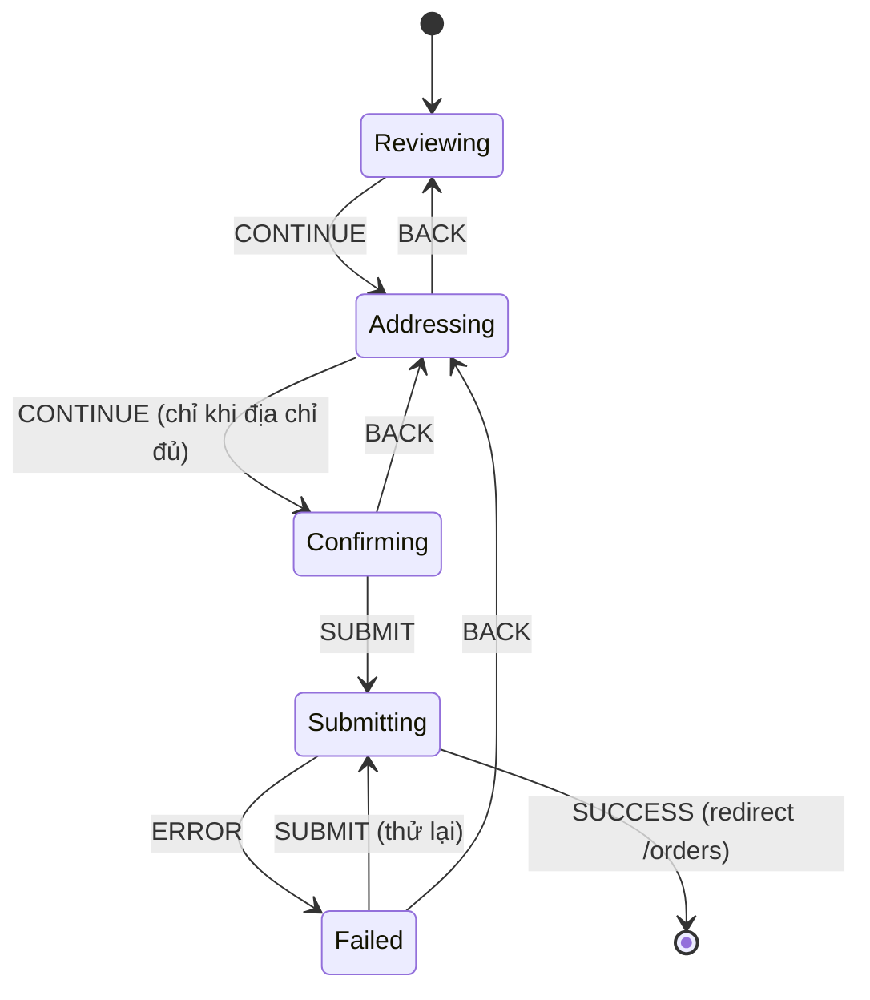

# 18. Custom Hooks & State Machines

> **Mục tiêu:** thiết kế custom hook ở mức API library, và mô hình hoá UI phức tạp thành
> **state machine** để loại bỏ hẳn class bug "trạng thái không hợp lệ". Bài tập chính: viết lại
> `checkout-wizard.tsx` thành một FSM có kiểu chặt và test được.
>
> Phiên bản: React 19.2 — `useEffectEvent` đã stable, `useActionState`, `<form action>` tự reset form.

---

## Phần I — Thiết kế Custom Hook

## 1. Custom hook KHÔNG phải để "tái sử dụng code"

Nếu chỉ để tái sử dụng, một hàm thường là đủ. **Custom hook tồn tại để làm ba việc hàm thường không làm
được:**

1. **Gọi được các hook khác** (`useState`, `useEffect`, `use`…)
2. **Đặt tên cho một khái niệm có trạng thái** — biến một `useEffect` vô danh thành `useActionToast(state)`
3. **Đóng gói một hợp đồng** — "hook này quản lý vòng đời của X, bạn chỉ cần gọi nó"

Điều **(2)** là lý do quan trọng nhất và bị đánh giá thấp nhất:

```tsx
// Trước: người đọc phải giải mã ý định
useEffect(() => {
  if (detailsState.ok && detailsState.message) toast.success(detailsState.message)
  else if (!detailsState.ok && detailsState.message) toast.error(detailsState.message)
}, [detailsState])

// Sau: ý định nằm ngay trong tên
useActionToast(detailsState)
```

### 🧠 Custom hook như một "cơ quan" của component

Component là cơ thể; `useActionToast` là cơ quan thông báo, `useDisclosure` là cơ quan mở/đóng. Mỗi cơ
quan tự quản trạng thái nội bộ, có giao diện rõ ràng (tham số vào, giá trị ra), và **có thể có nhiều
bản**.

Nhắc lại file `15`: custom hook **không phải một đơn vị** ở tầng Fiber — React chỉ đếm lời gọi hook
nguyên thuỷ:

```tsx
useActionToast(detailsState)    // = useEffect ở slot #k
useActionToast(imagesState)     // = useEffect ở slot #k+1  → hai state độc lập
```

---

## 2. Bốn nguyên tắc thiết kế hook

### Nguyên tắc 1 — Tên nói khái niệm domain, không phải cơ chế

| ❌ Tên tệ | ✅ Tên tốt | Vì sao |
| --- | --- | --- |
| `useData()` | `useOrderDetail(id)` | "Data" không nói gì |
| `useUtils()` | `usePriceFormatter()` | Hook không phải túi đựng hàm |
| `useLogic()` | `useCheckoutWizard()` | Nói được domain |
| `useGetCart()` | `useCart()` | "get" là dư |

Và: **hàm không gọi hook nào thì KHÔNG được đặt tên `use…`** — lint và React Compiler coi tiền tố
`use` là cam kết tuân theo Rules of Hooks.

### Nguyên tắc 2 — Tuple cho 2 giá trị đối xứng, object cho 3+

```tsx
const [open, setOpen] = useState(false)                                  // ✅ tuple — đổi tên thoải mái
const { open, close, toggle, triggerProps, panelProps } = useDisclosure() // ✅ object

// ❌ Tuple 5 phần tử: phải nhớ thứ tự, thêm giá trị = breaking change
const [step, setStep, address, setAddress, method] = useWizard()
```

### Nguyên tắc 3 — Hàm trả về phải có identity ổn định

Nếu consumer đưa hàm vào dependency array hoặc truyền cho component `memo`, hàm **phải** ổn định:

```tsx
// ❌ close/toggle là hàm MỚI mỗi render
return { open, close: () => setOpen(false), toggle: () => setOpen((o) => !o) }

// ✅ useCallback + deps rỗng
const close = useCallback(() => setOpen(false), [])
const toggle = useCallback(() => setOpen((o) => !o), [])
```

⚠️ **`setOpen((o) => !o)` — dạng updater là điều kiện để identity ổn định.** Viết `setOpen(!open)` thì
`open` phải vào deps → hàm đổi mỗi lần `open` đổi.

Trong hook **công khai** bạn không biết consumer dùng thế nào, nên đây là một trong ít chỗ `useCallback`
thật sự cần (file `04`). Nếu bật React Compiler (`reactCompiler: true` trong `next.config.ts`, stable từ Next 16, cần cài
`babel-plugin-react-compiler` — repo hiện **chưa** bật), compiler tự memo hoá và phần lớn `useCallback` thủ công trở nên thừa.

### Nguyên tắc 4 — Một hook, một trách nhiệm

```tsx
// ❌ Hook "Chúa": fetch cart, validate address, payment, submit, toast, redirect...
function useCheckoutEverything() {}

// ✅ Hook nhỏ, compose được
function useCheckoutWizard() {
  const address = useAddressForm()
  const payment = usePaymentMethod()
  // ...
}
```

---

## 3. Ba hook đáng thêm vào repo này

### 3.1 `useActionToast` — callback của consumer qua `useEffectEvent`

```tsx
// lib/hooks/use-action-toast.ts
'use client'
import { useEffect, useEffectEvent } from 'react'
import { toast } from 'sonner'
import type { ActionState } from '@/actions/state'

/**
 * Toast kết quả của một Server Action.
 * Chạy lại mỗi khi `state` là object mới — action luôn trả object mới,
 * nên cùng một lỗi lặp lại vẫn toast.
 */
export function useActionToast(
  state: ActionState,
  { successSilent = false, onSuccess }: { successSilent?: boolean; onSuccess?: () => void } = {},
) {
  // Đọc giá trị MỚI NHẤT của onSuccess, nhưng không phải dependency
  const handleSuccess = useEffectEvent(() => onSuccess?.())

  useEffect(() => {
    if (!state.message && !state.ok) return            // initialActionState — chưa chạy action
    if (state.ok) {
      if (!successSilent && state.message) toast.success(state.message)
      handleSuccess()
    } else if (state.message) {
      toast.error(state.message)
    }
  }, [state, successSilent])                           // ✅ KHÔNG có handleSuccess
}
```

**`useEffectEvent` (stable từ React 19.2)** tách phần "phản ứng" (effect chạy lại khi `state` đổi) khỏi
phần "đọc giá trị mới nhất" (`onSuccess`). Ba luật:

- Chỉ gọi nó **bên trong effect** (hoặc effect event khác) — không gọi trong render, không truyền
  xuống component con.
- **Không** đưa vào dependency array (identity của nó cố ý không ổn định; lint plugin
  `eslint-plugin-react-hooks` v6+ hiểu điều này).
- Dùng cho logic **không** nên kích hoạt effect chạy lại — không phải để "lách" deps thật.

> Trước 19.2, người ta làm bằng tay: `const ref = useRef(cb); ref.current = cb` trong thân render. Mẫu đó
> **ghi ref trong render** — vi phạm luật render thuần (file `15`) và bị lint mới cảnh báo. Có
> `useEffectEvent` rồi thì đừng dùng mẫu ref nữa.

**📄 Áp dụng — `components/store/comment-form.tsx`:**

```tsx
// TRƯỚC (hiện tại)
useEffect(() => {
  if (state.ok && state.message) {
    toast.success(state.message)
    ref.current?.reset()
    onDone?.()
  } else if (!state.ok && state.message) {
    toast.error(state.message)
  }
}, [state, onDone])

// SAU
useActionToast(state, { onSuccess: () => onDone?.() })
```

**Điểm cộng ẩn:** ở bản TRƯỚC, `onDone` nằm trong deps. `CommentSection` truyền `onDone={close}`, với
`const close = () => setReplyOpen(null)` — **arrow function mới mỗi render** → effect chạy lại mỗi lần
`CommentSection` re-render (vô hại chỉ vì `state` không đổi nên không toast lại, nhưng là bẫy chờ nổ).

**Còn `ref.current?.reset()` đi đâu?** React 19: khi truyền **hàm** vào `<form action>`, sau khi action
chạy xong (không throw), React **tự reset** các field uncontrolled. Dòng `reset()` thủ công là thừa.

⚠️ Hệ quả ngược: form cũng bị reset khi action **trả về lỗi** (`{ ok: false }` vẫn là "chạy xong").
Người dùng gõ bình luận dài, lỗi validate → mất hết. Cách giữ giá trị: trả lại dữ liệu đã nhập trong
`ActionState` (thêm field `fields?: Record<string, string>` vào interface trong `actions/state.ts`)
và dùng làm `defaultValue`:

```tsx
// action: return { ok: false, message: 'Nội dung quá ngắn', fields: { content: raw } }
<Textarea name="content" defaultValue={state.fields?.content} key={state.fields?.content} />
```

### 3.2 `useOptimisticList` — tổng quát hoá bài toán ở file `07`

```tsx
// lib/hooks/use-optimistic-list.ts
'use client'
import { useOptimistic } from 'react'

export type ListMutation<T, K extends keyof T> =
  | { type: 'patch'; id: T[K]; patch: Partial<Omit<T, K>> }
  | { type: 'remove'; id: T[K] }
  | { type: 'add'; item: T }

/**
 * `serverItems` PHẢI là dữ liệu thật từ Server Component — khi action gọi
 * revalidatePath và prop này đổi, lớp optimistic tự bị bỏ.
 */
export function useOptimisticList<T, K extends keyof T>(serverItems: T[], idKey: K) {
  return useOptimistic(serverItems, (current: T[], m: ListMutation<T, K>): T[] => {
    switch (m.type) {
      case 'patch':  return current.map((it) => (it[idKey] === m.id ? { ...it, ...m.patch } : it))
      case 'remove': return current.filter((it) => it[idKey] !== m.id)
      case 'add':    return [...current, m.item]
    }
  })
}
```

```tsx
// Giỏ hàng
const [items, apply] = useOptimisticList(serverItems, 'productId')
startTransition(async () => {
  apply({ type: 'patch', id: productId, patch: { quantity: next } })
  await updateQuantityAction(productId, current, next)
})

// Bình luận — y nguyên hook
const [comments, apply] = useOptimisticList(serverComments, 'id')
apply({ type: 'add', item: draftComment })
```

⚠️ `apply` (setter của `useOptimistic`) phải gọi **trong một Transition/Action** — gọi ngoài sẽ có
warning và giá trị optimistic không giữ được.

Abstraction này đạt tiêu chí file `17`: shape giống hệt nhau giữa các ca dùng (cart, comments, publish
state của sản phẩm), chỉ khác `idKey`.

### 3.3 `useOnlineStatus` — đăng ký store bên ngoài React bằng `useSyncExternalStore`

Checkout cần cảnh báo khi mất mạng. Cách "tự nhiên" là `useState` + `useEffect` lắng nghe event —
nhưng có hai vấn đề: render đầu luôn sai giá trị (state khởi tạo cứng), và trong concurrent rendering
có thể **tearing** (hai component đọc cùng store thấy hai giá trị khác nhau). `useSyncExternalStore`
là API chính thức cho mọi nguồn dữ liệu nằm **ngoài** React (browser API, localStorage, store tự viết):

```tsx
// lib/hooks/use-online-status.ts
'use client'
import { useSyncExternalStore } from 'react'

// Khai báo NGOÀI hook → identity ổn định → không resubscribe mỗi render
function subscribe(onChange: () => void) {
  window.addEventListener('online', onChange)
  window.addEventListener('offline', onChange)
  return () => {
    window.removeEventListener('online', onChange)
    window.removeEventListener('offline', onChange)
  }
}

export function useOnlineStatus() {
  return useSyncExternalStore(
    subscribe,
    () => navigator.onLine,     // getSnapshot — client
    () => true,                 // getServerSnapshot — SSR + hydrate: giả định online, tránh mismatch
  )
}
```

```tsx
const online = useOnlineStatus()
// ...
{!online ? <p role="status" className="text-sm text-destructive">Bạn đang offline — chưa thể đặt hàng.</p> : null}
<SubmitButton disabled={!online}>Đặt hàng</SubmitButton>
```

⚠️ `getSnapshot` phải trả **cùng giá trị** nếu store không đổi (so sánh bằng `Object.is`). Trả về
object mới mỗi lần (`() => ({ online: navigator.onLine })`) → vòng lặp render vô hạn.

---

## 4. When NOT to make a custom hook

| Tình huống | Dùng gì thay thế |
| --- | --- |
| Không gọi hook nào bên trong | **Hàm thường** trong `lib/` — test không cần React |
| Chỉ dùng một chỗ, không có tên rõ ràng | Để inline |
| Chỉ để "gom code cho gọn" | Tách component |
| Bọc một hook duy nhất mà không thêm gì | Bỏ — trừ khi thêm guard |

📄 `lib/comments/group.ts` — `groupComments(list)` **đúng** là hàm thường: không gọi hook, có test
riêng (`lib/comments/__tests__/group.test.ts`), dùng được cả trong Server Component. Bọc thành
`useGroupedComments` chỉ mất ba thứ đó.

Wrapper **có** giá trị khi thêm guard:

```tsx
// ✅ fail-fast khi thiếu Provider (đề xuất — repo chưa có CartContext)
export function useCart(): CartValue {
  const ctx = use(CartContext)
  if (!ctx) throw new Error('useCart must be used inside <CartProvider>')
  return ctx
}
```

---

## Phần II — State Machines

## 5. Vấn đề: số trạng thái tăng theo lũy thừa

📄 `components/store/checkout-wizard.tsx` hiện tại:

```tsx
const [step, setStep] = useState(0)
const [address, setAddress] = useState({ street: '', city: '', state: '', country: '' })
const [method, setMethod] = useState('COD')
const [state, formAction] = useActionState(placeOrderAction, initialActionState)

useEffect(() => {
  if (!state.ok && state.message) toast.error(state.message)
}, [state])

const addressComplete = address.street && address.city && address.state && address.country
```

Kiểu hiện tại cho phép các trạng thái **vô nghĩa**:

```tsx
{ step: 2, address: { street: '', city: '', state: '', country: '' } }  // xác nhận với địa chỉ TRỐNG
{ step: 5 }                                                               // bước không tồn tại
{ method: 'BITCOIN' }                                                     // `string` nhận mọi thứ
```

Repo chặn chúng bằng **luật rải trong JSX**:

```tsx
<Button onClick={() => setStep(2)} disabled={!addressComplete}>Continue</Button>
```

⚠️ **`disabled` là bảo vệ ở tầng UI, không phải tầng dữ liệu.** Thêm một đường vào step 2 (deep link,
nút "Sửa", khôi phục từ localStorage) là luật này **không được áp dụng**.

### State machine là gì

- **Tập hữu hạn state** — tại một thời điểm ở **đúng một** state
- **Dữ liệu gắn với từng state** — mỗi state chỉ mang dữ liệu có nghĩa với nó
- **Transition được phép** — từ state A, event E dẫn tới state B
- **Mọi thứ khác không biểu diễn được** — không phải "bị chặn"

### 🧠 FSM như một sơ đồ tàu điện

Bạn ở một **ga** (state). Không có tuyến thì không đi được — không phải "có tuyến nhưng bị chặn", mà là
**không có đường ray**.



Đọc sơ đồ là thấy điều **không** có: không `Reviewing → Confirming` (nhảy qua địa chỉ), không
`Submitting → Addressing` (sửa địa chỉ khi đang gửi). Code hiện tại cho phép cả hai vì `setStep` nhận
mọi số.

---

## 6. 🛠️ Bài tập lớn: `checkout-wizard` thành FSM

### Bước 1 — State bằng discriminated union

```tsx
// lib/checkout/wizard-machine.ts
export const PAYMENT_METHODS = ['COD', 'CARD', 'MOMO'] as const
export type PaymentMethod = (typeof PAYMENT_METHODS)[number]

export interface Address { street: string; city: string; state: string; country: string }

/** Địa chỉ đã xác nhận là đầy đủ — brand type (file `21`). */
export type CompleteAddress = Address & { readonly __complete: unique symbol }

export function isAddressComplete(a: Address): a is CompleteAddress {
  return Boolean(a.street.trim() && a.city.trim() && a.state.trim() && a.country.trim())
}

/** Mỗi nhánh chỉ mang dữ liệu CÓ NGHĨA với nó. */
export type WizardState =
  | { status: 'reviewing'; address: Address; method: PaymentMethod }
  | { status: 'addressing'; address: Address; method: PaymentMethod }
  | { status: 'confirming'; address: CompleteAddress; method: PaymentMethod }
  | { status: 'submitting'; address: CompleteAddress; method: PaymentMethod }
  | { status: 'failed'; address: CompleteAddress; method: PaymentMethod; error: string }
```

**Điểm cốt lõi của chương:**

```tsx
// Kiểu cũ: hợp lệ theo TypeScript
{ step: 2, address: { street: '', city: '', state: '', country: '' } }   // ✅ compile

// Kiểu mới: KHÔNG BIỂU DIỄN ĐƯỢC
{ status: 'confirming', address: { street: '', /* ... */ } }
// ❌ Type error: Property '__complete' is missing
```

Bug không bị "chặn" — nó **không tồn tại**. "Make illegal states unrepresentable" (file `02`).

### Bước 2 — Event

```tsx
export type WizardEvent =
  | { type: 'CONTINUE' }
  | { type: 'BACK' }
  | { type: 'SET_ADDRESS_FIELD'; field: keyof Address; value: string }
  | { type: 'SET_METHOD'; method: PaymentMethod }
  | { type: 'SUBMIT' }
  | { type: 'ERROR'; message: string }
```

### Bước 3 — Reducer: bảng transition tường minh

```tsx
import { assertNever } from '@/lib/type-utils'

export function wizardReducer(state: WizardState, event: WizardEvent): WizardState {
  const { address, method } = state
  switch (state.status) {
    case 'reviewing':
      return event.type === 'CONTINUE' ? { status: 'addressing', address, method } : state

    case 'addressing':
      switch (event.type) {
        case 'SET_ADDRESS_FIELD':
          return { ...state, address: { ...state.address, [event.field]: event.value } }
        case 'SET_METHOD':
          return { ...state, method: event.method }
        case 'BACK':
          return { status: 'reviewing', address, method }
        case 'CONTINUE':
          // GUARD + type guard NÂNG KIỂU: sau if, state.address là CompleteAddress
          if (!isAddressComplete(state.address)) return state
          return { status: 'confirming', address: state.address, method }
        default:
          return state
      }

    case 'confirming':
      if (event.type === 'BACK') return { status: 'addressing', address: state.address, method }
      if (event.type === 'SUBMIT') return { status: 'submitting', address: state.address, method }
      return state

    case 'submitting':
      // BACK / SET_* bị bỏ qua có chủ đích: không sửa khi đang gửi
      if (event.type === 'ERROR') return { status: 'failed', address: state.address, method, error: event.message }
      return state

    case 'failed':
      if (event.type === 'SUBMIT') return { status: 'submitting', address: state.address, method }
      if (event.type === 'BACK') return { status: 'addressing', address: state.address, method }
      return state

    default:
      return assertNever(state)        // ⭐ thêm status mới mà quên case → lỗi compile
  }
}

export const initialWizardState = (): WizardState => ({
  status: 'reviewing',
  address: { street: '', city: '', state: '', country: '' },
  method: 'COD',
})
```

```tsx
// lib/type-utils.ts
export function assertNever(x: never): never {
  throw new Error(`Unhandled case: ${JSON.stringify(x)}`)
}
```

1. **`return state` cho event không hợp lệ** — bấm nút hai lần nhanh, event thứ hai rơi vào state đã đổi
   và không làm gì.
2. **Guard nằm trong reducer**, nên áp dụng cho **mọi** đường vào `confirming`, không chỉ một cái nút.
3. **`isAddressComplete` là type guard** — vừa kiểm tra vừa nâng kiểu. Không có nó, bạn phải cast
   `as CompleteAddress` và mất bảo đảm.
4. **Nhìn `case 'submitting'` là thấy luật** "không sửa dữ liệu khi đang gửi" — không cần comment.
5. **`assertNever`** bắt case thiếu **lúc compile** — thứ test không làm được (test chỉ kiểm tra những gì
   bạn nghĩ ra). Tương tự cho map: `const TITLES: Record<WizardState['status'], string> = {…}` thiếu key
   là lỗi compile.

### Bước 4 — Test reducer như hàm pure, KHÔNG cần React

```tsx
// lib/checkout/__tests__/wizard-machine.test.ts
import { describe, it, expect } from 'vitest'
import { wizardReducer, initialWizardState, isAddressComplete, type WizardState, type WizardEvent,
  type Address, type CompleteAddress } from '@/lib/checkout/wizard-machine'

const FULL = { street: '1 Lê Lợi', city: 'HCM', state: 'HCM', country: 'VN' } as CompleteAddress
const run = (events: WizardEvent[], from: WizardState = initialWizardState()) => events.reduce(wizardReducer, from)
const fill = (a: Address): WizardEvent[] =>
  (Object.keys(a) as (keyof Address)[]).map((field) => ({ type: 'SET_ADDRESS_FIELD', field, value: a[field] }))

describe('isAddressComplete', () => {
  it('false khi thiếu field hoặc chỉ có khoảng trắng', () => {
    expect(isAddressComplete(FULL)).toBe(true)
    expect(isAddressComplete({ ...FULL, city: '' })).toBe(false)
    expect(isAddressComplete({ ...FULL, street: '   ' })).toBe(false)
  })
})

describe('wizardReducer', () => {
  it('happy path: reviewing → addressing → confirming → submitting', () => {
    const s = run([{ type: 'CONTINUE' }, ...fill(FULL), { type: 'CONTINUE' }, { type: 'SUBMIT' }])
    expect(s.status).toBe('submitting')
  })

  it('guard: KHÔNG vào confirming khi thiếu một field', () => {
    const s = run([{ type: 'CONTINUE' }, ...fill({ ...FULL, country: '' }), { type: 'CONTINUE' }])
    expect(s.status).toBe('addressing')
  })

  it('không sửa được address khi đang submitting', () => {
    const s = run([{ type: 'SET_ADDRESS_FIELD', field: 'city', value: 'HÀ NỘI' }, { type: 'BACK' }],
      { status: 'submitting', address: FULL, method: 'COD' })
    expect(s.status).toBe('submitting')
    expect(s.address.city).toBe('HCM')
  })

  it('ERROR → failed giữ nguyên dữ liệu; SUBMIT lại → submitting', () => {
    let s = wizardReducer({ status: 'submitting', address: FULL, method: 'MOMO' }, { type: 'ERROR', message: 'Hết hàng' })
    expect(s).toMatchObject({ status: 'failed', error: 'Hết hàng', method: 'MOMO' })
    s = wizardReducer(s, { type: 'SUBMIT' })
    expect(s.status).toBe('submitting')
  })
})
```

Không `render()`, không jsdom, không mock — chạy được ngay với `environment: 'node'` hiện tại của repo
(`vitest.config.ts`). Test cùng logic qua component cần jsdom + RTL + mock `placeOrderAction`, chậm hơn
nhiều, và **không cover được** transition bị cấm (UI không có nút để thử).

### Bước 5 — Hook điều phối: nối machine với Server Action

```tsx
// lib/hooks/use-checkout-wizard.ts
'use client'
import { useActionState, useReducer } from 'react'
import { placeOrderAction } from '@/actions/order.actions'
import { initialActionState, type ActionState } from '@/actions/state'
import { wizardReducer, initialWizardState, isAddressComplete, type Address, type PaymentMethod }
  from '@/lib/checkout/wizard-machine'

export function useCheckoutWizard() {
  const [state, send] = useReducer(wizardReducer, undefined, initialWizardState)

  // ✅ Bọc action thay vì dùng useEffect để "đồng bộ" actionState → machine.
  // Effect đồng bộ state là anti-pattern (file 03): thêm một render, và chạy muộn.
  const [, formAction] = useActionState(async (prev: ActionState, formData: FormData) => {
    const result = await placeOrderAction(prev, formData)   // thành công → redirect, không quay lại đây
    if (!result.ok) send({ type: 'ERROR', message: result.message ?? 'Đặt hàng không thành công' })
    return result
  }, initialActionState)

  return {
    state,
    formAction,
    // dispatch của useReducer vốn đã ổn định → các hàm này chỉ cần useCallback nếu
    // consumer đưa chúng vào deps; ở đây gọi thẳng `send` là đủ đơn giản
    next: () => send({ type: 'CONTINUE' }),
    back: () => send({ type: 'BACK' }),
    submit: () => send({ type: 'SUBMIT' }),
    setAddressField: (field: keyof Address, value: string) => send({ type: 'SET_ADDRESS_FIELD', field, value }),
    setMethod: (method: PaymentMethod) => send({ type: 'SET_METHOD', method }),
    // Giá trị phái sinh — tính trực tiếp, không phải state (file `02`)
    canContinue: state.status !== 'addressing' || isAddressComplete(state.address),
  }
}
```

### Bước 6 — Component chỉ còn là render

```tsx
// components/store/checkout-wizard.tsx (rút gọn)
'use client'
const TITLES: Record<WizardState['status'], string> = {
  reviewing: 'Kiểm tra đơn hàng',
  addressing: 'Giao hàng & thanh toán',
  confirming: 'Xác nhận',
  submitting: 'Đang đặt hàng…',
  failed: 'Đặt hàng không thành công',
}

export function CheckoutWizard({ shopOrderIds, review, lines }: Props) {
  const { state, formAction, next, back, submit, setAddressField, setMethod, canContinue } = useCheckoutWizard()

  return (
    <Card className="max-w-2xl">
      <CardHeader><CardTitle>{TITLES[state.status]}</CardTitle></CardHeader>
      <CardContent className="space-y-6">
        {state.status === 'reviewing' ? (
          <>
            <OrderLines lines={lines} review={review} />
            <Button onClick={next}>Tiếp tục</Button>
          </>
        ) : null}

        {state.status === 'addressing' ? (
          <>
            {(['street', 'city', 'state', 'country'] as const).map((f) => (
              <Input key={f} aria-label={f} value={state.address[f]} onChange={(e) => setAddressField(f, e.target.value)} />
            ))}
            <Select value={state.method} onValueChange={(v) => setMethod((v ?? 'COD') as PaymentMethod)}>…</Select>
            <Button variant="outline" onClick={back}>Quay lại</Button>
            {/* disabled chỉ là GỢI Ý UX — guard thật nằm trong reducer */}
            <Button onClick={next} disabled={!canContinue}>Tiếp tục</Button>
          </>
        ) : null}

        {state.status === 'confirming' || state.status === 'submitting' || state.status === 'failed' ? (
          // onSubmit chạy đồng bộ TRƯỚC action → UI chuyển 'submitting' ngay lập tức
          <form action={formAction} onSubmit={submit} className="space-y-4">
            <input type="hidden" name="shop_order_ids" value={JSON.stringify(shopOrderIds)} />
            {(['street', 'city', 'state', 'country'] as const).map((f) => (
              <input key={f} type="hidden" name={f} value={state.address[f]} />
            ))}
            <input type="hidden" name="paymentMethod" value={state.method} />
            <p className="text-sm text-muted-foreground">
              Giao đến {Object.values(state.address).join(', ')} · {state.method}
            </p>
            {state.status === 'failed' ? <p role="alert" className="text-sm text-destructive">{state.error}</p> : null}
            <Button type="button" variant="outline" onClick={back} disabled={state.status === 'submitting'}>Quay lại</Button>
            <SubmitButton>{state.status === 'failed' ? 'Thử lại' : 'Đặt hàng'}</SubmitButton>
          </form>
        ) : null}
      </CardContent>
    </Card>
  )
}
```

| | Trước | Sau |
| --- | --- | --- |
| Nguồn trạng thái | 3 `useState` + `useActionState` độc lập | 1 machine + action đã bọc |
| Trạng thái vô nghĩa | Biểu diễn được, chặn bằng `disabled` | **Không biểu diễn được** |
| Luật nghiệp vụ | Rải trong JSX | Tập trung trong reducer |
| Test | jsdom + RTL + mock | **Hàm pure, 0 setup** |
| Xử lý lỗi | `toast.error` rồi mất, không có retry | State `failed`: message **ở lại** + "Thử lại", giữ dữ liệu |
| Thêm bước mới | Sửa 3–4 chỗ | Thêm 1 case — `assertNever`/`Record` chỉ chỗ thiếu |

**Ba tầng, mỗi tầng một trách nhiệm** ("tách quyết định khỏi thực thi", file `14`):

| Tầng | File | Trách nhiệm | Test bằng |
| --- | --- | --- | --- |
| Logic | `lib/checkout/wizard-machine.ts` | State + transition + guard | Vitest, hàm pure |
| Điều phối | `lib/hooks/use-checkout-wizard.ts` | Nối machine với Server Action | RTL (nếu cần) |
| Trình bày | `components/store/checkout-wizard.tsx` | JSX | Mắt / E2E |

---

## 7. Khi nào dùng FSM — và khi nào không

| Nên dùng FSM | Không cần FSM |
| --- | --- |
| Nhiều biến state phải nhất quán (`checkout-wizard`: step + address + method) | 1–2 state độc lập (`create-discount-form`: `type` + `appliesTo`) |
| Có bước tuần tự (wizard, onboarding, upload nhiều bước) | Chỉ bật/tắt (`seller-mobile-nav`: `open`) |
| Có transition bị cấm ("không sửa khi đang gửi") | State đã nằm trên URL (`product-list`: tab + page) |
| Cần retry giữ dữ liệu | Một biến, không transition phức tạp |
| Nhiều `if (a && !b && c)`; bug "sao nó lại ở trạng thái này" | |

📄 `comment-section.tsx`: `replyOpen: string | null` **đã là** một FSM tối giản — "không form nào mở"
/ "form của comment X đang mở". Không cần `useReducer` vì chỉ có một biến. **Nguyên tắc "make illegal
states unrepresentable" quan trọng hơn công cụ `useReducer`.**

⚖️ **Ranh giới thực dụng:** FSM khi có **≥3 state phụ thuộc nhau** hoặc **có transition bị cấm**. Cái giá:
nhiều boilerplate (union, event, reducer), brand type hơi lạ với người mới, thêm một file phải mở khi
đọc component. Với `checkout-wizard` rõ ràng đáng; với `create-discount-form` rõ ràng không.

---

## 8. Best Practices

1. **Đặt tên hook theo khái niệm domain.** Không gọi hook nào → không đặt tên `use…`, viết hàm thường ở `lib/`.
2. **Tuple cho 2 giá trị đối xứng, object cho 3+.**
3. **Hàm trả về từ hook công khai phải ổn định** (`useCallback` + updater form) — hoặc bật React Compiler.
4. **Callback của consumer đọc trong effect → `useEffectEvent`**, không đưa vào deps, không dùng mẫu ghi ref trong render.
5. **Dữ liệu ngoài React (browser API, store) → `useSyncExternalStore`**, `subscribe` khai báo ngoài
   component, `getSnapshot` trả giá trị ổn định, có `getServerSnapshot` cho SSR.
6. **React 19 tự reset form sau action** — bỏ `formRef.reset()`; muốn giữ giá trị khi lỗi thì trả về qua state.
7. **State bằng discriminated union**; "đã validate" là tính chất của **kiểu** (brand + type guard).
8. **Guard trong reducer, không trong JSX.** `disabled` là gợi ý UX; reducer là luật.
9. **`assertNever` + `Record<Status, T>`** để TypeScript bắt case thiếu.
10. **Đừng đồng bộ action state vào reducer bằng `useEffect`** — bọc action và `dispatch` trong đó.

---

## Tự kiểm tra

1. Ba việc custom hook làm được mà hàm thường không làm được?
2. Vì sao `setOpen((o) => !o)` là điều kiện để `useCallback` giữ identity ổn định?
3. `useEffectEvent` giải quyết vấn đề gì? Ba luật khi dùng nó?
4. Vì sao `useState + useEffect` để đọc `navigator.onLine` kém hơn `useSyncExternalStore`? `getServerSnapshot` để làm gì?
5. React 19 làm gì với form sau khi action chạy xong? Hệ quả xấu là gì và xử lý thế nào?
6. Kể ba trạng thái vô nghĩa mà kiểu hiện tại của `checkout-wizard` cho phép.
7. `CompleteAddress` với `__complete: unique symbol` giải quyết gì mà `boolean` không giải quyết được?
8. Vì sao guard phải nằm trong reducer chứ không ở `disabled`?
9. `assertNever` cho bạn điều gì mà test không cho được?
10. Khi nào FSM là over-engineering? Cho ví dụ từ repo.

➡️ Tiếp theo: `19-parallel-va-intercepting-routes.md`
