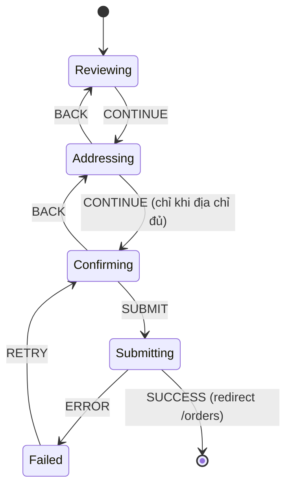

# 18. Custom Hooks & State Machines

> **Mục tiêu:** thiết kế custom hook ở mức API library, và mô hình hoá UI phức tạp thành
> **state machine** để loại bỏ hẳn class bug "trạng thái không hợp lệ". Bài tập chính: viết lại
> `checkout-wizard.tsx` thành một FSM có kiểu chặt và test được.

---

## Phần I — Thiết kế Custom Hook

## 1. Overview

### Custom hook KHÔNG phải để "tái sử dụng code"

Đây là ngộ nhận phổ biến. Nếu mục đích chỉ là tái sử dụng, một hàm thường là đủ.

**Custom hook tồn tại để làm ba việc mà hàm thường không làm được:**

1. **Gọi được các hook khác** (`useState`, `useEffect`, `useContext`) — hàm thường không được
2. **Đặt tên cho một khái niệm có trạng thái** — biến `useEffect(() => {...}, [state])` vô danh thành
   `useActionToast(state)` có ý nghĩa
3. **Đóng gói một hợp đồng** — "hook này quản lý vòng đời của X, bạn chỉ cần gọi nó"

Điều **(2)** là lý do quan trọng nhất, và cũng là lý do bị đánh giá thấp nhất.

📄 So sánh hai đoạn tương đương về hành vi:

```tsx
// Trước: người đọc phải giải mã ý định
useEffect(() => {
  if (detailsState.ok && detailsState.message) toast.success(detailsState.message)
  else if (!detailsState.ok && detailsState.message) toast.error(detailsState.message)
}, [detailsState])

// Sau: ý định nằm ngay trong tên
useActionToast(detailsState)
```

Dòng thứ hai không chỉ ngắn hơn. Nó nói **cái gì đang xảy ra** thay vì **cách nó xảy ra**. Người đọc
code không cần biết có `useEffect` bên trong.

---

## 2. Mental Model

### 🧠 Custom hook như một "cơ quan" của component

Component là cơ thể. Hook là các cơ quan có chức năng riêng:

- `useActionToast(state)` — cơ quan thông báo
- `useDisclosure()` — cơ quan mở/đóng
- `useCheckout(...)` — cơ quan điều phối luồng thanh toán

Mỗi cơ quan:
- **Tự quản trạng thái nội bộ** (bạn không cần biết bên trong)
- **Có một giao diện rõ ràng** (input là tham số, output là giá trị trả về)
- **Có thể có nhiều bản** trong cùng cơ thể (nhớ file `15`: mỗi lời gọi là một slot hook riêng)

**Nhắc lại điểm quan trọng từ file `15`:** custom hook **không phải một đơn vị** ở tầng Fiber. React
chỉ đếm số lời gọi hook nguyên thuỷ. Nghĩa là:

```tsx
useActionToast(detailsState)    // = useEffect ở slot #k
useActionToast(imagesState)     // = useEffect ở slot #k+1
```

Hai lời gọi → hai slot độc lập → hai state riêng. **Đây là tính chất, không phải may mắn.**

---

## 3. Bốn nguyên tắc thiết kế hook

### Nguyên tắc 1 — Tên bắt đầu bằng động từ hoặc danh từ chỉ khái niệm, không phải "get"

| ❌ Tên tệ | ✅ Tên tốt | Vì sao |
| --- | --- | --- |
| `useData()` | `useOrderDetail(id)` | "Data" không nói gì |
| `useUtils()` | `usePriceFormatter()` | Hook không phải túi đựng hàm |
| `useLogic()` | `useCheckoutFlow()` | Nói được domain |
| `useHandler()` | `useOptimisticCart()` | Nói được nó làm gì |
| `useGetCart()` | `useCart()` | "get" là dư — hook luôn "get" |

### Nguyên tắc 2 — Chọn shape trả về theo số lượng và tính đối xứng

```tsx
// TUPLE — khi có 2 giá trị và người dùng thường đổi tên
const [state, formAction] = useActionState(...)      // ✅ đổi tên thoải mái
const [open, setOpen] = useState(false)               // ✅

// OBJECT — khi có 3+ giá trị, hoặc một số là tuỳ chọn
const { open, close, toggle, triggerProps, panelProps } = useDisclosure()   // ✅
```

**Ranh giới:** 2 giá trị đối xứng (value + setter) → tuple. Nhiều hơn, hoặc không đối xứng → object.

Vì sao? Với tuple 5 phần tử, call site phải nhớ **thứ tự**:

```tsx
// ❌ Không đọc được, và thêm giá trị mới là breaking change
const [step, setStep, address, setAddress, method] = useWizard()
```

Với object, thêm field là **thay đổi tương thích**.

### Nguyên tắc 3 — Trả về identity ổn định cho hàm

Nếu hook trả về hàm mà consumer đưa vào dependency array, hàm đó **phải** ổn định:

```tsx
// ❌ close/toggle là hàm MỚI mỗi render → phá dependency array của consumer
export function useDisclosure() {
  const [open, setOpen] = useState(false)
  return {
    open,
    close: () => setOpen(false),        // mới mỗi render
    toggle: () => setOpen(o => !o),      // mới mỗi render
  }
}

// ✅ Ổn định qua useCallback với deps rỗng
export function useDisclosure() {
  const [open, setOpen] = useState(false)
  const close = useCallback(() => setOpen(false), [])
  const toggle = useCallback(() => setOpen((o) => !o), [])
  return { open, close, toggle }
}
```

⚠️ **Chú ý `setOpen((o) => !o)` — dạng updater.** Nếu viết `setOpen(!open)` thì `open` phải vào
dependency array của `useCallback` → hàm không còn ổn định. **Dạng updater là điều kiện để identity
ổn định.**

Đây là một trong ít trường hợp `useCallback` **thực sự cần thiết** (nhớ file `04`: chỉ dùng khi hàm
đi vào dependency array hoặc component đã `memo`). Trong một hook công khai, bạn **không biết** consumer
sẽ dùng thế nào — nên phải phòng.

### Nguyên tắc 4 — Một hook, một trách nhiệm

```tsx
// ❌ Hook "Chúa" — làm mọi thứ, không tái dùng được phần nào
function useCheckoutEverything() {
  // fetch cart, validate address, chọn payment, submit order, toast, redirect...
}

// ✅ Hook nhỏ, compose được
function useAddressForm() { /* ... */ }
function usePaymentMethod() { /* ... */ }
function useCheckoutFlow() {                    // ← compose từ các hook nhỏ
  const address = useAddressForm()
  const payment = usePaymentMethod()
  // ...
}
```

Hook compose được là hook có giá trị. Hook làm mọi thứ chỉ là một component viết ngược.

---

## 4. Ba hook đáng thêm vào repo này

### 4.1 `useActionToast` — đã đề xuất ở file `03`, giờ hoàn thiện

```tsx
// lib/hooks/use-action-toast.ts
'use client'
import { useEffect, useRef } from 'react'
import { toast } from 'sonner'
import type { ActionState } from '@/actions/state'

interface Options {
  /** Bỏ qua toast thành công (khi action redirect và trang đích tự toast). */
  successSilent?: boolean
  /** Gọi khi action thành công — ví dụ để reset form. */
  onSuccess?: () => void
}

/**
 * Toast kết quả của một Server Action.
 *
 * Chạy lại mỗi khi `state` là object mới — useActionState luôn trả object mới
 * sau mỗi lần chạy, nên cùng một lỗi lặp lại vẫn toast.
 *
 * `onSuccess` được đọc qua ref nên KHÔNG cần identity ổn định ở call site,
 * và không gây chạy lại effect khi consumer truyền inline arrow function.
 */
export function useActionToast(state: ActionState, options: Options = {}) {
  const { successSilent = false } = options
  const onSuccessRef = useRef(options.onSuccess)
  onSuccessRef.current = options.onSuccess      // cập nhật mỗi render, không reactive

  useEffect(() => {
    if (!state.message && !state.ok) return     // trạng thái ban đầu — chưa chạy action
    if (state.ok) {
      if (!successSilent && state.message) toast.success(state.message)
      onSuccessRef.current?.()
    } else if (state.message) {
      toast.error(state.message)
    }
  }, [state, successSilent])
}
```

**Chú ý kỹ thuật `onSuccessRef`.** Đây là bản "tự làm" của `useEffectEvent` (file `03`):

```tsx
const onSuccessRef = useRef(options.onSuccess)
onSuccessRef.current = options.onSuccess
```

Ghi vào ref **trong thân render**... nhưng file `15` nói không được chạm ref trong render?

⚖️ **Đây là một ngoại lệ được cộng đồng chấp nhận, và cần hiểu rõ ranh giới:**

- Việc ghi này **idempotent** — ghi lại cùng giá trị nhiều lần không đổi kết quả
- Nó **không được đọc trong render** — chỉ đọc trong effect (sau commit)
- Nếu render bị bỏ, ref có giá trị từ render bị bỏ — nhưng render tiếp theo sẽ ghi lại giá trị đúng
  **trước khi** bất kỳ effect nào đọc nó

Nếu bạn thấy không thoải mái (hoàn toàn hợp lý), dùng `useEffectEvent` của React 19.2 — nó chính là
API chính thức cho việc này:

```tsx
import { useEffect, useEffectEvent } from 'react'

export function useActionToast(state: ActionState, options: Options = {}) {
  const { successSilent = false, onSuccess } = options
  const handleSuccess = useEffectEvent(() => onSuccess?.())

  useEffect(() => {
    if (!state.message && !state.ok) return
    if (state.ok) {
      if (!successSilent && state.message) toast.success(state.message)
      handleSuccess()
    } else if (state.message) {
      toast.error(state.message)
    }
  }, [state, successSilent])
}
```

**Áp dụng — `components/store/comment-form.tsx` trước và sau:**

```tsx
// TRƯỚC
export function CommentForm({ productId, parentId, replyToUserId, onDone }) {
  const [state, formAction] = useActionState(createCommentAction, initialActionState)
  const ref = useRef<HTMLFormElement>(null)

  useEffect(() => {
    if (state.ok && state.message) {
      toast.success(state.message)
      ref.current?.reset()
      onDone?.()
    } else if (!state.ok && state.message) {
      toast.error(state.message)
    }
  }, [state, onDone])
  // ...
}

// SAU
export function CommentForm({ productId, parentId, replyToUserId, onDone }) {
  const [state, formAction] = useActionState(createCommentAction, initialActionState)
  const ref = useRef<HTMLFormElement>(null)

  useActionToast(state, {
    onSuccess: () => {
      ref.current?.reset()
      onDone?.()
    },
  })
  // ...
}
```

**Điểm cộng ẩn:** ở bản TRƯỚC, `onDone` nằm trong dependency array. `CommentSection` truyền
`onDone={close}` — và `close` là `() => setReplyOpen(null)`, một **arrow function mới mỗi render**.
Nghĩa là effect đó chạy lại mỗi lần `CommentSection` re-render. Bản SAU không có vấn đề đó vì
`onSuccess` được đọc qua ref/`useEffectEvent`.

Đây là loại bug im lặng mà một hook được thiết kế cẩn thận **loại bỏ hẳn** cho mọi call site.

### 4.2 `useOptimisticList` — tổng quát hoá bài toán ở file `07`

```tsx
// lib/hooks/use-optimistic-list.ts
'use client'
import { useOptimistic } from 'react'

/**
 * useOptimistic cho một danh sách được định danh bằng `id`.
 *
 * `serverItems` PHẢI là state thật từ Server Component — khi action gọi
 * revalidatePath và prop này đổi, optimistic overlay tự bị loại bỏ.
 */
export function useOptimisticList<T extends { [K in IdKey]: string }, IdKey extends string = 'id'>(
  serverItems: T[],
  idKey: IdKey,
) {
  const [items, apply] = useOptimistic(
    serverItems,
    (current: T[], mutation: ListMutation<T, IdKey>): T[] => {
      switch (mutation.type) {
        case 'patch':
          return current.map((it) =>
            it[idKey] === mutation.id ? { ...it, ...mutation.patch } : it,
          )
        case 'remove':
          return current.filter((it) => it[idKey] !== mutation.id)
        case 'add':
          return [...current, mutation.item]
      }
    },
  )
  return [items, apply] as const
}

export type ListMutation<T, IdKey extends string> =
  | { type: 'patch'; id: string; patch: Partial<Omit<T, IdKey>> }
  | { type: 'remove'; id: string }
  | { type: 'add'; item: T }
```

Dùng cho giỏ hàng:

```tsx
const [items, apply] = useOptimisticList(serverItems, 'productId')
// apply({ type: 'patch', id: productId, patch: { quantity: next } })
// apply({ type: 'remove', id: productId })
```

Và dùng lại **y nguyên** cho comment:

```tsx
const [comments, apply] = useOptimisticList(serverComments, 'id')
// apply({ type: 'add', item: draftComment })
// apply({ type: 'remove', id: commentId })
```

**Đây là abstraction đúng theo tiêu chí file `17`:** có **ba** ca dùng thật (cart, comments, product
publish state), và shape hoàn toàn giống nhau — chỉ khác `idKey`.

### 4.3 `useActionToast` + `useOptimisticList` compose được

```tsx
// components/store/cart-items.tsx
'use client'
export function CartItems({ items: serverItems }: { items: CartProduct[] }) {
  const [items, apply] = useOptimisticList(serverItems, 'productId')
  return (
    <div className="space-y-6">
      <div>
        {items.map((p) => (
          <CartLine key={p.productId} product={p} apply={apply} />
        ))}
      </div>
      <CartSummary items={items} />
    </div>
  )
}
```

Hai hook độc lập, compose tự nhiên, mỗi cái một trách nhiệm.

---

## 5. When NOT to make a custom hook

| Tình huống | Dùng gì thay thế |
| --- | --- |
| Không gọi hook nào bên trong | **Hàm thường** trong `lib/` — test được không cần React |
| Chỉ dùng ở một chỗ và không có tên rõ ràng | Để inline. Hook một-lần-dùng chỉ thêm một file phải mở |
| Chỉ để "gom code cho gọn" | Tách component thay vì tách hook |
| Wrap một hook duy nhất mà không thêm gì | `useCart = () => useContext(CartContext)` — vô nghĩa nếu không thêm guard |

📄 Ví dụ **không** nên làm hook, từ repo:

```tsx
// lib/comments/group.ts — ĐÚNG là hàm thường
export function groupComments(list: Comment[]) { /* ... */ }
```

Không gọi hook nào. Nếu bọc thành `useGroupedComments(list)`:
- ❌ Không test được mà không render component
- ❌ Không dùng được trong Server Component
- ❌ Không thêm giá trị gì

Repo để nó là hàm thường và có test 33 dòng — **đúng**.

📄 Ngược lại, một wrapper hook **có** giá trị khi nó thêm guard (file `05`):

```tsx
// ✅ Thêm giá trị: fail-fast khi thiếu Provider
export function useCart(): CartValue {
  const ctx = useContext(CartContext)
  if (!ctx) throw new Error('useCart must be used inside <CartProvider>')
  return ctx
}
```

---

## Phần II — State Machines

## 6. Overview

### Vấn đề: số trạng thái tăng theo lũy thừa

📄 `components/store/checkout-wizard.tsx`:

```tsx
const [step, setStep] = useState(0)
const [address, setAddress] = useState({ street: '', city: '', state: '', country: '' })
const [method, setMethod] = useState('COD')
const [state, formAction] = useActionState(placeOrderAction, initialActionState)
```

Hãy đếm số tổ hợp trạng thái mà **kiểu dữ liệu cho phép**:

| Biến | Số giá trị hợp lệ theo kiểu |
| --- | --- |
| `step` | `number` → **vô hạn** (nhưng chỉ 0,1,2 có nghĩa) |
| `address` | 4 chuỗi tuỳ ý → vô hạn |
| `method` | `string` → **vô hạn** (nhưng chỉ COD/CARD/MOMO có nghĩa) |
| `state` | `{ok, message?}` → 3-4 trạng thái thực |

Kiểu hiện tại cho phép các trạng thái **vô nghĩa**:

```tsx
{ step: 2, address: { street: '', city: '', state: '', country: '' }, method: 'COD' }
// Ở bước xác nhận nhưng địa chỉ TRỐNG — không nên tồn tại

{ step: 5, ... }                 // bước không tồn tại
{ method: 'BITCOIN', ... }       // phương thức không hỗ trợ
{ step: 0, state: { ok: true } } // đã đặt hàng thành công nhưng vẫn ở bước review??
```

Repo hiện chặn chúng bằng **luật rải trong JSX**:

```tsx
const addressComplete = address.street && address.city && address.state && address.country
// ...
<Button onClick={() => setStep(2)} disabled={!addressComplete}>Continue</Button>
```

⚠️ **`disabled` là bảo vệ ở tầng UI, không phải tầng dữ liệu.** Nếu ai đó thêm một đường vào step 2
(deep link, nút "Sửa" từ bước 3, khôi phục từ localStorage), luật này **không được áp dụng**.

### State machine là gì

Một FSM (finite state machine) định nghĩa:

- **Một tập hữu hạn state** — và tại một thời điểm hệ thống ở **đúng một** state
- **Dữ liệu gắn với từng state** — mỗi state chỉ mang dữ liệu có nghĩa với nó
- **Các transition được phép** — từ state A, event E dẫn tới state B
- **Mọi thứ khác là không thể** — không phải "bị chặn", mà là **không biểu diễn được**

---

## 7. Mental Model

### 🧠 FSM như một sơ đồ tàu điện

Bạn ở một **ga** (state). Từ ga đó có **một số tuyến** đi ga khác (transition). Không có tuyến thì
không đi được — không phải "có tuyến nhưng bị chặn", mà là **không có đường ray**.



Đọc sơ đồ này bạn thấy ngay điều gì **không** có:

- Không có `Reviewing → Confirming` (không nhảy qua bước địa chỉ)
- Không có `Submitting → Addressing` (không sửa địa chỉ khi đang gửi)
- Không có `Confirming → Reviewing` (chỉ lùi một bước)

Trong code hiện tại, cả ba đều **có thể** xảy ra vì `setStep` nhận bất kỳ số nào.

---

## 8. 🛠️ Bài tập lớn: `checkout-wizard` thành FSM

### Bước 1 — Định nghĩa state bằng discriminated union

```tsx
// lib/checkout/wizard-machine.ts
import type { CheckoutOrder, OrderProduct, ShopOrderItem } from '@/types/order'

export const PAYMENT_METHODS = ['COD', 'CARD', 'MOMO'] as const
export type PaymentMethod = (typeof PAYMENT_METHODS)[number]

export interface Address {
  street: string
  city: string
  state: string
  country: string
}

/** Địa chỉ đã được xác nhận là đầy đủ — brand type, xem file `21`. */
export type CompleteAddress = Address & { readonly __complete: unique symbol }

export function isAddressComplete(a: Address): a is CompleteAddress {
  return Boolean(a.street.trim() && a.city.trim() && a.state.trim() && a.country.trim())
}

/**
 * State của wizard. Mỗi nhánh chỉ mang dữ liệu CÓ NGHĨA với nó.
 *
 * Chú ý: `Confirming` và `Submitting` yêu cầu `CompleteAddress`, nên
 * KHÔNG THỂ tạo ra một state "đang xác nhận với địa chỉ trống".
 */
export type WizardState =
  | { status: 'reviewing'; address: Address; method: PaymentMethod }
  | { status: 'addressing'; address: Address; method: PaymentMethod }
  | { status: 'confirming'; address: CompleteAddress; method: PaymentMethod }
  | { status: 'submitting'; address: CompleteAddress; method: PaymentMethod }
  | { status: 'failed'; address: CompleteAddress; method: PaymentMethod; error: string }
```

**Đây là điểm cốt lõi của cả chương.** So sánh:

```tsx
// Kiểu cũ: state 'confirming' với địa chỉ trống là HỢP LỆ theo TypeScript
{ step: 2, address: { street: '', city: '', state: '', country: '' } }   // ✅ compile

// Kiểu mới: KHÔNG BIỂU DIỄN ĐƯỢC
{ status: 'confirming', address: { street: '', ... } }
// ❌ Type error: Property '__complete' is missing
```

Bug không bị "chặn" — nó **không tồn tại**. Đây là "make illegal states unrepresentable" ở dạng đầy đủ
(nhớ lại file `02`, mục về `string | null`).

### Bước 2 — Định nghĩa event

```tsx
export type WizardEvent =
  | { type: 'CONTINUE' }
  | { type: 'BACK' }
  | { type: 'SET_ADDRESS_FIELD'; field: keyof Address; value: string }
  | { type: 'SET_METHOD'; method: PaymentMethod }
  | { type: 'SUBMIT' }
  | { type: 'ERROR'; message: string }
  | { type: 'RETRY' }
```

### Bước 3 — Reducer: bảng transition tường minh

```tsx
export function wizardReducer(state: WizardState, event: WizardEvent): WizardState {
  switch (state.status) {
    // ---------- REVIEWING ----------
    case 'reviewing':
      switch (event.type) {
        case 'CONTINUE':
          return { status: 'addressing', address: state.address, method: state.method }
        default:
          return state                        // mọi event khác bị BỎ QUA, không crash
      }

    // ---------- ADDRESSING ----------
    case 'addressing':
      switch (event.type) {
        case 'SET_ADDRESS_FIELD':
          return { ...state, address: { ...state.address, [event.field]: event.value } }
        case 'SET_METHOD':
          return { ...state, method: event.method }
        case 'BACK':
          return { status: 'reviewing', address: state.address, method: state.method }
        case 'CONTINUE':
          // GUARD: chỉ đi tiếp khi địa chỉ đủ. Type guard cũng NÂNG KIỂU cho ta.
          if (!isAddressComplete(state.address)) return state
          return { status: 'confirming', address: state.address, method: state.method }
        default:
          return state
      }

    // ---------- CONFIRMING ----------
    case 'confirming':
      switch (event.type) {
        case 'BACK':
          return { status: 'addressing', address: state.address, method: state.method }
        case 'SUBMIT':
          return { status: 'submitting', address: state.address, method: state.method }
        default:
          return state
      }

    // ---------- SUBMITTING ----------
    case 'submitting':
      switch (event.type) {
        case 'ERROR':
          return { status: 'failed', address: state.address, method: state.method, error: event.message }
        // BACK/CONTINUE bị bỏ qua có chủ đích: không cho sửa khi đang gửi
        default:
          return state
      }

    // ---------- FAILED ----------
    case 'failed':
      switch (event.type) {
        case 'RETRY':
          return { status: 'confirming', address: state.address, method: state.method }
        case 'BACK':
          return { status: 'addressing', address: state.address, method: state.method }
        default:
          return state
      }
  }
}

export function initialWizardState(): WizardState {
  return {
    status: 'reviewing',
    address: { street: '', city: '', state: '', country: '' },
    method: 'COD',
  }
}
```

**Bốn điều đáng chú ý:**

**(1) `default: return state` — event không hợp lệ bị bỏ qua, không crash.** Đây là hành vi đúng cho UI:
nếu người dùng bấm nút hai lần nhanh, event thứ hai vào state đã đổi và không làm gì.

**(2) Guard nằm trong reducer, không trong JSX.** `if (!isAddressComplete(...)) return state`.
Giờ luật này áp dụng cho **mọi** đường vào `confirming`, không chỉ đường qua cái nút.

**(3) `isAddressComplete` là type guard, nên nó vừa kiểm tra vừa NÂNG KIỂU.** Sau dòng `if`,
TypeScript biết `state.address` là `CompleteAddress` — nên `return { status: 'confirming', address: state.address }`
compile được. Không có type guard, bạn phải cast (`as CompleteAddress`) và mất luôn tính bảo đảm.

**(4) Nhìn `case 'submitting'` là thấy ngay: không có transition nào sửa address hay method.**
Luật "không sửa dữ liệu khi đang gửi" trở nên **đọc được từ code**, không cần comment.

### Bước 4 — Test reducer như hàm pure, KHÔNG cần React

Đây là lợi ích thực tế lớn nhất:

```tsx
// lib/checkout/__tests__/wizard-machine.test.ts
import { describe, it, expect } from 'vitest'
import {
  wizardReducer,
  initialWizardState,
  isAddressComplete,
  type WizardState,
  type Address,
} from '@/lib/checkout/wizard-machine'

const FULL: Address = { street: '1 Lê Lợi', city: 'HCM', state: 'HCM', country: 'VN' }
const EMPTY: Address = { street: '', city: '', state: '', country: '' }

/** Helper: đi qua một chuỗi event từ state ban đầu. */
function run(events: Parameters<typeof wizardReducer>[1][], from = initialWizardState()): WizardState {
  return events.reduce(wizardReducer, from)
}

describe('isAddressComplete', () => {
  it('true khi đủ 4 field', () => {
    expect(isAddressComplete(FULL)).toBe(true)
  })
  it('false khi thiếu field', () => {
    expect(isAddressComplete({ ...FULL, city: '' })).toBe(false)
  })
  it('false khi chỉ có khoảng trắng', () => {
    expect(isAddressComplete({ ...FULL, street: '   ' })).toBe(false)
  })
})

describe('wizardReducer — happy path', () => {
  it('reviewing → addressing → confirming → submitting', () => {
    let s = run([{ type: 'CONTINUE' }])
    expect(s.status).toBe('addressing')

    s = run(
      (Object.keys(FULL) as (keyof Address)[]).map((field) => ({
        type: 'SET_ADDRESS_FIELD' as const, field, value: FULL[field],
      })),
      s,
    )
    s = wizardReducer(s, { type: 'CONTINUE' })
    expect(s.status).toBe('confirming')

    s = wizardReducer(s, { type: 'SUBMIT' })
    expect(s.status).toBe('submitting')
  })
})

describe('wizardReducer — guard', () => {
  it('KHÔNG cho vào confirming khi địa chỉ trống', () => {
    const s = run([{ type: 'CONTINUE' }, { type: 'CONTINUE' }])
    expect(s.status).toBe('addressing')        // vẫn ở addressing, không nhảy
  })
  it('KHÔNG cho vào confirming khi thiếu MỘT field', () => {
    let s = run([{ type: 'CONTINUE' }])
    s = wizardReducer(s, { type: 'SET_ADDRESS_FIELD', field: 'street', value: '1 Lê Lợi' })
    s = wizardReducer(s, { type: 'SET_ADDRESS_FIELD', field: 'city', value: 'HCM' })
    s = wizardReducer(s, { type: 'SET_ADDRESS_FIELD', field: 'state', value: 'HCM' })
    // thiếu country
    s = wizardReducer(s, { type: 'CONTINUE' })
    expect(s.status).toBe('addressing')
  })
})

describe('wizardReducer — transition bị cấm', () => {
  it('không nhảy từ reviewing sang confirming', () => {
    // Không có event nào làm được điều này — kiểm tra bằng cách thử mọi event
    const s = initialWizardState()
    const events = [
      { type: 'SUBMIT' }, { type: 'BACK' }, { type: 'RETRY' },
      { type: 'ERROR', message: 'x' },
    ] as const
    for (const e of events) {
      expect(wizardReducer(s, e).status).toBe('reviewing')
    }
  })

  it('không sửa được address khi đang submitting', () => {
    let s: WizardState = { status: 'submitting', address: FULL as never, method: 'COD' }
    s = wizardReducer(s, { type: 'SET_ADDRESS_FIELD', field: 'city', value: 'HÀ NỘI' })
    expect(s.status).toBe('submitting')
    expect(s.address.city).toBe('HCM')          // KHÔNG đổi
  })

  it('không lùi được khi đang submitting', () => {
    const s: WizardState = { status: 'submitting', address: FULL as never, method: 'COD' }
    expect(wizardReducer(s, { type: 'BACK' }).status).toBe('submitting')
  })
})

describe('wizardReducer — xử lý lỗi', () => {
  it('submitting + ERROR → failed, giữ nguyên dữ liệu', () => {
    const s = wizardReducer(
      { status: 'submitting', address: FULL as never, method: 'MOMO' },
      { type: 'ERROR', message: 'Hết hàng' },
    )
    expect(s.status).toBe('failed')
    if (s.status === 'failed') {
      expect(s.error).toBe('Hết hàng')
      expect(s.method).toBe('MOMO')             // dữ liệu KHÔNG mất
      expect(s.address.city).toBe('HCM')
    }
  })

  it('failed + RETRY → về confirming, KHÔNG mất địa chỉ', () => {
    const s = wizardReducer(
      { status: 'failed', address: FULL as never, method: 'COD', error: 'Hết hàng' },
      { type: 'RETRY' },
    )
    expect(s.status).toBe('confirming')
    expect(s.address.street).toBe('1 Lê Lợi')
  })
})
```

**Đây là 60 dòng test cho toàn bộ luồng checkout — không có `render()`, không jsdom, không mock.**
Chạy trong vài millisecond với cấu hình `environment: 'node'` hiện tại của repo.

So sánh với việc test cùng logic đó qua component: cần jsdom, React Testing Library, `fireEvent` cho
từng click, `waitFor` cho async, và mock cả `placeOrderAction` + `toast`. Khoảng 200 dòng, chạy chậm
hơn 100 lần, và **vẫn không cover được** các transition bị cấm (vì UI không có nút để thử).

### Bước 5 — Component trở thành hàm render thuần

```tsx
// components/store/checkout-wizard.tsx
'use client'
import { useReducer, useEffect } from 'react'
import { placeOrderAction } from '@/actions/order.actions'
import { initialActionState } from '@/actions/state'
import { useActionState } from 'react'
import { toPriceString } from '@/lib/products/price'
import {
  wizardReducer,
  initialWizardState,
  isAddressComplete,
  PAYMENT_METHODS,
  type Address,
  type PaymentMethod,
} from '@/lib/checkout/wizard-machine'
import { SubmitButton } from '@/components/auth/submit-button'
import { Button } from '@/components/ui/button'
import { Input } from '@/components/ui/input'
import { Label } from '@/components/ui/label'
import { Select, SelectContent, SelectItem, SelectTrigger, SelectValue } from '@/components/ui/select'
import { Card, CardContent, CardHeader, CardTitle } from '@/components/ui/card'
import type { CheckoutOrder, OrderProduct, ShopOrderItem } from '@/types/order'

const TITLES = {
  reviewing: 'Kiểm tra đơn hàng',
  addressing: 'Giao hàng & thanh toán',
  confirming: 'Xác nhận',
  submitting: 'Đang đặt hàng…',
  failed: 'Đặt hàng không thành công',
} as const

export function CheckoutWizard({
  shopOrderIds,
  review,
  lines,
}: {
  shopOrderIds: ShopOrderItem[]
  review: CheckoutOrder
  lines: OrderProduct[]
}) {
  const [wizard, send] = useReducer(wizardReducer, undefined, initialWizardState)
  const [actionState, formAction] = useActionState(placeOrderAction, initialActionState)

  // Đồng bộ kết quả action vào machine. Action thành công thì redirect,
  // nên chỉ đường lỗi cần xử lý ở đây.
  useEffect(() => {
    if (!actionState.ok && actionState.message) {
      send({ type: 'ERROR', message: actionState.message })
    }
  }, [actionState])

  const setField = (field: keyof Address) => (e: React.ChangeEvent<HTMLInputElement>) =>
    send({ type: 'SET_ADDRESS_FIELD', field, value: e.target.value })

  return (
    <Card className="max-w-2xl">
      <CardHeader><CardTitle>{TITLES[wizard.status]}</CardTitle></CardHeader>
      <CardContent className="space-y-6">
        {wizard.status === 'reviewing' ? (
          <div className="space-y-4">
            <div className="space-y-2">
              {lines.map((l) => (
                <div key={l.productId} className="flex items-center gap-3 text-sm">
                  {/* eslint-disable-next-line @next/next/no-img-element */}
                  
                  <span className="flex-1">{l.name}</span>
                  <span className="text-muted-foreground">× {l.quantity}</span>
                  <span className="tabular-nums">{toPriceString(l.price)}</span>
                </div>
              ))}
            </div>
            <OrderTotals review={review} />
            <Button onClick={() => send({ type: 'CONTINUE' })}>Tiếp tục</Button>
          </div>
        ) : null}

        {wizard.status === 'addressing' ? (
          <div className="space-y-4">
            <div className="grid gap-4 sm:grid-cols-2">
              <FieldRow id="street" label="Số nhà, đường" value={wizard.address.street} onChange={setField('street')} />
              <FieldRow id="city" label="Thành phố" value={wizard.address.city} onChange={setField('city')} />
              <FieldRow id="state" label="Tỉnh/Thành" value={wizard.address.state} onChange={setField('state')} />
              <FieldRow id="country" label="Quốc gia" value={wizard.address.country} onChange={setField('country')} />
            </div>
            <div className="space-y-2">
              <Label>Phương thức thanh toán</Label>
              <Select
                value={wizard.method}
                onValueChange={(v) => send({ type: 'SET_METHOD', method: (v ?? 'COD') as PaymentMethod })}
              >
                <SelectTrigger className="w-full"><SelectValue /></SelectTrigger>
                <SelectContent>
                  {PAYMENT_METHODS.map((m) => (
                    <SelectItem key={m} value={m}>{m}</SelectItem>
                  ))}
                </SelectContent>
              </Select>
            </div>
            <div className="flex gap-2">
              <Button variant="outline" onClick={() => send({ type: 'BACK' })}>Quay lại</Button>
              {/* disabled giờ chỉ là GỢI Ý cho người dùng — guard thật nằm trong reducer */}
              <Button
                onClick={() => send({ type: 'CONTINUE' })}
                disabled={!isAddressComplete(wizard.address)}
              >
                Tiếp tục
              </Button>
            </div>
          </div>
        ) : null}

        {wizard.status === 'confirming' || wizard.status === 'submitting' || wizard.status === 'failed' ? (
          <form action={formAction} onSubmit={() => send({ type: 'SUBMIT' })} className="space-y-4">
            <input type="hidden" name="shop_order_ids" value={JSON.stringify(shopOrderIds)} />
            <input type="hidden" name="street" value={wizard.address.street} />
            <input type="hidden" name="city" value={wizard.address.city} />
            <input type="hidden" name="state" value={wizard.address.state} />
            <input type="hidden" name="country" value={wizard.address.country} />
            <input type="hidden" name="paymentMethod" value={wizard.method} />

            <div className="space-y-1 text-sm">
              <p className="font-medium">Giao đến</p>
              <p className="text-muted-foreground">
                {wizard.address.street}, {wizard.address.city}, {wizard.address.state}, {wizard.address.country}
              </p>
              <p className="text-muted-foreground">Thanh toán: {wizard.method}</p>
            </div>
            <p className="text-lg font-semibold tabular-nums">
              Tổng {toPriceString(review.totalCheckout)}
            </p>

            {wizard.status === 'failed' ? (
              <p role="alert" className="text-sm text-destructive">{wizard.error}</p>
            ) : null}

            <div className="flex gap-2">
              <Button
                type="button"
                variant="outline"
                onClick={() => send({ type: 'BACK' })}
                disabled={wizard.status === 'submitting'}
              >
                Quay lại
              </Button>
              <SubmitButton>
                {wizard.status === 'failed' ? 'Thử lại' : 'Đặt hàng'}
              </SubmitButton>
            </div>
          </form>
        ) : null}
      </CardContent>
    </Card>
  )
}
```

**So sánh trước / sau:**

| | Trước | Sau |
| --- | --- | --- |
| Nguồn trạng thái | 4 `useState`/`useActionState` độc lập | 1 machine + 1 action state |
| Trạng thái vô nghĩa | Biểu diễn được, chặn bằng `disabled` | **Không biểu diễn được** (type error) |
| Luật nghiệp vụ nằm ở | Rải trong JSX (`disabled={!addressComplete}`) | Tập trung trong reducer |
| Test được? | Cần jsdom + RTL + mock | **Hàm pure, 0 setup** |
| Xử lý lỗi | Toast rồi hết — không có retry | State `failed` + nút "Thử lại", giữ dữ liệu |
| Đọc được luồng? | Phải đọc hết component | Đọc reducer là thấy sơ đồ |
| Thêm bước mới | Sửa 3-4 chỗ, dễ quên | Thêm 1 case, TypeScript bắt chỗ thiếu |

**Điểm cộng lớn nhất là cột "Xử lý lỗi".** Bản cũ:

```tsx
useEffect(() => {
  if (!state.ok && state.message) toast.error(state.message)
}, [state])
```

Toast hiện rồi biến mất. Người dùng ở lại step 2, không biết phải làm gì. Bản mới có state `failed`
tường minh với message **ở lại trên màn hình** và nút "Thử lại" — và toàn bộ địa chỉ/phương thức
**được giữ nguyên** (vì `failed` mang theo chúng trong kiểu).

### Bước 6 — Exhaustiveness checking: TypeScript bắt lỗi khi thêm state

Thêm một trợ giúp nhỏ để TypeScript báo lỗi khi bạn quên xử lý một state mới:

```tsx
// lib/type-utils.ts
/** Gọi ở nhánh default của switch để TypeScript bắt case còn thiếu. */
export function assertNever(x: never): never {
  throw new Error(`Unhandled case: ${JSON.stringify(x)}`)
}
```

```tsx
export function wizardReducer(state: WizardState, event: WizardEvent): WizardState {
  switch (state.status) {
    case 'reviewing':  /* ... */
    case 'addressing': /* ... */
    case 'confirming': /* ... */
    case 'submitting': /* ... */
    case 'failed':     /* ... */
    default:
      return assertNever(state)     // ⭐
  }
}
```

Giờ nếu bạn thêm `| { status: 'paying'; ... }` vào `WizardState` mà quên thêm case, `assertNever` gây
**lỗi compile**:

```
Argument of type '{ status: "paying"; ... }' is not assignable to parameter of type 'never'
```

**Đây là lợi ích không có bằng test.** Test chỉ kiểm tra những gì bạn nghĩ ra để test. Exhaustiveness
checking bắt **mọi** chỗ bạn quên, tự động.

Áp dụng cả cho JSX bằng một map:

```tsx
const TITLES: Record<WizardState['status'], string> = {
  reviewing: 'Kiểm tra đơn hàng',
  addressing: 'Giao hàng & thanh toán',
  confirming: 'Xác nhận',
  submitting: 'Đang đặt hàng…',
  failed: 'Đặt hàng không thành công',
}
```

`Record<WizardState['status'], string>` yêu cầu **đủ mọi key**. Thêm state mới mà quên title → lỗi compile.

---

## 9. Khi nào dùng FSM — và khi nào không

| Dấu hiệu nên dùng FSM | Ví dụ trong repo |
| --- | --- |
| Nhiều biến state phải nhất quán với nhau | `checkout-wizard`: step + address + method |
| Có bước/giai đoạn tuần tự | Wizard, onboarding, upload nhiều bước |
| Có transition bị cấm | "không sửa địa chỉ khi đang gửi" |
| Cần retry / rollback giữ dữ liệu | `failed → RETRY → confirming` |
| Bạn thấy nhiều `if (a && !b && c)` | — |
| Bug kiểu "sao nó lại ở trạng thái này" | — |

| Dấu hiệu KHÔNG cần FSM | Ví dụ trong repo |
| --- | --- |
| 1-2 state độc lập | `create-discount-form`: `type` + `appliesTo` không liên quan nhau |
| Chỉ bật/tắt | `seller-mobile-nav`: `open` boolean |
| State đã được URL quản lý | `product-list`: tab + page trong searchParams |
| Chỉ một state, không có transition phức tạp | `comment-section`: `replyOpen: string \| null` |

📄 **Chú ý `comment-section.tsx`:** `replyOpen: string | null` **đã là** một FSM tối giản — hai state
("không có form nào mở" / "form của comment X đang mở"), transition qua `toggle`. Nó không cần
`useReducer` vì chỉ có một biến. **Nguyên tắc "make illegal states unrepresentable" quan trọng hơn
công cụ `useReducer`.**

⚖️ **Trade-off thật của FSM:**

| Lợi ích | Cái giá |
| --- | --- |
| Trạng thái sai không biểu diễn được | Nhiều boilerplate hơn (union types, event types, reducer) |
| Luật tập trung một chỗ, đọc được | Với 2 state đơn giản, đây là over-engineering rõ rệt |
| Test như hàm pure, 0 setup | Cần hiểu discriminated union + type guard |
| Exhaustiveness checking bắt lỗi khi mở rộng | Thêm một file trong `lib/` phải mở khi đọc component |
| Retry/rollback tự nhiên | Brand type (`__complete`) hơi lạ với người mới |

**Ranh giới thực dụng:** dùng FSM khi bạn có **≥3 state phụ thuộc nhau** hoặc **có transition bị cấm**.
Với `checkout-wizard` (4 nguồn state, 3 bước, có luật) — rõ ràng đáng. Với `create-discount-form`
(2 state độc lập) — rõ ràng không.

---

## 10. Bọc FSM thành custom hook

Kết hợp hai nửa của chương:

```tsx
// lib/hooks/use-checkout-wizard.ts
'use client'
import { useReducer, useEffect, useCallback } from 'react'
import { useActionState } from 'react'
import { placeOrderAction } from '@/actions/order.actions'
import { initialActionState } from '@/actions/state'
import {
  wizardReducer,
  initialWizardState,
  isAddressComplete,
  type Address,
  type PaymentMethod,
  type WizardState,
} from '@/lib/checkout/wizard-machine'

/**
 * Điều phối luồng checkout: machine + Server Action.
 *
 * Component chỉ cần đọc `state` và gọi các hàm điều hướng — không cần biết
 * có reducer hay useActionState bên trong.
 */
export function useCheckoutWizard() {
  const [state, send] = useReducer(wizardReducer, undefined, initialWizardState)
  const [actionState, formAction] = useActionState(placeOrderAction, initialActionState)

  // Action thành công thì redirect (Server Action lo), nên chỉ map đường lỗi.
  useEffect(() => {
    if (!actionState.ok && actionState.message) {
      send({ type: 'ERROR', message: actionState.message })
    }
  }, [actionState])

  // Identity ổn định — consumer có thể đưa vào dependency array an toàn.
  const next = useCallback(() => send({ type: 'CONTINUE' }), [])
  const back = useCallback(() => send({ type: 'BACK' }), [])
  const submit = useCallback(() => send({ type: 'SUBMIT' }), [])
  const setAddressField = useCallback(
    (field: keyof Address, value: string) => send({ type: 'SET_ADDRESS_FIELD', field, value }),
    [],
  )
  const setMethod = useCallback(
    (method: PaymentMethod) => send({ type: 'SET_METHOD', method }),
    [],
  )

  return {
    state,
    formAction,
    next,
    back,
    submit,
    setAddressField,
    setMethod,
    /** Giá trị phái sinh — tính trực tiếp, không phải state (file `02`) */
    canContinue: state.status === 'addressing' ? isAddressComplete(state.address) : true,
    isSubmitting: state.status === 'submitting',
  }
}
```

Component giờ chỉ còn là render:

```tsx
export function CheckoutWizard({ shopOrderIds, review, lines }: Props) {
  const { state, formAction, next, back, setAddressField, setMethod, canContinue, isSubmitting } =
    useCheckoutWizard()
  // ...chỉ JSX
}
```

**Ba tầng, mỗi tầng một trách nhiệm:**

| Tầng | File | Trách nhiệm | Test bằng |
| --- | --- | --- | --- |
| **Logic** | `lib/checkout/wizard-machine.ts` | State + transition + guard | Vitest, hàm pure |
| **Điều phối** | `lib/hooks/use-checkout-wizard.ts` | Nối machine với Server Action | RTL (nếu cần) |
| **Trình bày** | `components/store/checkout-wizard.tsx` | JSX | Mắt / snapshot |

Đây chính là nguyên tắc **"tách quyết định khỏi thực thi"** từ file `14`, áp vào state management.

---

## 11. Best Practices

1. **Đặt tên hook theo khái niệm domain**, không phải theo cơ chế. `useCheckoutWizard`, không
   `useWizardState`.

2. **Tuple cho 2 giá trị đối xứng, object cho 3+.** Object cho phép thêm field mà không breaking.

3. **Hàm trả về từ hook phải có identity ổn định** (`useCallback` + deps rỗng + updater form).
   Trong hook công khai bạn không biết consumer dùng thế nào.

4. **Đọc callback của consumer qua `useEffectEvent`** (hoặc ref) để nó không cần identity ổn định và
   không gây chạy lại effect.

5. **Không gọi hook nào bên trong → viết hàm thường ở `lib/`.** `groupComments` là mẫu đúng.

6. **Định nghĩa state bằng discriminated union**, mỗi nhánh chỉ mang dữ liệu có nghĩa với nó.

7. **Dùng brand type + type guard** (`CompleteAddress`, `isAddressComplete`) để "đã validate" trở thành
   một tính chất của **kiểu**, không phải một biến boolean rời rạc.

8. **Guard trong reducer, không trong JSX.** `disabled` là gợi ý UX; reducer là luật.

9. **`assertNever` ở nhánh default** và `Record<Status, T>` cho map — để TypeScript bắt case thiếu khi
   bạn mở rộng.

10. **Có state `failed` tường minh với dữ liệu được giữ.** Toast rồi mất là trải nghiệm tệ; retry giữ
    dữ liệu là trải nghiệm tốt.

11. **FSM khi ≥3 state phụ thuộc nhau hoặc có transition bị cấm.** Dưới ngưỡng đó là over-engineering.

---

## Tự kiểm tra

1. Ba việc custom hook làm được mà hàm thường không làm được?
2. Vì sao `setOpen((o) => !o)` là điều kiện để `useCallback` giữ identity ổn định?
3. `groupComments` nên là hàm thường hay hook? Vì sao?
4. Kể ba trạng thái vô nghĩa mà kiểu hiện tại của `checkout-wizard` cho phép.
5. `CompleteAddress` với `__complete: unique symbol` giải quyết vấn đề gì mà `boolean` không giải quyết được?
6. Vì sao guard phải nằm trong reducer chứ không phải ở `disabled` của button?
7. `assertNever` cho bạn điều gì mà test không cho được?
8. Vì sao state `failed` mang theo `address` và `method` trong kiểu?
9. Test FSM cần bao nhiêu setup? So sánh với test cùng logic qua component.
10. Khi nào FSM là over-engineering? Cho ví dụ từ repo.

➡️ Tiếp theo: `19-parallel-va-intercepting-routes.md`
