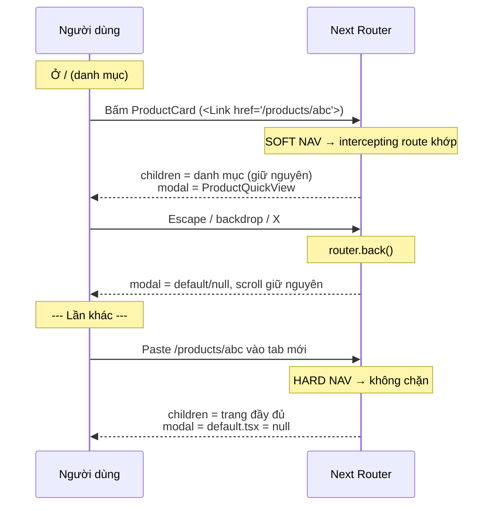

# 19. Parallel Routes & Intercepting Routes

> **Mục tiêu:** hiểu hai convention khó nhất của App Router. Dựng được modal "chia sẻ link được"
> (Instagram-style) và dashboard nhiều vùng độc lập — cả hai áp dụng trực tiếp vào repo này.
>
> Phiên bản: Next.js 16.2 — **mọi slot bắt buộc có `default.tsx`, thiếu là build fail.**

---

## 1. Overview

### Vấn đề 1: một layout, nhiều vùng độc lập

📄 Hình dung `app/(seller)/seller/page.tsx` (hiện chỉ là mảng `QUICK_ACTIONS` tĩnh) phát triển thành
dashboard thật:

```
┌─────────────────────────────────────────────┐
│  Doanh thu 7 ngày   │  Đơn hàng mới         │
│  (API chậm, 800ms)  │  (API nhanh, 100ms)   │
├─────────────────────┼───────────────────────┤
│  Sản phẩm sắp hết   │  Đánh giá gần đây     │
└─────────────────────────────────────────────┘
```

Bọc mỗi vùng trong `<Suspense>` (file `06`) giải quyết **loading**. Nhưng mỗi vùng **không có
`error.tsx` riêng**, **không có route riêng**, và tất cả nằm trong **một file**.

### Vấn đề 2: modal phải vừa là modal, vừa là trang

Người dùng ở `/` (danh mục), bấm một sản phẩm. Bạn muốn:

- **Bấm từ danh mục** → **modal** xem nhanh, grid vẫn phía sau
- **Copy URL gửi bạn bè** / **F5** → **trang chi tiết đầy đủ**
- **Nút Back** → đóng modal, không rời trang

Cùng URL `/products/abc`, **hai UI tuỳ cách bạn đến đó.** Làm bằng state client thì mất "chia sẻ
link được"; làm bằng route thường thì mất "modal trên nền danh mục". **Intercepting + Parallel
Routes giải quyết đúng bài toán này.**

---

## 2. Mental Model

### 🧠 Parallel routes như nhiều `{children}` có tên

Layout thường có **một** lỗ (`children`). Parallel routes cho layout **nhiều lỗ có tên** — mỗi lỗ là
một **slot**, khai báo bằng thư mục `@tên`:

```
app/(seller)/seller/
├── layout.tsx        ← nhận { children, revenue, orders }
├── page.tsx          ← điền vào `children` (children là slot ngầm định)
├── @revenue/
│   ├── page.tsx      ← điền vào `revenue`
│   ├── default.tsx   ← ⚠️ BẮT BUỘC (Next 16)
│   ├── loading.tsx   ← loading RIÊNG
│   └── error.tsx     ← error boundary RIÊNG
└── @orders/ ...
```

```tsx
// app/(seller)/seller/layout.tsx
export default function Layout({ children, revenue, orders }: LayoutProps<'/seller'>) {
  return (
    <>
      {children}
      <div className="grid gap-6 lg:grid-cols-2">{revenue}{orders}</div>
    </>
  )
}
```

`LayoutProps<'/seller'>` là helper **global** (sinh ra khi `next dev`/`next build`/`next typegen`) —
nó tự suy ra `params` **và các slot** từ cấu trúc thư mục, không cần import.

- **`@revenue` KHÔNG xuất hiện trong URL** — giống route group, chỉ là công cụ tổ chức.
- Mỗi slot là một **subtree độc lập**: `loading.tsx`, `error.tsx`, trạng thái navigation riêng, và được
  **stream độc lập**.

### 🧠 Slot "nhớ" trạng thái khi soft nav, quên khi hard nav

Đây là quy tắc gốc giải thích mọi hành vi lạ của parallel routes:

| Loại navigation | Slot không khớp URL mới thì sao? |
| --- | --- |
| **Soft** (bấm `<Link>`, `router.push`) | **Giữ nguyên** nội dung đang hiện (partial render) |
| **Hard** (F5, gõ URL, mở tab mới) | Render **`default.tsx`** của slot đó |

### 🧠 Intercepting routes như "chặn thư giữa đường"

```
Soft nav (bấm <Link> trong app):
  /products/abc ──▶ 🚧 CHẶN ──▶ @modal/(.)products/[id]/page.tsx  → MODAL (children giữ danh mục)

Hard nav (gõ URL / F5 / mở từ ngoài):
  /products/abc ──────────────▶ products/[id]/page.tsx             → TRANG ĐẦY ĐỦ
```

Soft nav đi qua **router ở client** — Next biết bạn đang ở đâu nên có thể "giữ trang cũ, chồng modal
lên". Hard nav là một HTTP request mới — không có "trang cũ" nào để chồng.

---

## 3. Cú pháp Intercepting Routes

| Cú pháp | Nghĩa | Tương tự |
| --- | --- | --- |
| `(.)folder` | Chặn route **cùng cấp** | `./folder` |
| `(..)folder` | Chặn route **một cấp trên** | `../folder` |
| `(..)(..)folder` | Chặn route **hai cấp trên** | `../../folder` |
| `(...)folder` | Chặn route tính từ **`app/` root** | `/folder` |

⚠️ **Cấp được tính theo ROUTE SEGMENT (URL), không theo hệ thống file.** Cả **route group `(store)`**
lẫn **thư mục slot `@modal`** đều **không** được đếm:

```
app/
└── (store)/
    ├── page.tsx                    → /
    ├── @modal/
    │   └── (.)products/[id]/       → chặn /products/:id   ⭐ (.) chứ không phải (..)
    └── products/[id]/page.tsx      → /products/:id
```

Về file, `(.)products` nằm sâu hơn `products` hai cấp. Về URL, cả hai ở cấp gốc → `(.)`. **Modal không
hiện? Kiểm tra số dấu chấm trước tiên** — sai là bug im lặng, không có lỗi nào.

---

## 4. 🛠️ Bài tập 1: Product Quick-View Modal

### Cấu trúc file

```
app/(store)/
├── layout.tsx                          ← SỬA: nhận thêm slot `modal`
├── page.tsx                            → /
├── products/[id]/page.tsx              → /products/:id  (trang đầy đủ)
└── @modal/
    ├── default.tsx                     ← BẮT BUỘC: return null
    ├── page.tsx                        ← return null — đóng modal khi soft nav về /
    ├── [...catchAll]/page.tsx          ← return null — đóng modal khi soft nav đi nơi khác
    └── (.)products/[id]/page.tsx       ← bản modal
```

### Bước 1 — Layout nhận slot

📄 `app/(store)/layout.tsx` hiện chỉ nhận `children` (render `StoreHeader`, `<main>`, footer PERKS):

```tsx
export default function StoreLayout({
  children,
  modal,                                    // ⭐ slot @modal
}: {
  children: React.ReactNode
  modal: React.ReactNode
}) {
  return (
    <div className="flex min-h-full flex-1 flex-col bg-surface">
      <StoreHeader />
      <main className="mx-auto w-full max-w-7xl flex-1 px-4 py-6">{children}</main>
      {modal}                               {/* thường là null */}
      <footer className="mt-8 bg-card">{/* PERKS ... */}</footer>
    </div>
  )
}
```

### Bước 2 — ⭐ `default.tsx` và catch-all: hai file mọi người quên

```tsx
// app/(store)/@modal/default.tsx
export default function ModalDefault() {
  return null
}

// app/(store)/@modal/[...catchAll]/page.tsx
export default function CloseModal() {
  return null
}
```

**`default.tsx` trả lời câu hỏi:** *"sau hard nav, slot này không khớp URL hiện tại thì render gì?"*

- Ở `/cart` sau F5: `children` → `cart/page.tsx`; `@modal` không có `cart` → `default.tsx` → `null`.
- F5 khi modal đang mở ở `/products/abc`: `children` khớp trang đầy đủ; `@modal` không suy ra được trạng
  thái → `default.tsx` → `null`. ✅ Đúng hành vi ta muốn.

⚠️ **Next 16: thiếu `default.tsx` cho một slot `@name` → build fail.** (Next 15 trả 404 lúc runtime.)
Muốn giữ hành vi 404 cũ thì cho `default.tsx` gọi `notFound()`.

**Vì sao cần thêm catch-all?** Nhớ quy tắc: **soft nav giữ nguyên slot không khớp.** Modal đang mở, người
dùng bấm "Giỏ hàng" trên header → `children` đổi sang `/cart`, nhưng `@modal` **vẫn hiện modal cũ** vì
không có gì trong `@modal` khớp `/cart`. `[...catchAll]/page.tsx` trả `null` làm `@modal` khớp **mọi**
URL khác → modal đóng. `[...catchAll]` cần ít nhất một segment nên **không** khớp `/` → thêm
`@modal/page.tsx` trả `null` để bấm logo về trang chủ cũng đóng modal.

> `children` cũng là một slot ngầm định (`app/page.js` ≡ `app/@children/page.js`). Docs Next khuyến nghị
> tạo luôn `app/(store)/default.tsx` (thường gọi `notFound()`) làm fallback khi Next không khôi phục được
> trạng thái của `children` sau hard nav — ví dụ một URL mà slot khác có trang nhưng `children` thì không.

### Bước 3 — Modal shell (Client Component) dùng `<dialog>` native

```tsx
// components/store/route-modal.tsx
'use client'
import { useEffect, useRef } from 'react'
import { useRouter } from 'next/navigation'
import { X } from 'lucide-react'

export function RouteModal({ children, label }: { children: React.ReactNode; label: string }) {
  const router = useRouter()
  const ref = useRef<HTMLDialogElement>(null)

  useEffect(() => {
    // showModal(): top layer + backdrop + phần còn lại của trang thành inert (focus trap miễn phí)
    if (!ref.current?.open) ref.current?.showModal()
  }, [])

  return (
    <dialog
      ref={ref}
      aria-label={label}
      onClose={() => router.back()}          // Escape → 'close' → back
      onClick={(e) => e.target === ref.current && router.back()}   // click backdrop
      className="m-auto max-h-[85vh] w-full max-w-3xl overflow-y-auto rounded-xl bg-background shadow-lg backdrop:bg-black/50"
    >
      {/* padding đặt ở div con: nếu đặt trên <dialog>, click vào vùng padding cũng có
          e.target === dialog → bị hiểu nhầm là click backdrop và đóng modal */}
      <div className="relative p-6">
        <button type="button" onClick={() => router.back()} aria-label="Đóng" className="absolute right-4 top-4">
          <X className="size-5" />
        </button>
        {children}
      </div>
    </dialog>
  )
}
```

`showModal()` cho sẵn những thứ trước đây phải tự viết ~60 dòng: Escape để đóng, focus trap (nội
dung ngoài dialog thành `inert`), `aria-modal`, lớp backdrop. (Vẫn nên khoá scroll `body` nếu cần — xem
`useDisclosure` ở file `17`.)

**Vì sao `router.back()` mà không phải `router.push('/')`?**

| | `router.back()` | `router.push('/')` |
| --- | --- | --- |
| Nút Back sau khi đóng | ✅ Modal đã bị pop khỏi history | ❌ Thêm entry → Back mở lại modal |
| Về đúng trang trước | ✅ Kể cả `/?q=áo&page=2` | ❌ Luôn về `/` |
| Giữ vị trí scroll | ✅ | ❌ |

Và `router.back()` luôn an toàn ở đây: modal **chỉ** tồn tại sau soft nav → luôn có entry để back về.
Intercepting route và `router.back()` là một cặp tự nhiên.

### Bước 4 — Trang modal (Server Component)

```tsx
// app/(store)/@modal/(.)products/[id]/page.tsx
import { notFound } from 'next/navigation'
import { apiFetch } from '@/lib/api/server-client'
import { normalizeProductDetail } from '@/lib/products/sku'
import { RouteModal } from '@/components/store/route-modal'
import { ProductPurchase } from '@/components/store/product-purchase'

export default async function ProductQuickView({ params }: PageProps<'/products/[id]'>) {
  const { id } = await params                      // params là Promise (Next 15+)
  const detail = normalizeProductDetail(await apiFetch<unknown>(`/product/${id}`))
  if (!detail) notFound()

  return (
    <RouteModal label={`Xem nhanh: ${detail.spu.product_name}`}>
      <ProductPurchase spu={detail.spu} skus={detail.skus} />
      <div className="mt-6 border-t pt-4">
        {/* ⚠️ <a> thường, KHÔNG phải <Link>: URL đã là /products/:id, một <Link> tới
            chính nó vẫn là soft nav → bị chặn lại thành modal. <a> ép hard nav. */}
        <a href={`/products/${id}`} className="text-sm text-primary hover:underline">
          Xem đầy đủ chi tiết & bình luận →
        </a>
      </div>
    </RouteModal>
  )
}
```

📄 Trang đầy đủ `app/(store)/products/[id]/page.tsx` hiện đã tách phần mua hàng thành
`<ProductPurchase spu skus />` (Client Component) — modal **dùng lại đúng component đó**, nên hai view
không bao giờ lệch nhau. Modal **không** hiện highlights/specifications/comments: nó là **một view khác**
của cùng dữ liệu (xem nhanh), không phải bản thu nhỏ của trang.

> Gợi ý thêm cho trang đầy đủ (file `06`, `16`): thay khối `if (error || !detail) return <p>…</p>`
> bằng `notFound()` để có HTTP 404 thật, và tách comments ra async component trong `<Suspense>`.

### Luồng hoàn chỉnh



### ⚠️ Bốn cạm bẫy

1. **Số dấu chấm sai.** `(.)products`, vì `(store)` và `@modal` không phải segment.
2. **Thiếu `@modal/default.tsx`** → Next 16 build fail.
3. **Thiếu catch-all** → modal "dính" lại khi bấm link khác trên header (soft nav giữ slot).
4. **Chỉ chặn khi đang ở trong layout chứa slot.** Từ `/seller/products` (layout `(seller)`) bấm tới
   `/products/abc` → layout `(store)` chưa mount → không chặn → trang đầy đủ. Thường đó lại là điều bạn
   muốn — nhưng hãy kiểm tra từng đường vào, đừng giả định.

---

## 5. 🛠️ Bài tập 2: Seller Dashboard nhiều vùng độc lập

```
app/(seller)/seller/
├── layout.tsx              ← SỬA: nhận { children, revenue, lowStock }
├── page.tsx                → QUICK_ACTIONS hiện tại
├── @revenue/   default.tsx · loading.tsx · error.tsx · page.tsx
└── @lowStock/  default.tsx · loading.tsx · error.tsx · page.tsx
```

📄 `app/(seller)/seller/layout.tsx` hiện render `SellerSidebar` + `SellerMobileNav` + `<main>{children}</main>`.
Chỉ cần thêm slot vào `<main>`:

```tsx
export default function SellerLayout({ children, revenue, lowStock }: LayoutProps<'/seller'>) {
  return (
    <div className="flex min-h-screen bg-surface">
      <aside className="sticky top-0 hidden h-screen w-60 shrink-0 border-r border-sidebar-border bg-card md:block">
        <SellerSidebar />
      </aside>
      <div className="flex min-w-0 flex-1 flex-col">
        <SellerMobileNav />
        <main className="flex-1 space-y-6 p-6 md:p-10">
          {children}
          <div className="grid gap-6 lg:grid-cols-2">{revenue}{lowStock}</div>
        </main>
      </div>
    </div>
  )
}
```

⚠️ Layout này bọc **mọi** trang `/seller/*`. Ở `/seller/products` sau F5, `@revenue` không có
`products/page.tsx` → render `default.tsx`. Nếu chỉ muốn widget ở trang tổng quan, cho `default.tsx`
trả `null`; nếu muốn hiện mọi nơi, cho `default.tsx` render lại `page.tsx` (`export { default } from './page'`).

```tsx
// app/(seller)/seller/@revenue/page.tsx
export default async function RevenueSlot() {
  // KHÔNG try/catch — để error.tsx của slot xử lý. Lỗi ở đây KHÔNG làm sập cả dashboard.
  const data = await apiFetch<{ total: number; orderCount: number }>('/order/shop/summary?days=7', { auth: true })
  return (
    <Card>
      <CardHeader><CardTitle>Doanh thu 7 ngày</CardTitle></CardHeader>
      <CardContent>
        <p className="text-3xl font-semibold tabular-nums">{toPriceString(data.total)}</p>
        <p className="text-sm text-muted-foreground">{data.orderCount} đơn hàng</p>
      </CardContent>
    </Card>
  )
}
```

```tsx
// app/(seller)/seller/@revenue/error.tsx
'use client'
export default function RevenueError({ unstable_retry }: { error: Error & { digest?: string }; unstable_retry: () => void }) {
  return (
    <Card>
      <CardHeader><CardTitle>Doanh thu 7 ngày</CardTitle></CardHeader>
      <CardContent className="space-y-3">
        <p className="text-sm text-muted-foreground">Không tải được số liệu doanh thu.</p>
        {/* unstable_retry (thêm ở Next 16.2) re-fetch + re-render chỉ slot này; `reset()` cũ
            chỉ re-render, không fetch lại — xem file 16 */}
        <Button variant="outline" size="sm" onClick={() => unstable_retry()}>Thử lại</Button>
      </CardContent>
    </Card>
  )
}
```

`loading.tsx` của slot là một skeleton `Card` bình thường — nó tự thành `<Suspense fallback>` cho slot.

### Vì sao hơn `<Suspense>` trong một page

| | `<Suspense>` trong `page.tsx` | Parallel route slot |
| --- | --- | --- |
| Loading riêng từng vùng | ✅ (fallback viết tay) | ✅ `loading.tsx` per slot |
| **Error boundary riêng** | ⚠️ Tự bọc (`unstable_catchError`/class) | ✅ `error.tsx` per slot |
| Team làm song song | ❌ Cùng một file | ✅ Mỗi slot một thư mục |
| Sub-navigation riêng trong một vùng | ❌ | ✅ (`@revenue/weekly/page.tsx`…) |
| Độ phức tạp | Thấp | Cao hơn (nhiều file, `default.tsx`) |

Với `<Suspense>` một mình, API doanh thu sập → lỗi nổi lên `error.tsx` của **cả trang**. Với slot, chỉ
**card doanh thu** hiện lỗi.

⚖️ **Nhưng đừng dùng cho dashboard hiện tại của repo.** `seller/page.tsx` chỉ render `QUICK_ACTIONS`
tĩnh — không fetch, không có gì để lỗi. 8 file mới cho 0 lợi ích. **Ngưỡng:** ≥2 vùng, mỗi vùng **tự
fetch dữ liệu**, và bạn **thực sự muốn** chúng lỗi độc lập.

---

## 6. Conditional Routes — cùng URL, hai UI theo điều kiện

```tsx
// app/(seller)/seller/account/layout.tsx — với @shop/ và @upgrade/ (mỗi slot có default.tsx)
import { isShop } from '@/lib/auth/session'

export default async function AccountLayout({ shop, upgrade }: LayoutProps<'/seller/account'>) {
  return (await isShop()) ? shop : upgrade
}
```

📄 So với `app/(seller)/seller/account/page.tsx` hiện tại:

```tsx
export default async function AccountPage() {
  const payload = await getAccessPayload()
  const isShop = Boolean(payload?.roles?.includes('shop'))
  // New sellers land here from "Start Selling" — give them a focused, guided upgrade flow…
  if (!isShop) {
    return (
      <div className="mx-auto max-w-xl space-y-6">
        <h1 className="text-2xl font-bold">Start selling on SHOP</h1>
        <UpgradeShopForm isShop={isShop} />
      </div>
    )
  }
  return <div className="space-y-6">{/* ...UI cho shop... */}</div>
}
```

⚖️ **Code hiện tại TỐT HƠN:** 1 file vs 5 file, một `if` đọc là thấy, comment nằm ngay chỗ quyết định.
Conditional parallel routes chỉ đáng khi **mỗi nhánh là một subtree lớn** với dữ liệu và loading riêng
(ví dụ dashboard admin vs dashboard user khác hoàn toàn).

---

## 7. When NOT to Use

| Đừng dùng | Dùng gì thay thế |
| --- | --- |
| Modal mà URL không cần đổi (confirm xoá, tooltip) | `useState` + `<Dialog>` của base-ui |
| Chia layout nhiều cột | CSS `grid` |
| Nhiều vùng cùng một nguồn dữ liệu | Một `page.tsx` + `<Suspense>` |
| Chỉ cần loading riêng, không cần error riêng | `<Suspense>` trong page |
| Điều kiện đơn giản 2 nhánh | `if (...) return` |
| Tab trong một trang (Draft/Published) | `?tab=` + `<Link>` (như repo đang làm) |

⚖️ **Trade-off:** đổi lại modal có URL thật (share, deep-link, Back đúng) và lỗi cô lập per slot, bạn trả
bằng nhiều file, convention `(.)`/`default.tsx`/catch-all khó nhớ, và những bug im lặng (sai dấu chấm →
modal không hiện, không lỗi; thiếu catch-all → modal dính).

---

## 8. Best Practices

1. **Mỗi slot `@name` PHẢI có `default.tsx`** — Next 16 build fail nếu thiếu.
2. **Đếm dấu chấm theo URL segment.** Route group `(store)` và slot `@modal` không tính.
3. **Modal route cần `@modal/[...catchAll]/page.tsx` trả `null`** để đóng khi soft nav đi nơi khác.
4. **`router.back()` để đóng modal**, không `router.push`.
5. **Link "xem đầy đủ" trong modal dùng `<a>`** để ép hard nav.
6. **Dùng chung component** (`ProductPurchase`) giữa modal và trang đầy đủ; modal là **view khác**, không phải bản thu nhỏ.
7. **Slot không `try/catch`** — để `error.tsx` của slot xử lý (`unstable_retry` chỉ retry slot đó).
8. **`<dialog>` + `showModal()`** cho modal shell: Escape, focus trap, inert miễn phí.
9. **Type layout bằng `LayoutProps<'/route'>`** — slot được suy ra tự động.
10. **Ngưỡng dùng parallel routes:** ≥2 vùng tự fetch và cần lỗi độc lập.

---

## Tự kiểm tra

1. Parallel route slot cho bạn những gì mà `<Suspense>` không cho?
2. Soft nav và hard nav xử lý slot không khớp URL khác nhau thế nào?
3. Vì sao `default.tsx` là bắt buộc? Next 16 khác Next 15 ở đâu?
4. Vì sao cần `@modal/[...catchAll]/page.tsx`? Thiếu nó thì bug gì xảy ra?
5. Trong `app/(store)/@modal/`, vì sao là `(.)products` mà không phải `(..)products`?
6. Vì sao F5 khi modal đang mở lại hiện trang đầy đủ?
7. Vì sao link "xem đầy đủ" trong modal phải là `<a>` chứ không phải `<Link>`?
8. Vì sao `RevenueSlot` KHÔNG nên có `try/catch`?
9. `account/page.tsx` có nên chuyển sang conditional parallel routes không? Vì sao?

➡️ Tiếp theo: `20-route-handlers-streaming-realtime.md`
