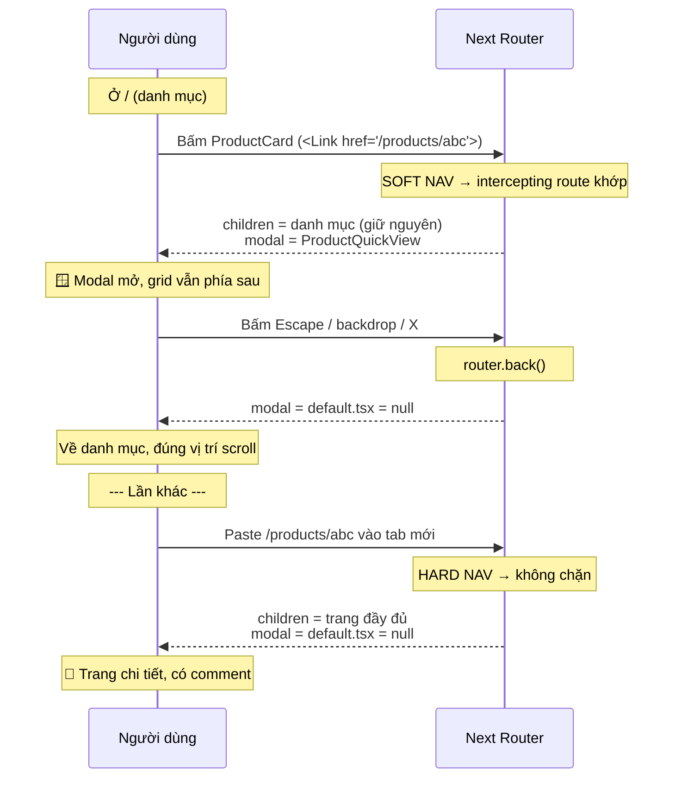

# 19. Parallel Routes & Intercepting Routes

> **Mục tiêu:** hiểu hai convention khó nhất của App Router. Dựng được modal "chia sẻ link được"
> (Instagram-style) và dashboard nhiều vùng độc lập — cả hai đều áp dụng trực tiếp vào repo này.

---

## 1. Overview

### Vấn đề 1: một layout, nhiều vùng độc lập

📄 Hình dung `app/(seller)/seller/page.tsx` phát triển thành một dashboard thật:

```
┌─────────────────────────────────────────────┐
│  Doanh thu 7 ngày   │  Đơn hàng mới         │
│  (API chậm, 800ms)  │  (API nhanh, 100ms)   │
├─────────────────────┼───────────────────────┤
│  Sản phẩm sắp hết   │  Đánh giá gần đây     │
│  (500ms)            │  (300ms)              │
└─────────────────────────────────────────────┘
```

Với một `page.tsx` duy nhất, bạn có thể bọc mỗi vùng trong `<Suspense>` (file `06`). Điều đó giải quyết
được **loading**. Nhưng:

- ❌ Mỗi vùng **không có `error.tsx` riêng** — lỗi ở "Doanh thu" cần error boundary tự viết
- ❌ Mỗi vùng **không có route riêng** — không deep-link vào "chỉ xem doanh thu"
- ❌ Tất cả nằm trong **một file** — bốn team sửa cùng một file

### Vấn đề 2: modal phải vừa là modal, vừa là trang

Đây là vấn đề mà mọi app e-commerce đều gặp.

Người dùng ở `/` (danh mục), bấm một sản phẩm. Bạn muốn:

- **Bấm từ danh mục** → mở **modal** xem nhanh, giữ nguyên grid phía sau, đóng lại là về danh mục
- **Copy URL đó gửi cho bạn bè** → họ mở ra thấy **trang chi tiết đầy đủ**
- **Refresh (F5) khi modal đang mở** → thấy **trang chi tiết đầy đủ**, không phải modal lơ lửng
- **Nút Back** → đóng modal, không rời khỏi trang

Cùng một URL `/products/abc123`, **hai UI khác nhau tuỳ cách bạn đến đó.**

Làm bằng state ở client thì mất "chia sẻ link được". Làm bằng route thường thì mất "modal trên nền
danh mục". **Intercepting Routes giải quyết đúng bài toán này.**

---

## 2. Mental Model

### 🧠 Parallel routes như nhiều `{children}` có tên

Layout thường chỉ có **một** cái lỗ:

```tsx
export default function Layout({ children }) {
  return <div>{children}</div>
}
```

Parallel routes cho layout **nhiều lỗ có tên**:

```tsx
export default function Layout({ children, revenue, orders }) {
  return (
    <div>
      {children}
      <div className="grid grid-cols-2">
        {revenue}
        {orders}
      </div>
    </div>
  )
}
```

Mỗi lỗ là một **slot**, khai báo bằng thư mục `@tên`:

```
app/(seller)/seller/
├── layout.tsx        ← nhận { children, revenue, orders }
├── page.tsx          ← điền vào `children`
├── @revenue/
│   ├── page.tsx      ← điền vào `revenue`
│   ├── loading.tsx   ← ⭐ loading RIÊNG của slot này
│   └── error.tsx     ← ⭐ error boundary RIÊNG
└── @orders/
    ├── page.tsx
    ├── loading.tsx
    └── error.tsx
```

**`@revenue` KHÔNG xuất hiện trong URL.** Giống route group `(store)` — nó chỉ là công cụ tổ chức.

**Điểm mấu chốt:** mỗi slot là một **subtree độc lập** với `loading.tsx`, `error.tsx`, và trạng thái
navigation riêng. Đó là thứ `<Suspense>` một mình không cho bạn.

### 🧠 Intercepting routes như "chặn thư giữa đường"

Khi người dùng navigate tới `/products/abc`, bình thường Next.js render
`app/(store)/products/[id]/page.tsx`.

Intercepting route nói: *"nếu request này đến từ **soft navigation** trong app, hãy đưa nó cho tôi
thay vì cho route thật."*

```
Soft nav (bấm <Link> trong app):
  /products/abc ──▶ 🚧 CHẶN ──▶ (.)products/[id]/page.tsx  → render thành MODAL

Hard nav (gõ URL / F5 / mở từ ngoài):
  /products/abc ──────────────▶ products/[id]/page.tsx      → render TRANG ĐẦY ĐỦ
```

**Vì sao hai đường lại khác nhau?** Vì soft navigation đi qua **router ở client** — Next.js biết bạn
đang ở đâu và có thể quyết định "giữ trang cũ, chồng modal lên". Hard navigation là một HTTP request
mới — không có "trang cũ" nào để chồng lên.

---

## 3. Cú pháp Intercepting Routes

| Cú pháp | Nghĩa | Tương tự |
| --- | --- | --- |
| `(.)folder` | Chặn route ở **cùng cấp** | `./folder` |
| `(..)folder` | Chặn route ở **một cấp trên** | `../folder` |
| `(..)(..)folder` | Chặn route **hai cấp trên** | `../../folder` |
| `(...)folder` | Chặn route tính từ **`app/` root** | `/folder` |

⚠️ **Cạm bẫy quan trọng: các cấp được tính theo cấu trúc ROUTE (URL), không phải theo hệ thống file.**

Route group `(store)` không tạo cấp URL, nên nó **không** được đếm:

```
app/
└── (store)/
    ├── page.tsx                    → /
    ├── @modal/
    │   └── (.)products/[id]/       → chặn /products/:id   ⭐ dùng (.) không phải (..)
    └── products/[id]/page.tsx      → /products/:id
```

Về mặt file, `@modal` và `products` đều nằm trong `(store)`. Về mặt URL, cả hai ở cấp gốc.
Nên `(.)products` là đúng — dù trực giác về đường dẫn file có thể mách bạn `(..)`.

**Đây là lỗi phổ biến nhất khi dùng intercepting routes.** Nếu modal không hiện, hãy kiểm tra số dấu
chấm trước tiên.

---

## 4. 🛠️ Bài tập 1: Product Quick-View Modal

Áp dụng vào repo: bấm sản phẩm từ danh mục → modal xem nhanh; share link → trang đầy đủ.

### Cấu trúc file

```
app/(store)/
├── layout.tsx                          ← SỬA: nhận thêm prop `modal`
├── default.tsx                         ← MỚI (bắt buộc, giải thích ở dưới)
├── page.tsx                            → /
├── products/[id]/page.tsx              → /products/:id  (trang đầy đủ, GIỮ NGUYÊN)
└── @modal/
    ├── default.tsx                     ← MỚI (bắt buộc)
    └── (.)products/[id]/
        └── page.tsx                    ← MỚI: bản modal
```

### Bước 1 — Layout nhận slot

```tsx
// app/(store)/layout.tsx
import { StoreHeader } from '@/components/store/store-header'

export default function StoreLayout({
  children,
  modal,                                  // ⭐ slot @modal
}: {
  children: React.ReactNode
  modal: React.ReactNode
}) {
  return (
    <div className="min-h-full">
      <StoreHeader />
      <main className="mx-auto max-w-6xl px-4 py-8">{children}</main>
      {modal}                             {/* ⭐ render slot; thường là null */}
      <footer className="border-t">
        <div className="mx-auto max-w-6xl px-4 py-6 text-sm text-muted-foreground">© Shop</div>
      </footer>
    </div>
  )
}
```

### Bước 2 — ⭐ `default.tsx`: file khó hiểu nhất của parallel routes

```tsx
// app/(store)/@modal/default.tsx
export default function ModalDefault() {
  return null
}
```

```tsx
// app/(store)/default.tsx
import StoreHomePage from './page'
export default StoreHomePage
```

**Vì sao cần `default.tsx`? Đây là chỗ mọi người bị mắc.**

Next.js phải render **mọi slot** cho **mọi URL**. Khi bạn ở `/cart`:

- Slot `children` → render `cart/page.tsx` ✅
- Slot `modal` → **render cái gì?** Không có `@modal/cart/page.tsx`

Nếu không có `default.tsx`, Next.js **không biết** phải điền gì vào slot `modal` → lỗi 404 hoặc lỗi
build.

`default.tsx` là câu trả lời cho: *"khi slot này không khớp URL hiện tại, render gì?"*

- `@modal/default.tsx` → `null` (không có modal)
- `(store)/default.tsx` → trang chủ (fallback cho slot `children` sau hard nav)

**Chi tiết tinh vi hơn nữa:** `default.tsx` được dùng khi Next.js **không thể suy ra** state của slot —
điển hình là sau một **hard navigation hoặc full page reload** khi router cache không còn thông tin về
slot đó.

Đây là cơ chế cho hành vi ta muốn: F5 khi modal mở → `@modal` không suy ra được → dùng `default.tsx`
→ `null` → không modal. Còn `children` khớp `/products/abc` → render trang đầy đủ. ✅

> **Quy tắc:** mỗi slot `@name` **phải** có `default.tsx`. Nếu bạn thấy lỗi
> *"parallel route ... did not match"* — thiếu `default.tsx`.

### Bước 3 — Modal shell (Client Component)

Cần client vì có keyboard, click-outside, và focus management:

```tsx
// components/store/route-modal.tsx
'use client'
import { useCallback, useEffect, useRef } from 'react'
import { useRouter } from 'next/navigation'
import { X } from 'lucide-react'

export function RouteModal({
  children,
  label,
}: {
  children: React.ReactNode
  label: string
}) {
  const router = useRouter()
  const panelRef = useRef<HTMLDivElement>(null)
  const previouslyFocused = useRef<HTMLElement | null>(null)

  // router.back() đóng modal VÀ xoá entry khỏi history →
  // nút Back của browser hoạt động đúng như người dùng mong đợi.
  const close = useCallback(() => router.back(), [router])

  // Escape để đóng
  useEffect(() => {
    const onKey = (e: KeyboardEvent) => {
      if (e.key === 'Escape') close()
    }
    document.addEventListener('keydown', onKey)
    return () => document.removeEventListener('keydown', onKey)
  }, [close])

  // Lock scroll — pattern lưu/khôi phục từ seller-mobile-nav.tsx (file 03)
  useEffect(() => {
    const prev = document.body.style.overflow
    document.body.style.overflow = 'hidden'
    return () => {
      document.body.style.overflow = prev
    }
  }, [])

  // Focus management: nhớ nơi focus cũ, focus vào panel, trả về khi đóng
  useEffect(() => {
    previouslyFocused.current = document.activeElement as HTMLElement | null
    panelRef.current?.focus()
    return () => previouslyFocused.current?.focus()
  }, [])

  // Focus trap — Tab không được thoát ra khỏi modal (chi tiết ở file 23)
  useEffect(() => {
    const onKeyDown = (e: KeyboardEvent) => {
      if (e.key !== 'Tab' || !panelRef.current) return
      const focusable = panelRef.current.querySelectorAll<HTMLElement>(
        'a[href], button:not([disabled]), input:not([disabled]), select, textarea, [tabindex]:not([tabindex="-1"])',
      )
      if (focusable.length === 0) return
      const first = focusable[0]
      const last = focusable[focusable.length - 1]
      if (e.shiftKey && document.activeElement === first) {
        e.preventDefault()
        last.focus()
      } else if (!e.shiftKey && document.activeElement === last) {
        e.preventDefault()
        first.focus()
      }
    }
    document.addEventListener('keydown', onKeyDown)
    return () => document.removeEventListener('keydown', onKeyDown)
  }, [])

  return (
    <div className="fixed inset-0 z-50 flex items-center justify-center p-4">
      <div
        className="absolute inset-0 bg-black/50"
        onClick={close}
        aria-hidden="true"
      />
      <div
        ref={panelRef}
        role="dialog"
        aria-modal="true"
        aria-label={label}
        tabIndex={-1}
        className="relative max-h-[85vh] w-full max-w-3xl overflow-y-auto rounded-xl bg-background p-6 shadow-lg outline-none"
      >
        <button
          type="button"
          onClick={close}
          aria-label="Đóng"
          className="absolute right-4 top-4 text-muted-foreground hover:text-foreground"
        >
          <X className="size-5" />
        </button>
        {children}
      </div>
    </div>
  )
}
```

**Tại sao `router.back()` mà không phải `router.push('/')`?**

| | `router.back()` | `router.push('/')` |
| --- | --- | --- |
| Nút Back của browser | ✅ Đúng — modal đã bị pop khỏi history | ❌ Thêm entry mới → Back mở lại modal |
| Về đúng trang trước | ✅ Kể cả khi đến từ `/search?q=áo` | ❌ Luôn về `/` |
| Giữ vị trí scroll | ✅ | ❌ |

⚠️ **Nhưng `router.back()` có một ca gãy:** nếu người dùng mở modal bằng cách **hard nav** (không có
history) thì... thực ra ca đó không xảy ra, vì hard nav render trang đầy đủ, không phải modal. Modal
chỉ tồn tại sau soft nav → luôn có entry để back về. **Đây là lý do intercepting route và
`router.back()` là một cặp tự nhiên.**

### Bước 4 — Trang modal (Server Component, chia sẻ code với trang đầy đủ)

Tách phần nội dung dùng chung để **không trùng lặp**:

```tsx
// components/store/product-detail.tsx  — Server Component
import { toPriceString } from '@/lib/products/price'
import { Badge } from '@/components/ui/badge'
import { AddToCart } from '@/components/store/add-to-cart'
import type { Product } from '@/types/product'

export function ProductDetail({ product, compact = false }: { product: Product; compact?: boolean }) {
  const gallery = product.product_images?.length
    ? product.product_images
    : [{ url: product.product_thumb, public_id: 'thumb' }]
  const attrs = product.product_attributes ?? {}

  return (
    <div className={compact ? 'grid gap-6 sm:grid-cols-2' : 'grid gap-8 md:grid-cols-2'}>
      <div className="grid grid-cols-2 gap-2">
        {/* Trong modal chỉ hiện 2 ảnh đầu — modal không nên cuộn dài */}
        {(compact ? gallery.slice(0, 2) : gallery).map((img) => (
          // eslint-disable-next-line @next/next/no-img-element
          
        ))}
      </div>
      <div className="space-y-4">
        <div className="flex items-center gap-2">
          <h1 className={compact ? 'text-xl font-semibold' : 'text-2xl font-semibold'}>
            {product.product_name}
          </h1>
          <Badge variant="secondary">{product.product_type}</Badge>
        </div>
        <p className="text-xl">{toPriceString(product.product_price)}</p>
        <p className="text-sm text-muted-foreground">Còn lại: {product.product_quantity}</p>
        {product.product_description ? (
          <p className={compact ? 'line-clamp-3 text-sm' : 'text-sm'}>{product.product_description}</p>
        ) : null}
        {Object.keys(attrs).length > 0 ? (
          <dl className="grid grid-cols-2 gap-1 text-sm">
            {Object.entries(attrs).map(([k, v]) => (
              <div key={k} className="contents">
                <dt className="text-muted-foreground capitalize">{k}</dt>
                <dd>{String(v)}</dd>
              </div>
            ))}
          </dl>
        ) : null}
        <AddToCart productId={product._id} max={product.product_quantity} />
      </div>
    </div>
  )
}
```

```tsx
// app/(store)/@modal/(.)products/[id]/page.tsx
import { notFound } from 'next/navigation'
import Link from 'next/link'
import { apiFetch } from '@/lib/api/server-client'
import { ApiError } from '@/lib/api/http'
import { RouteModal } from '@/components/store/route-modal'
import { ProductDetail } from '@/components/store/product-detail'
import type { Product } from '@/types/product'

export default async function ProductQuickView({
  params,
}: {
  params: Promise<{ id: string }>
}) {
  const { id } = await params
  let product: Product
  try {
    product = await apiFetch<Product>(`/product/${id}`)
  } catch (e) {
    if (e instanceof ApiError && e.status === 404) notFound()
    throw e
  }

  return (
    <RouteModal label={`Xem nhanh: ${product.product_name}`}>
      <ProductDetail product={product} compact />
      <div className="mt-6 border-t pt-4">
        <Link href={`/products/${id}`} className="text-sm text-primary hover:underline">
          Xem đầy đủ chi tiết & bình luận →
        </Link>
      </div>
    </RouteModal>
  )
}
```

**Chú ý dòng cuối:** modal **không** hiện phần comment (nó dài và không phù hợp với xem nhanh), nhưng
cho người dùng một đường đi tới trang đầy đủ. Đó là lý do modal có `compact` — nó là một **view khác**
của cùng dữ liệu, không phải bản thu nhỏ.

### Bước 5 — Trang đầy đủ dùng lại `ProductDetail`

```tsx
// app/(store)/products/[id]/page.tsx  (sửa)
import { Suspense } from 'react'
import { notFound } from 'next/navigation'
import Link from 'next/link'
import { apiFetch } from '@/lib/api/server-client'
import { ApiError } from '@/lib/api/http'
import { ProductDetail } from '@/components/store/product-detail'
import { ProductComments } from '@/components/store/product-comments'
import { CommentsSkeleton } from '@/components/store/comments-skeleton'
import type { Product } from '@/types/product'

export default async function ProductDetailPage({
  params,
}: {
  params: Promise<{ id: string }>
}) {
  const { id } = await params
  let product: Product
  try {
    product = await apiFetch<Product>(`/product/${id}`)
  } catch (e) {
    if (e instanceof ApiError && e.status === 404) notFound()
    throw e
  }

  return (
    <div className="space-y-6">
      <Link href="/" className="text-sm text-primary hover:underline">← Về danh mục</Link>
      <ProductDetail product={product} />
      <Suspense fallback={<CommentsSkeleton />}>
        <ProductComments productId={id} />
      </Suspense>
    </div>
  )
}
```

**Ba cải thiện gộp vào một lần sửa** (từ file `06`, `09`, và chương này):
- `notFound()` thay vì render lỗi inline → HTTP 404 đúng + TypeScript narrowing
- Comments trong `<Suspense>` → hết waterfall 300ms
- `ProductDetail` dùng chung → modal và trang không lệch nhau

### Luồng hoàn chỉnh



### ⚠️ Ba cạm bẫy khi triển khai

**(1) Số dấu chấm sai.** `(.)products` không phải `(..)products`, vì `(store)` là route group.
Đây là lỗi #1.

**(2) Thiếu `default.tsx`.** Cả `@modal/default.tsx` và `(store)/default.tsx`. Triệu chứng: lỗi
"parallel route did not match" hoặc 404 ở các trang không liên quan.

**(3) `<Link>` từ ngoài route group không bị chặn.** Nếu người dùng ở `/seller/products` và bấm link
tới `/products/abc`, intercepting route trong `(store)` **có** khớp (vì cùng cây `app/`), nhưng slot
`@modal` của `(store)` chưa được mount → hành vi có thể không như mong đợi. Kiểm tra thực tế các
đường vào bạn thực sự hỗ trợ, đừng giả định.

---

## 5. 🛠️ Bài tập 2: Seller Dashboard nhiều vùng độc lập

### Cấu trúc

```
app/(seller)/seller/
├── layout.tsx              ← SỬA: nhận { children, revenue, lowStock }
├── page.tsx                → nội dung chính (QUICK_ACTIONS hiện tại)
├── default.tsx
├── @revenue/
│   ├── default.tsx
│   ├── loading.tsx         ← skeleton RIÊNG
│   ├── error.tsx           ← error boundary RIÊNG
│   └── page.tsx
└── @lowStock/
    ├── default.tsx
    ├── loading.tsx
    ├── error.tsx
    └── page.tsx
```

```tsx
// app/(seller)/seller/layout.tsx
import { SellerSidebar } from '@/components/seller/seller-sidebar'
import { SellerMobileNav } from '@/components/seller/seller-mobile-nav'

export default function SellerLayout({
  children,
  revenue,
  lowStock,
}: {
  children: React.ReactNode
  revenue: React.ReactNode
  lowStock: React.ReactNode
}) {
  return (
    <div className="flex min-h-screen">
      <aside className="hidden w-60 shrink-0 border-r border-sidebar-border bg-sidebar md:block">
        <SellerSidebar />
      </aside>
      <div className="flex min-w-0 flex-1 flex-col">
        <SellerMobileNav />
        <main className="flex-1 space-y-6 p-6 md:p-10">
          {children}
          <div className="grid gap-6 lg:grid-cols-2">
            {revenue}
            {lowStock}
          </div>
        </main>
      </div>
    </div>
  )
}
```

```tsx
// app/(seller)/seller/@revenue/page.tsx
import { apiFetch } from '@/lib/api/server-client'
import { toPriceString } from '@/lib/products/price'
import { Card, CardContent, CardHeader, CardTitle } from '@/components/ui/card'

interface RevenueSummary { total: number; orderCount: number }

export default async function RevenueSlot() {
  // KHÔNG try/catch — để error.tsx của slot này xử lý.
  // Đây là điểm khác biệt: lỗi ở đây KHÔNG làm sập cả dashboard.
  const data = await apiFetch<RevenueSummary>('/order/shop/summary?days=7', { auth: true })

  return (
    <Card>
      <CardHeader><CardTitle>Doanh thu 7 ngày</CardTitle></CardHeader>
      <CardContent>
        <p className="text-3xl font-semibold tabular-nums">{toPriceString(data.total)}</p>
        <p className="text-sm text-muted-foreground">{data.orderCount} đơn hàng</p>
      </CardContent>
    </Card>
  )
}
```

```tsx
// app/(seller)/seller/@revenue/loading.tsx
import { Card, CardContent, CardHeader } from '@/components/ui/card'

export default function RevenueLoading() {
  return (
    <Card aria-busy="true" aria-label="Đang tải doanh thu">
      <CardHeader><div className="h-5 w-40 animate-pulse rounded bg-muted" /></CardHeader>
      <CardContent className="space-y-2">
        <div className="h-9 w-32 animate-pulse rounded bg-muted" />
        <div className="h-4 w-24 animate-pulse rounded bg-muted" />
      </CardContent>
    </Card>
  )
}
```

```tsx
// app/(seller)/seller/@revenue/error.tsx
'use client'
import { Card, CardContent, CardHeader, CardTitle } from '@/components/ui/card'
import { Button } from '@/components/ui/button'

export default function RevenueError({ reset }: { error: Error; reset: () => void }) {
  return (
    <Card>
      <CardHeader><CardTitle>Doanh thu 7 ngày</CardTitle></CardHeader>
      <CardContent className="space-y-3">
        <p className="text-sm text-muted-foreground">Không tải được số liệu doanh thu.</p>
        <Button variant="outline" size="sm" onClick={reset}>Thử lại</Button>
      </CardContent>
    </Card>
  )
}
```

### Vì sao hơn `<Suspense>` trong một page

| | `<Suspense>` trong `page.tsx` | Parallel route slot |
| --- | --- | --- |
| Loading riêng từng vùng | ✅ (viết fallback tay) | ✅ (`loading.tsx` per slot) |
| **Error boundary riêng** | ⚠️ Phải tự viết ErrorBoundary class | ✅ **`error.tsx` per slot** |
| **`reset()` chỉ retry vùng đó** | ⚠️ Tự implement | ✅ Có sẵn |
| Team làm việc song song | ❌ Cùng một file | ✅ Mỗi slot một thư mục |
| Deep-link vào một vùng | ❌ | ✅ Có route riêng |
| Độ phức tạp | Thấp | Cao hơn (nhiều file, `default.tsx`) |

**Điểm quan trọng nhất là "Error boundary riêng".** Với `<Suspense>` một mình, nếu API doanh thu sập,
lỗi nổi lên `error.tsx` của **cả trang** → toàn bộ dashboard biến thành trang lỗi. Với parallel route,
chỉ **card doanh thu** hiện lỗi; ba card kia vẫn hoạt động.

⚖️ **Nhưng đừng dùng parallel routes cho dashboard hiện tại của repo.** `app/(seller)/seller/page.tsx`
chỉ render một mảng `QUICK_ACTIONS` tĩnh — không fetch gì, không có gì để lỗi. Parallel routes ở đây
là **over-engineering rõ rệt**: 8 file mới cho 0 lợi ích.

**Ngưỡng đáng dùng:** ≥2 vùng, mỗi vùng **tự fetch dữ liệu riêng**, và bạn **thực sự muốn** chúng lỗi
độc lập.

---

## 6. Conditional Routes — cùng URL, hai UI theo điều kiện

Parallel routes cũng dùng để render UI khác nhau theo trạng thái, mà không cần điều kiện trong JSX:

```
app/(seller)/seller/account/
├── layout.tsx
├── @shop/
│   ├── default.tsx
│   └── page.tsx          ← UI cho người ĐÃ là shop
└── @upgrade/
    ├── default.tsx
    └── page.tsx          ← UI cho người CHƯA là shop
```

```tsx
// app/(seller)/seller/account/layout.tsx
import { isShop } from '@/lib/auth/session'

export default async function AccountLayout({
  shop,
  upgrade,
}: {
  shop: React.ReactNode
  upgrade: React.ReactNode
}) {
  return (await isShop()) ? shop : upgrade
}
```

📄 So sánh với code hiện tại — `app/(seller)/seller/account/page.tsx`:

```tsx
export default async function AccountPage() {
  const payload = await getAccessPayload()
  const isShop = Boolean(payload?.roles?.includes('shop'))

  // New sellers land here from "Start Selling" — give them a focused, guided
  // upgrade flow instead of burying the form in the account grid.
  if (!isShop) {
    return (
      <div className="mx-auto max-w-xl space-y-6">
        <div>
          <h1 className="text-2xl font-semibold">Start selling on SHOP</h1>
          <p className="text-sm text-muted-foreground">
            Create your shop to start listing products and reaching buyers.
          </p>
        </div>
        <UpgradeShopForm isShop={isShop} />
      </div>
    )
  }

  return (
    <div className="space-y-6">
      {/* ...UI cho shop... */}
    </div>
  )
}
```

⚖️ **Đánh giá thẳng thắn: code hiện tại TỐT HƠN.**

| | `if (!isShop) return ...` (hiện tại) | Conditional parallel routes |
| --- | --- | --- |
| Số file | 1 | 5 |
| Đọc luồng | Một `if`, thấy ngay | Phải mở 3 file |
| Comment giải thích | Có, ngay chỗ quyết định | Phân tán |
| Lợi ích thêm | — | `loading.tsx`/`error.tsx` riêng mỗi nhánh |

Với 44 dòng và hai nhánh đơn giản, `if` là đúng. Conditional parallel routes chỉ đáng khi **mỗi nhánh
là một subtree lớn** với dữ liệu và trạng thái loading riêng — ví dụ dashboard admin vs dashboard user
khác nhau hoàn toàn.

> **Đây là bài học chung của chương:** parallel & intercepting routes là công cụ **mạnh và đắt**.
> Chúng giải quyết những vấn đề mà không cách nào khác giải quyết được (modal share-able, error
> boundary per vùng). Nhưng chúng thêm nhiều file, nhiều convention phải nhớ, và một `default.tsx`
> mà ai cũng quên. Chỉ dùng khi bạn thực sự có vấn đề đó.

---

## 7. When NOT to Use

| Đừng dùng | Vì | Dùng gì thay thế |
| --- | --- | --- |
| Modal mà URL không cần đổi (confirm dialog, tooltip) | Không có gì để share/deep-link | `useState` + `<Dialog>` |
| Chia layout thành nhiều cột | Đây là CSS grid, không phải routing | `grid grid-cols-2` |
| Nhiều vùng nhưng cùng một nguồn dữ liệu | Không cần độc lập | Một `page.tsx` + `<Suspense>` |
| Chỉ cần loading riêng, không cần error riêng | Ít lợi ích, nhiều file | `<Suspense>` trong page |
| Điều kiện đơn giản 2 nhánh | 5 file cho một `if` | `if (...) return` |
| Tab trong một trang (Draft/Published) | Đã có `searchParams`, đơn giản hơn | `?tab=` + `<Link>` (như repo đang làm) |

---

## 8. Trade-offs

| Lợi ích | Cái giá |
| --- | --- |
| Modal có URL riêng: share, deep-link, Back button đúng | Nhiều file mới; convention `(.)`/`default.tsx` khó nhớ |
| `loading.tsx` + `error.tsx` **per slot** → cô lập lỗi thật | Số dấu chấm sai là bug im lặng (modal không hiện, không lỗi) |
| Nhiều team sửa nhiều thư mục, không tranh chấp file | Khó debug: "vì sao slot này render `default`?" |
| Deep-link vào một vùng dashboard | Router cache có thể giữ slot ở trạng thái cũ giữa các nav |
| Conditional route mà không có `if` trong JSX | Logic điều kiện bị "ẩn" trong cấu trúc file — kém rõ ràng hơn một `if` |

---

## 9. Best Practices

1. **Mỗi slot `@name` PHẢI có `default.tsx`.** Đây là nguyên nhân #1 của lỗi khi mới dùng.

2. **Đếm dấu chấm theo cấu trúc URL, không theo cây file.** Route group `(store)` không tính.

3. **`router.back()` để đóng modal**, không `router.push`. Nó giữ đúng hành vi nút Back.

4. **Tách nội dung dùng chung** (`ProductDetail`) để modal và trang đầy đủ không lệch nhau.

5. **Modal nên là VIEW KHÁC, không phải bản thu nhỏ.** Bỏ comment, giới hạn ảnh, thêm link "xem đầy đủ".

6. **Slot không `try/catch`** — để `error.tsx` của slot xử lý. Đó chính là lý do dùng parallel route.

7. **Modal phải có `role="dialog"`, `aria-modal`, focus trap, và trả focus khi đóng.** Xem file `23`.

8. **Đừng dùng parallel routes cho layout hoặc điều kiện đơn giản.** Ngưỡng: ≥2 vùng tự fetch dữ liệu
   và cần lỗi độc lập.

---

## Tự kiểm tra

1. Parallel route slot cho bạn hai thứ mà `<Suspense>` không cho. Là gì?
2. Vì sao `default.tsx` là bắt buộc? Nó trả lời câu hỏi gì?
3. Trong `app/(store)/@modal/`, vì sao là `(.)products` mà không phải `(..)products`?
4. Vì sao F5 khi modal đang mở lại hiện trang đầy đủ? Cơ chế nào?
5. Vì sao `router.back()` đúng hơn `router.push('/')` khi đóng modal?
6. Vì sao `RevenueSlot` KHÔNG nên có `try/catch`?
7. Đánh giá: `app/(seller)/seller/account/page.tsx` nên chuyển sang conditional parallel routes không? Vì sao?
8. Kể ba trường hợp KHÔNG nên dùng parallel/intercepting routes.

➡️ Tiếp theo: `20-route-handlers-streaming-realtime.md`
